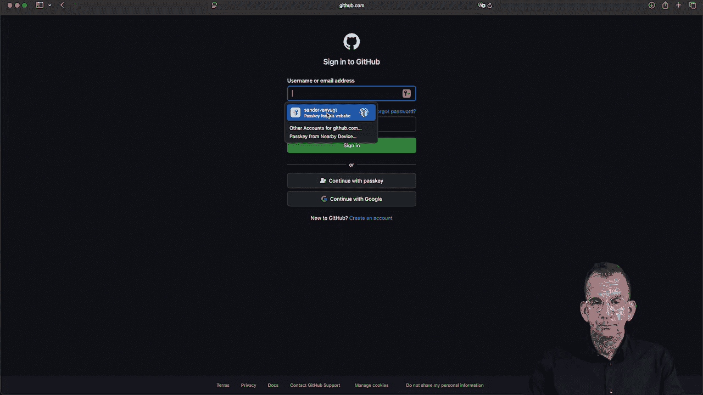
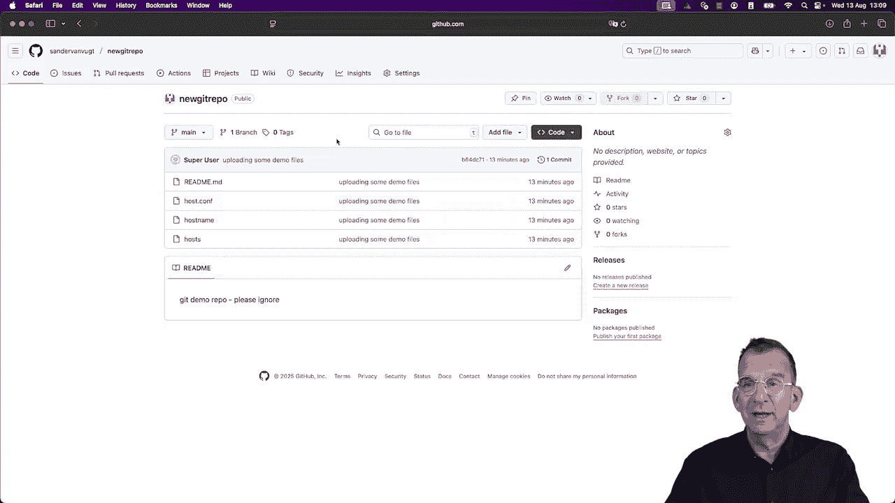

# CompTIA Linux+ V8：202：创建Git仓库 📦


在本节课中，我们将学习如何创建Git仓库。我们会先在GitHub上准备远程仓库，然后在本地Linux机器上初始化本地仓库，配置Git的身份信息，最后把本地代码推送到远程服务器。无论你是第一次接触Git，还是想复习一下基础操作，这篇教程都会一步步带你走通整个流程。




## 准备GitHub远程仓库 🌐

在开始动手之前，我们需要先有一个地方来存放代码。GitHub是一个非常流行的公共Git托管平台，所以我们先从这里开始。

要在GitHub上进行任何操作，首先得有一个账号。如果你还没有账号，就需要先注册一个；如果已经有了，直接登录即可。登录之后，你就进入了自己的Git环境，接下来就可以开始创建新的仓库了。

点击界面上的"New"按钮来创建一个新的Git仓库。在新建页面中，你需要给仓库起一个名字，这里我们就把它叫做"New Gs Repo"。系统会检查这个名字是否可用，如果显示可用，就可以继续下一步。

以下是你可以选择的仓库可见性选项：
- Public：公共仓库，任何人都可以访问。
- Private：私有仓库，不是所有人都能访问，只有你授权的人才能看到。

设置完成后，还有更多选项可以暂时忽略，直接点击"Create repository"按钮创建仓库。创建成功后，页面会告诉你接下来需要做的所有步骤，帮助你把新仓库设置好。

## 在命令行创建本地Git仓库 🐧

上一节我们介绍了如何在GitHub上创建远程仓库，本节中我们来看看如何在本地Linux机器上初始化Git仓库，并配置必要的全局选项。

在使用Git之前，可能需要先设置一些全局选项。这些选项是客户端层面的，会被写入`~/.gitconfig`文件中。你可以使用以下命令查看当前所有的全局选项：
`git config -l`

以下是你需要配置的基本身份信息：
- 用户名：`git config --global user.name "你的名字"`
- 电子邮件：`git config --global user.email "你的邮箱地址"`

如果你只想针对某个特定仓库使用不同的配置，也可以不加`--global`参数，直接使用`git config`命令。这样配置就会只作用于当前的本地仓库，适合一个仓库需要不同凭据而另一个不需要的情况。

配置完全局设置后，就可以开始创建Git仓库了。整个流程是这样的：首先在Git服务器上创建上游仓库（也就是刚才在GitHub上做的事情），然后在本地工作目录中创建一个文件夹，在这个目录下执行：
`git init`

`git init`命令的作用是初始化Git元数据。执行之后，Git会在当前目录下创建一个`.git`文件夹，里面包含Git正常运行所需的所有信息。

## 添加文件并提交到暂存区 📝

有了本地仓库之后，我们还需要往里面放点东西，并且让Git知道哪些文件应该被追踪。本节将介绍如何添加README文件，以及使用标准的Git命令流程来提交代码。

最好在仓库中添加一个`README.md`文件。在GitHub网站上，创建`README.md`通常是下一步建议的操作。这个文件一般用来介绍你通过这个Git仓库想要完成什么，所以它被称为"readme"也是很合理的。除了`README.md`，你也可以添加其他任意文件。

以下是常见的操作步骤：
- `git add .`：把所有文件添加到暂存区。
- `git commit -m "提交说明"`：把暂存区的文件提交到HEAD。
- `git push`：把文件从HEAD推送到远程仓库。

在执行第一次推送之前，可以使用以下命令把推送方式设置为`simple`（通常默认已经是这样）：
`git config --global push.default simple`

Git支持不同的push方法，设置成`simple`可以让推送行为更加直观。

## 在Linux上动手创建仓库并推送 💻

理论部分讲完了，本节中我们来看看如何在实际的Linux机器上一步步完成整个过程，从创建目录到推送代码。

首先在本地创建一个新目录，然后进入它：
```bash
mkdir "new git repo"
cd "new git repo"
```

进入目录后执行`git init`。初始化时，Git可能会提示使用`master`作为初始分支名称，但`master`这个术语现在已经被弃用了。我们可以把分支改名为`main`：
`git branch -M main`

执行`ls .git`可以看到Git在`.git`目录下创建的结构，包括`HEAD`和其他必要的元数据文件。

为了让仓库看起来更正经，可以创建一个README文件，并写上一些说明：
`echo "Git demo repo. Please ignore." > README.md`

这样做的好处是，关注你Git账户的人看到这个新仓库时，就不会误以为它是个重要项目。

接着可以复制一些随机文件进来，比如把`/etc`目录下的所有文件复制到当前目录：
`cp /etc/* .`

现在目录里已经有四个文件，足够用来做演示了。

使用`git add .`把所有文件加入暂存区，这是添加文件后的第一步。然后使用`git commit -m "uploading some demo files"`进行提交。`-m`参数后面必须跟一个提交消息，否则Git会报错。这些消息用来描述你为什么要推送代码，这样你的同行开发者就能明白你在想什么。

提交的时候，你可能会遇到类似"committer super user root"的错误，这是因为之前没有设置Git身份。解决方法是编辑全局配置文件：
`git config --global --edit`

打开配置文件后，取消`user.name`和`user.email`相关行的注释，填入你的名字和邮箱。如果你更喜欢直接在命令行设置，可以使用：
`git config --global user.email mail@example.com`
`git config --global user.name "你的名字"`

注意，只有当你打算向仓库提交代码时才需要设置这些信息；如果你只是想克隆别人的仓库，不需要让Git知道你是谁。

## 关联远程仓库并推送代码 🔗

本地提交完成后，代码还只存在于你的机器上。本节将介绍如何把本地仓库和GitHub上的远程仓库关联起来，并把代码推送上去。

目前本地目录还没有和远程仓库建立连接，需要使用以下命令添加远程地址：
`git remote add origin https://github.com/你的用户名/newgitrepo.git`

执行完成后，本地仓库的元数据里就记录了远程仓库的位置。接下来可以尝试推送：
`git push -u origin main`

在推送过程中，你可能会遇到身份验证失败的情况。比如提示"invalid username or token"，或者"password authentication is not supported for Git operations"。这意味着你的系统开启了强身份验证，不能再直接用密码推送了。

既然不能用密码验证，就可以生成SSH密钥来进行身份认证。Git支持SSH密钥验证，这是一个比较干净可靠的方法。生成密钥的命令如下：
`ssh-keygen -t ed25519 -C "你的邮箱地址"`

执行过程中直接回车，不需要设置密码短语，之后就会得到一对SSH公钥和私钥。

生成密钥后，需要把私钥添加到SSH代理中，这样Git在推送时才能自动使用它：
```bash
eval "$(ssh-agent -s)"
ssh-add ~/.ssh/id_ed25519
```

接下来需要把公钥上传到GitHub。使用以下命令查看公钥内容：
`cat ~/.ssh/id_ed25519.pub`

复制输出的内容，然后登录GitHub，进入Settings（设置），选择SSH and GPG keys，点击New SSH key，给它起个标题比如"Linux plus Demo machine key"，把公钥粘贴进去，点击Add SSH key保存。

密钥保存好之后，回到Linux机器。之前的远程地址使用的是HTTPS协议，现在需要改为SSH协议：
`git remote set-url origin git@github.com:你的用户名/newgitrepo.git`

URL会因为协议变更而稍微改变，但最终效果是一样的。

现在重新执行之前失败的推送命令：
`git push -u origin main`

Git会提示无法建立GitHub的真实性，输入`yes`接受之后，推送就会完成。

## 验证推送结果 ✅

推送完成之后，我们需要确认代码到底有没有成功传到GitHub上。本节将介绍如何进行最终检查。

回到GitHub网站，查看你的仓库列表。你应该能看到刚才创建的仓库，并且显示"updated one minute ago"（一分钟前更新），这是一个很好的信号。点击进入仓库，就能看到你在Linux上最初添加的那些文件，说明整个流程已经成功运行。

## 总结



在本节课中，我们一起学习了如何创建Git仓库。首先在GitHub上创建了远程仓库并设置了可见性；然后在本地Linux机器上初始化Git仓库，配置了全局用户名和邮箱；接着添加了README文件，使用`git add`、`git commit`和`git push`完成了标准的Git工作流；最后解决了身份验证问题，通过SSH密钥把本地代码成功推送到了GitHub。希望这篇教程能帮助你掌握创建和推送Git仓库的基础操作。

