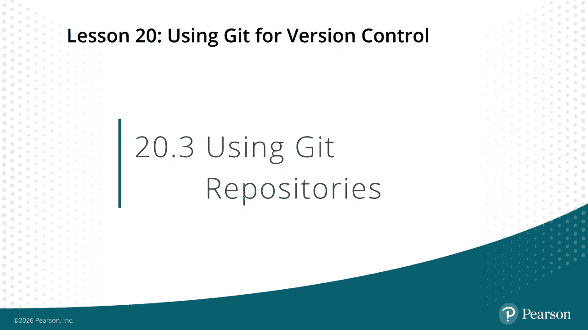
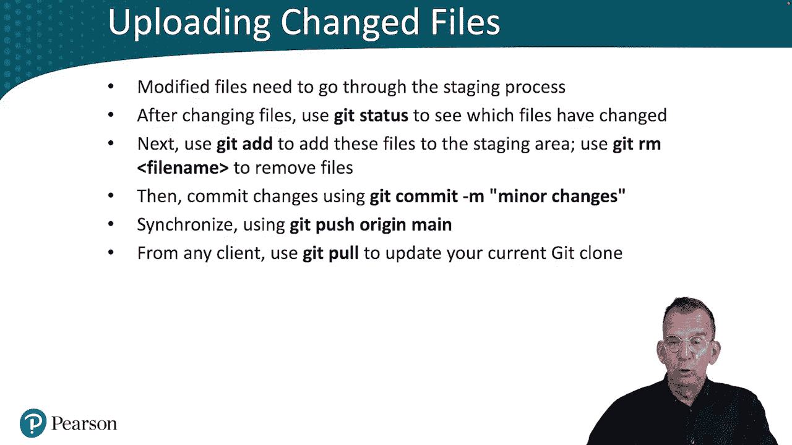
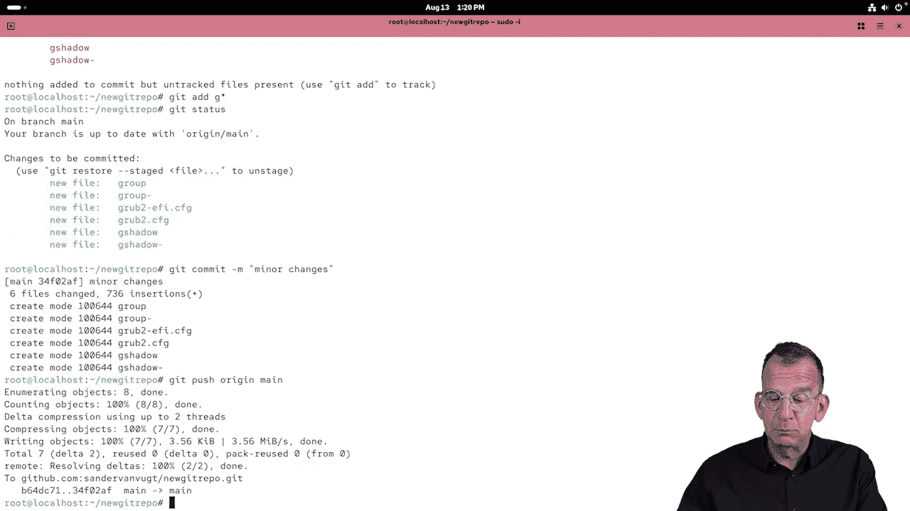

# CompTIA Linux+ V8：203：使用 Git 仓库 🐧

在本节课中我们将要学习如何配置和使用 Git 仓库。首先回顾一下强身份认证的设置，因为 GitHub 已经不再支持用户名和密码的认证方式，我们需要切换到基于 SSH 密钥的认证。接着会讲解如何在 Linux 上生成 SSH 密钥对、将密钥加入本地代理、把公钥上传到 GitHub，以及在本地设置远程仓库地址。完成这些准备之后，我们会介绍 Git 的基本操作，包括克隆远程仓库、拉取最新提交、查看文件变更状态、把文件添加到暂存区、删除文件、提交更改以及推送到远程分支。最后通过一个实际演示，完整展示如何修改文件并把更新同步到 Git 仓库，确保所有客户端都能拿到最新的内容。


## 一、为什么不再使用密码认证 🔑

上一节我们介绍了强身份认证的基本设置，本节中我们来看看 Git 仓库的使用方法。在开始之前，我们需要先理解一个重要的变化：GitHub 已经不再接受用户名和密码的认证方式。这意味着如果你还在用老旧的密码登录，现在已经无法正常工作了。

作为一个简单的替代方案，你可以使用基于 SSH 密钥的认证。我建议你采用这种方法，因为 SSH 是 Linux 的原生协议，设置起来通常比较简单，而且在日常使用中也更安全。


### 1.1 在 Linux 上生成 SSH 密钥 🛠️

在 Linux 系统中，你需要先创建一对密钥。具体操作是使用 `ssh-keygen -t ed25519 -C "你的邮箱地址"` 命令。这里的 `-t ed25519` 指定了密钥类型，而 `-C` 后面跟着你的邮箱地址，GitHub 会用这个邮箱来识别你的身份。

生成密钥之后，你需要把私钥添加到本地的 SSH 代理中，使用 `eval $(ssh-agent -s)` 和 `ssh-add 你的私钥文件`。这样做可以确保你的私钥被正确加载，特别是当你的私钥被密码保护时，会非常方便。


### 1.2 将公钥上传到 GitHub 📤

接下来，你需要获取公钥的内容，并将其添加到 GitHub 账号中。公钥文件通常位于 `~/.ssh/id_ed25519.pub`，你可以把里面的内容复制出来。

然后去 GitHub 网站，进入你的账号设置，找到 "SSH and GPG keys" 选项，添加一个新的 SSH 密钥，并保存。


### 1.3 配置远程仓库地址 🌐

保存 SSH 密钥后，你需要在 Linux 机器上根据 SSH URL 设置远程仓库。之前课程中看到的 `git remote` 命令需要进行修改，具体操作如下：

```bash
git remote set-url origin git@github.com:你的用户名/仓库名.git
```

这行命令指定了 Git 使用的协议，包含你的用户名和仓库名。设置完成后，你的本地仓库就可以和 GitHub 上的远程仓库正常通信了。


## 二、Git 仓库的基本操作 📦

完成远程仓库的配置后，你就可以开始使用 Git 仓库了。掌握几个基本技能就足以应付大多数日常工作。


### 2.1 克隆远程仓库 📥

如果你想把远程仓库的内容复制到自己的服务器上，可以使用 `git clone https://git-server/repo-name` 命令。克隆操作会把远程仓库的所有分支、提交历史和文件都下载到本地，让你拥有一个完整的副本。


### 2.2 更新本地仓库 🔄

当远程仓库的内容被其他人修改后，你可以使用 `git pull` 命令把本地仓库更新到最新的提交。`git pull` 会把远程的变更同步到你的本地系统，确保你一直在基于最新的代码进行开发。


### 2.3 查看文件状态 📋

作为开发者，你时常需要处理修改过的文件。修改后的文件需要经过暂存过程才能被提交。你可以使用 `git status` 命令查看哪些文件发生了变化，Git 会告诉你哪些文件是未跟踪的，哪些文件已经被修改。

以下是处理文件变更的常见步骤：

- 使用 `git status` 查看变更的文件。
- 使用 `git add 文件名` 把修改的文件添加到暂存区。
- 如果需要删除文件，使用 `git rm 文件名`，它会从当前仓库移除文件，并标记为在远程仓库中删除。
- 使用 `git commit -m "提交信息"` 提交暂存区的更改，提交信息可以随意填写。
- 使用 `git push origin main` 把本地的更改推送到远程仓库的 main 分支。




## 三、实际操作演示 🖥️

下面我们来看一个具体的例子，看看上面的命令在真实场景中是如何工作的。

假设我把一些新文件复制到 `/etc/g*` 目录下，使用 `ls` 命令可以看到这些新文件。在 Git 仓库中，我使用 `git status` 命令，Git 会提示我有未跟踪的文件。

为了解决这个问题，我使用 `git add g*` 或者 `git add *` 把这些文件加入暂存区。再次运行 `git status` 时，Git 会显示有文件准备提交。

接下来，我使用 `git commit -m "minor change"` 提交更改，提交信息写 "minor change" 就足够了。提交之后，我执行 `git push origin main`，把更改推送到 Git 仓库。

推送完成后，任何使用 `git pull` 的客户端都能获取到更新后的文件。至此，整个操作就全部完成了。


## 本节总结 📚



本节课中我们一起学习了如何配置基于 SSH 密钥的 GitHub 认证，包括生成 SSH 密钥对、添加到 SSH 代理、上传公钥到 GitHub 以及设置远程仓库 URL。我们还掌握了 Git 的核心操作，即克隆仓库、拉取更新、查看文件状态、添加文件到暂存区、删除文件、提交更改以及推送到远程。最后通过实际演示，演示了如何把本地修改同步到远程仓库，确保所有客户端都能拿到最新内容。

