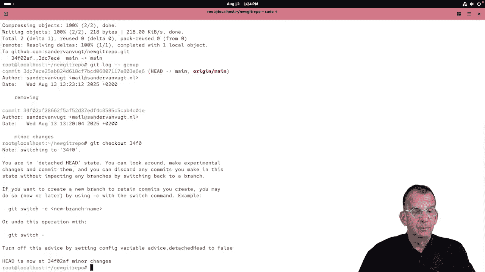
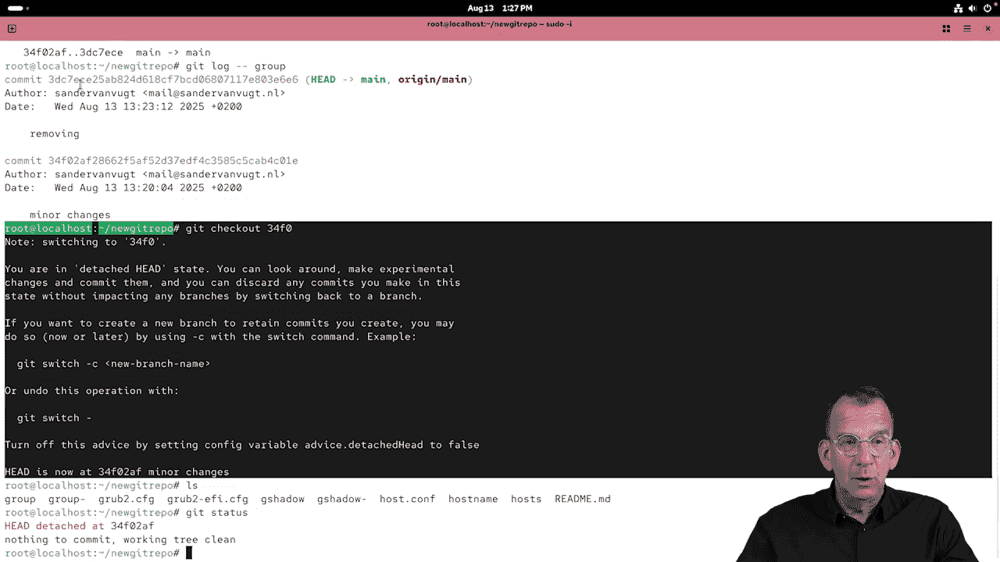
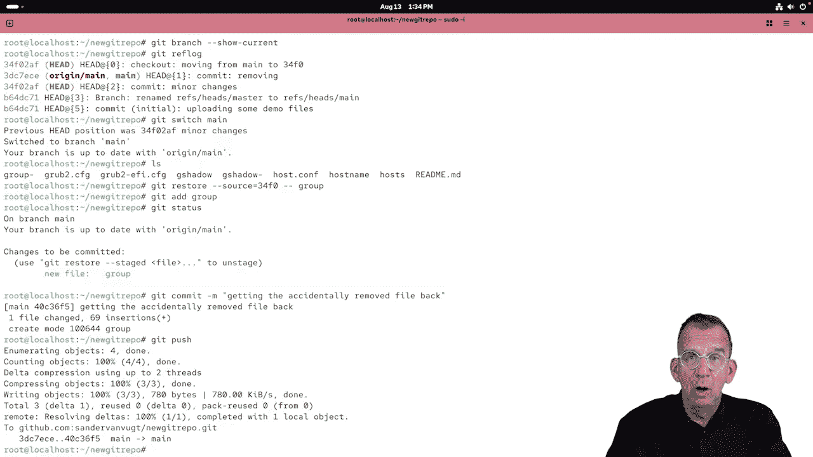

# CompTIA Linux+ V8：204：撤销更改 🔧

在本节课中，我们将会学习 Git 中撤销更改的方法。有时候我们不小心提交了不想要的修改，或者误删了文件，甚至把错误的内容推送到了远程仓库，这时候就需要知道怎么撤回。我们会先看看最简单的情况，也就是文件只是暂存了但还没提交，接着再看看如果文件已经提交了该怎么办，最后通过一个完整的实战例子，讲解怎么处理提交后还出现 detached HEAD 状态的问题。

## 情况一：文件已暂存但未提交

当你使用 `git add` 把文件放入暂存区，但还没有执行 `git commit` 时，撤销这个动作非常简单。这时候文件还没有正式入库，Git 允许你把它从暂存区移出来，恢复到正常的工作区状态。

以下是操作步骤：
- 使用 `git restore --staged <文件名>` 把文件从暂存区移出。
- 使用 `git status` 确认文件依然存在，但不再出现在暂存区列表中。
- 使用 `git restore <文件名>` 如果你也想丢弃工作区里的修改。

这里要说明的是，`git restore --staged` 只会把文件从暂存区拿出来，不会删掉文件本身，也不会改动你已经写好的代码，所以它是一个比较安全的操作。完成之后，文件就会回到未暂存的状态，你可以随时重新提交或者继续修改。

## 情况二：文件已经提交

如果你已经执行了 `git commit`，那么情况就稍微复杂一些，因为修改已经被记录到仓库的历史里了。这时候你不能只靠 `git restore` 来搞定，需要先找到那个包含错误修改的提交，再决定怎么回滚。

以下是操作步骤：
- 使用 `git log` 查看提交历史，通过提交信息定位到问题所在的那次提交。
- 记下那次提交的哈希值，或者只取前几个字符。
- 使用 `git checkout <提交哈希值> -- <文件名>` 把文件恢复到之前某次提交时的状态。

值得注意的是，你需要确保回滚到文件还存在的那次提交，而不是文件已经被删除之后的提交。找到正确的提交 ID 并不总是容易的事情，特别是当提交信息写得不清楚的时候，所以养成写好提交信息的习惯非常重要。

## 实战演示：误删文件并推送到远程

现在我们来看一个完整的实战场景，这样你能更直观地理解上面的概念。假设我们在 Git 仓库里有一个名为 `group` 的文件，不小心执行了 `git rm group` 把它删除了，接着又提交了这次删除，最后还用 `git push` 把更改推送到了远程仓库。这时候本地和远程都没有这个文件了，情况看起来非常糟糕。

以下是演示的操作顺序：
- 执行 `git rm group` 删除文件。
- 执行 `git status`，此时会显示文件被删除。
- 执行 `git commit -m "Very moving"` 提交删除操作。
- 执行 `git status`，此时工作区干净，没有任何未提交的更改。
- 执行 `git push` 将删除同步到远程仓库。

这时候如果你想把文件找回来，可以先用 `git log -- group` 查看这个文件的提交历史。你会看到最近一次提交的信息是删除文件，而再往前一次提交里文件还在。commit 信息写得清楚，能帮你快速定位到需要回滚的目标提交。

## 处理 detached HEAD 状态

接下来我们尝试用 `git checkout 34F0` 这种方式直接回退到某个旧的提交 ID，结果会发现 Git 提示进入了 detached HEAD 状态。这意味着你不在任何分支上，而是直接停留在某个特定的提交上，Git 会觉得比较困惑，因为你没有在正常的分支上操作。

以下是检查和修复的方法：
- 执行 `git branch --show-current`，输出为空，说明当前没有所在的分支。
- 执行 `git reflog` 查看引用日志，你可以看到之前从 `main` 分支切换到了 `34F0`。
- 执行 `git switch main` 回到 `main` 分支，这时候你虽然在 main 分支上，但是刚才恢复的文件还不在这里，因为文件还停留在那个旧的提交里。

这时候需要知道旧分支的哈希值，也就是 `34F0`，然后把文件从那个提交里恢复到当前环境中。

## 最终恢复并推送

现在我们已经回到了 `main` 分支，但 `group` 文件还没有出现在当前工作区，它还留在旧的 `34F0` 提交里。我们需要把文件从旧提交拉出来，重新加入暂存区，然后提交并推送。

以下是最后的操作步骤：
- 执行 `git restore --source 34F0 -- group`，把文件从 `34F0` 提交中恢复出来。
- 执行 `git add group` 将文件重新加入暂存区。
- 执行 `git status` 确认文件以新文件的形式出现在暂存区中。
- 执行 `git commit -m "getting the file back"` 把文件彻底恢复到仓库历史中。
- 执行 `git push` 将恢复后的文件推送到远程仓库。

完成之后，文件就回来了，而且远程仓库上也有了这个文件，整个误删除的问题就解决了。

## 总结

本节课中，我们一起学习了在 Git 中撤销更改的几种常见场景。首先是文件已暂存但未提交时，用 `git restore --staged` 和 `git restore` 就能处理；其次是文件已提交时，需要用 `git log` 找到对应的提交，再用 `git checkout` 或 `git restore --source` 把文件找回来。我们还通过实战演示了怎么处理误删除并推送到远程的情况，以及怎么从 detached HEAD 状态恢复回正常分支。希望这些内容能帮助你在日常开发中更加从容地处理 Git 出错的问题。
