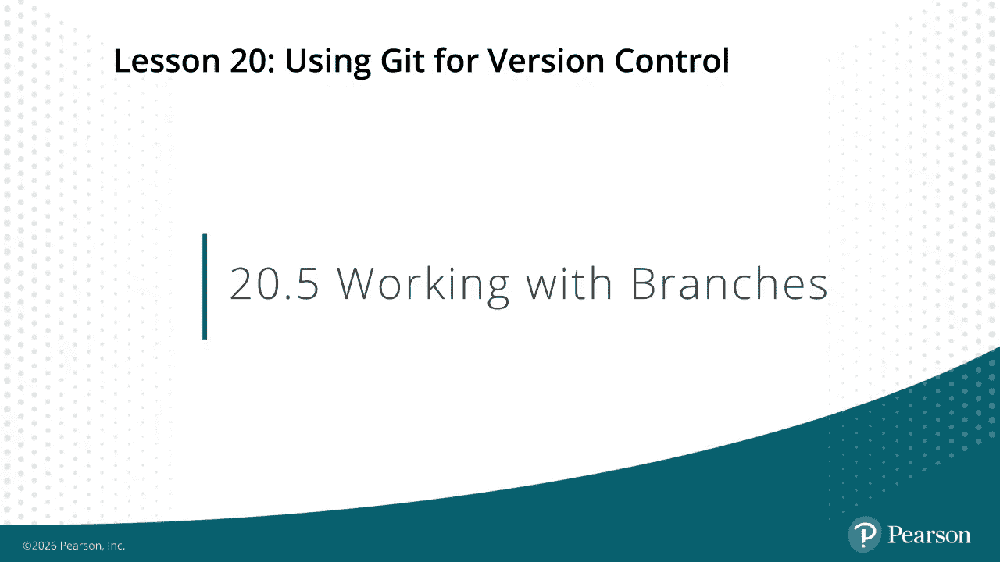
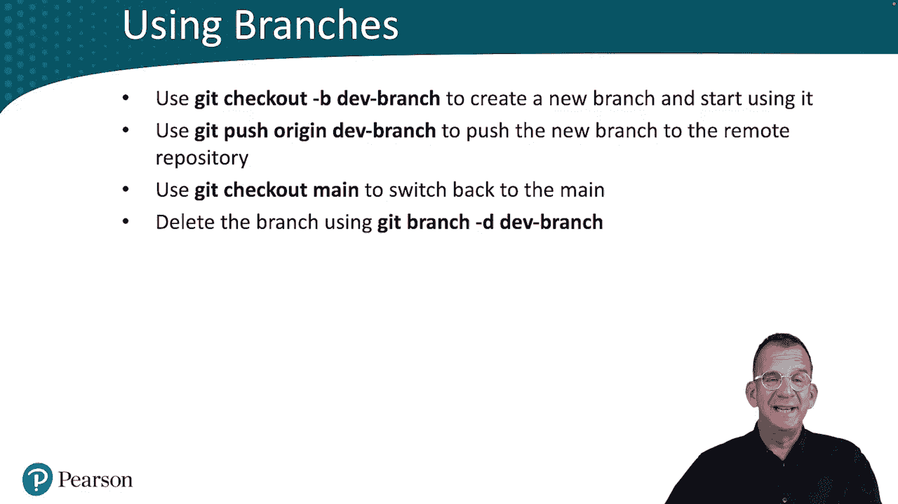
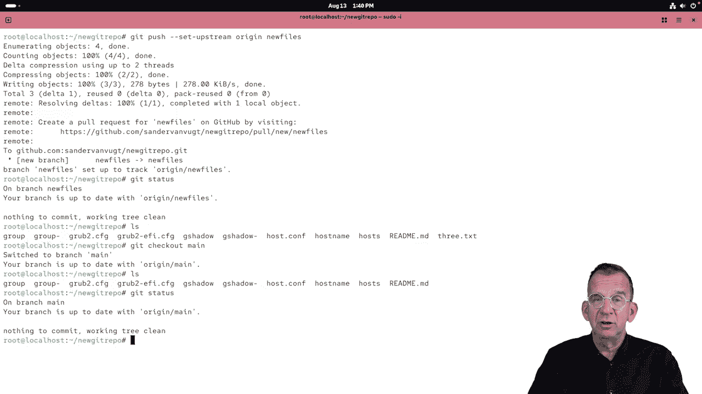

# Oreilly - CompTIA Linux+ V8：438：使用分支 🌿


在本节课中，我们将要学习 Git 中的分支是什么，以及如何在日常开发中使用分支来管理代码。分支是版本控制里非常基础且重要的概念，只要掌握了分支的用法，你就可以在不影响主代码的前提下，安全地尝试新功能，或者独立地修复问题。



我们先来看看分支到底是什么东西。在前面的内容里，我们已经多次提到分支，现在有必要把它的定义讲清楚。

分支是用来在与主线代码隔离的环境里开发新功能的。你可以把它理解成一个独立的测试环境，在里面随意修改代码，不会干扰到其他人正在使用的代码。主分支是默认存在的分支，通常代表当前稳定可用的代码版本。除了主分支之外，你还可以手动添加其他分支。分支的名称完全取决于你自己的决定，在我的演示里我把它叫做 main，但如果你没有做任何修改，它可能被称为 master，或者你喜欢的任何其他名称。

任何 Git 仓库都可以包含多个分支，这样开发人员就可以独立地进行工作，互不干扰。当开发工作完成，并且修改内容经过审核批准之后，你就需要把这些分支合并回主分支。

如果多个分支处于不同的状态，那么对比分支就变得很重要了。你可以使用 Git diff 命令来完成这个任务。

以下是比较两个分支差异的命令示例：

```bash
git diff <分支名称1> <分支名称2>
```

执行这条命令之后，Git 会预览两个分支之间的区别，并让你查看是否存在潜在的代码冲突。

当你需要把另一个分支合并到当前所在的活动分支中时，应该使用 Git merge 命令。

以下是合并分支的命令格式：

```bash
git merge <要合并进来的分支名称>
```

如果你想创建一个新分支，并且立即开始使用它，可以使用 checkout 命令加上 -b 参数。

以下是创建并切换到新分支的命令：

```bash
git checkout -b <新分支名称>
```

分支创建完成之后，你通常希望把它推送到远程仓库，这样其他开发人员也能看到这个分支，而不仅仅是你本地能看见。在修改内容被合并到主分支之前，让分支对其他人可见是很有意义的。

以下是把新分支推送到远程仓库的命令：

```bash
git push origin <新分支名称>
```

当你完成所有工作，并且修改内容已经整合到主分支中之后，就可以切换回主分支，并清理不再需要的分支了。

以下是切换回主分支的命令：

```bash
git checkout main
```

以下是删除已合并分支的命令：

```bash
git branch -d <分支名称>
```

下面来看一个具体的操作演示，帮助你更好地理解整个流程。

首先，我使用 git branch 命令来创建一个名为 new-fs 的分支。



```bash
git branch new-fs
```

接着，我使用 git status 命令查看当前状态。Git 会告诉我，当前所在的分支是 main。

现在我想要切换分支，所以使用 git checkout 命令切换到 new-false 分支。

```bash
git checkout new-false
```

然后，我创建一个新文件，使用 echo 命令把内容写入 3.txt 文件，文件名随意，反正只是个演示。

```bash
echo 3 > 3.txt
```

之后，我使用 git add 命令把所有变更添加到暂存区。

```bash
git add *
```

接着，我使用 git commit 命令提交更改，提交信息写为 tree，在新分支中操作，最好要具体一点。

```bash
git commit -m "tree"
```

接下来，我使用 git push 命令把分支推送到远程仓库，并设置上游关联。

```bash
git push --set-upstream origin new-files
```

推送完成之后，我再次使用 git status 命令查看状态。这时可以看到 new files 分支下的内容。接着我使用 ls 命令列出文件，可以看到 3.txt 文件存在。

随后，我使用 git checkout main 命令切换回主分支，然后再次使用 ls 命令查看文件。这时 3.txt 文件不见了。git status 命令也确认我已经在 main 分支上，并且没有那个 3.txt 文件。

这说明当你在分支上工作，创建了文件，但没有合并到主分支时，切换回主分支后，那个文件就会消失。接下来要处理这个文件该怎么办，我们将在下一个视频中学习。



在本节课中，我们一起学习了 Git 分支的基本概念，了解了如何比较分支差异、如何合并分支、如何创建并推送新分支，以及如何在工作完成后切换回主分支和删除旧分支。希望通过这节课的讲解，你能对 Git 分支有一个清晰的认识，并在实际操作中熟练使用这些命令。
