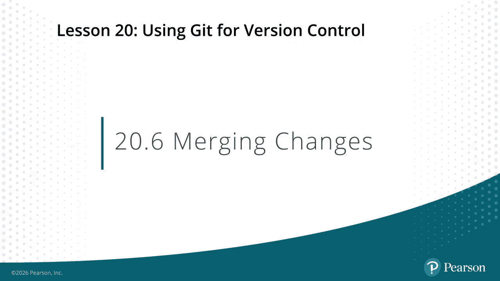
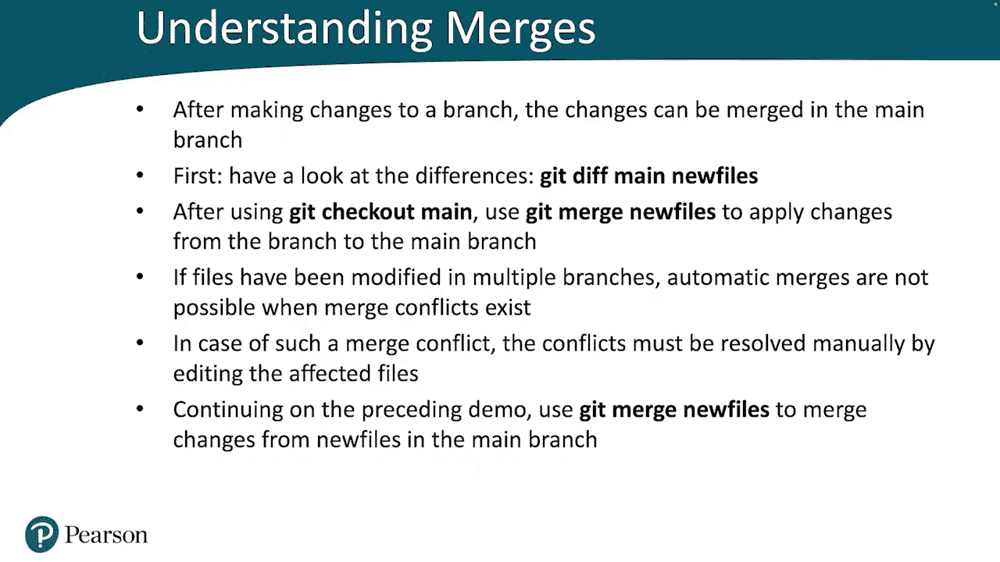
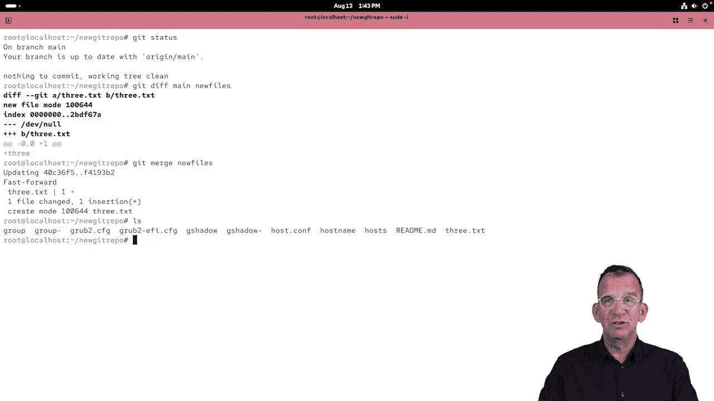

Oreilly - CompTIA Linux+ V8 - Pearson Cert Prep：part5 p39 439. 206：合并更改 🔀


在本节课中我们将要学习 Git 分支合并的基础知识。上一节内容主要讲了如何在分支上进行操作，但还没有把这些更改合并到主分支。这节课会告诉你，在团队成员都同意你的修改之后，应该怎样把分支上的内容合并到主分支里。我们还会看看当多个分支修改了同一文件时，会出现什么情况，以及怎么解决合并冲突。内容会比较基础，适合刚接触 Git 的朋友阅读，所以不用担心看不懂，跟着步骤一步步来就可以了。




上一节我们介绍了如何在分支上工作，但还没有把更改合并到主分支。本节中我们来看看合并的基本原理和使用场景。

在日常开发中，我们通常会在独立的分支上添加新功能或者修复问题。等到所有人都确认修改没有问题之后，就需要把这些更改合并到主分支。合并操作的核心就是把一个分支的提交应用到另一个分支上。你可以把它理解成把分支上的工作成果汇合到主线上，这样主分支就包含了最新的功能。

以下是合并操作的核心命令：

```bash
git merge <分支名>
```

这行命令的作用是将指定分支的更改合并到当前所在的分支中。执行之后，目标分支就会包含来源分支上的所有提交记录。


在执行合并之前，先看看两个分支之间到底有什么不同是个好习惯。这样可以帮助你了解即将合并的内容，避免出现意外情况。

你可以使用 `git diff` 命令来对比主分支和功能分支之间的差异。具体操作是先确认当前所在的分支，然后对比两个分支的文件内容，看看哪些文件被修改了，哪些文件是新增的。

以下是查看差异的命令示例：

```bash
git diff main new-files
```

这条命令会展示 `main` 分支和 `new-files` 分支之间不同的地方。如果输出中显示某个文件只存在于一个分支而不存在于另一个分支，那说明这个文件是新增的，合并之后就会出现在主分支中。


查看完差异之后，我们需要回到主分支，然后把其他分支的更改合并进来。合并操作必须在目标分支上执行，也就是你想要接收更改的那个分支。

首先使用 `git checkout` 切换到主分支，确保当前处于正确的位置。之后就可以使用 `git merge` 把功能分支的内容合并到主分支中了。合并完成之后，主分支就会包含新分支中的所有提交。

以下是切换分支并合并的操作步骤：

```bash
git checkout main
git merge new-files
```

执行完这两条命令后，`new-files` 分支上的更改就会被应用到 `main` 分支上。这时候主分支就变成了包含新功能的最新版本。


如果多个分支修改了同一个文件的同一部分，Git 就无法自动完成合并，这时候就会出现合并冲突。这种情况下，自动合并是不可能的，必须由开发者手动介入解决。

解决冲突的方法是编辑受影响的文件，把冲突标记处理掉，然后保存文件。虽然这听起来不太容易，但只要仔细对比文件内容，就能把问题解决，之后再次提交即可继续合并。

以下是冲突存在时可能出现的情况描述：



```text
自动合并失败，存在合并冲突
需要手动编辑冲突文件并解决冲突
```

冲突解决完成之后，就可以继续完成合并操作了。


接下来我们通过一个实际演示来看看具体怎么操作。这个例子会展示如何从功能分支把更改合并到主分支，并验证合并结果是否正确。

首先使用 `git status` 确认当前所在的分支是 `main`。然后使用 `git diff` 对比 `main` 和 `new-files` 两个分支。假设我们看到 `new-files` 分支中有一个名为 `3.txt` 的文件，而 `main` 分支中还没有这个文件。接着执行 `git merge new-files` 进行合并。合并完成后，使用 `ls` 命令查看当前目录，你就能看到 `3.txt` 已经存在了。

以下是演示中使用的命令序列：

```bash
git status
git diff main new-files
git merge new-files
ls
```

通过这一系列操作，你就完成了分支合并，并且新文件已经出现在主分支的工作目录中。之后就可以继续正常的开发工作了，不需要做额外的处理。




本节课中我们一起学习了如何在 Git 中合并分支更改。我们了解了合并的基本概念，学习了如何在合并前查看分支差异，掌握了切换到主分支并执行合并的命令，也知道了当出现合并冲突时该如何手动解决。最后通过实际演示，把整个合并流程串联了起来。希望这些内容能帮助你更好地理解 Git 分支合并的工作方式，在实际项目中能够顺利地把分支上的代码合并到主分支。
