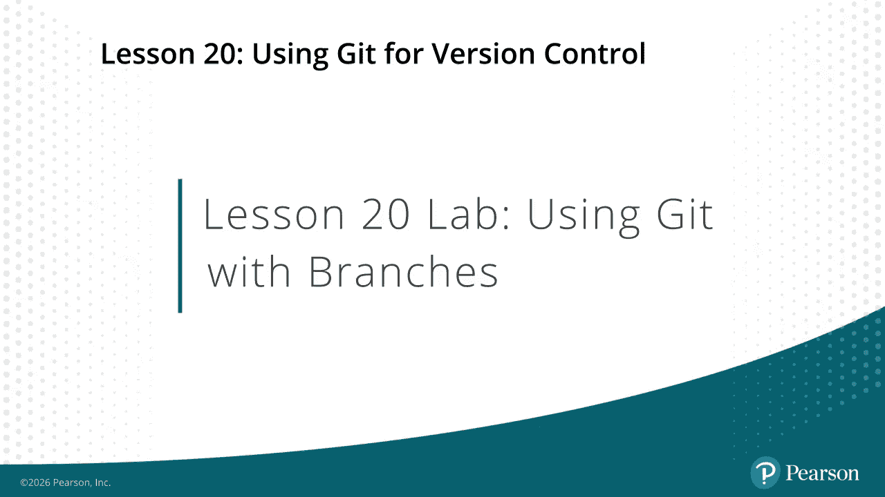
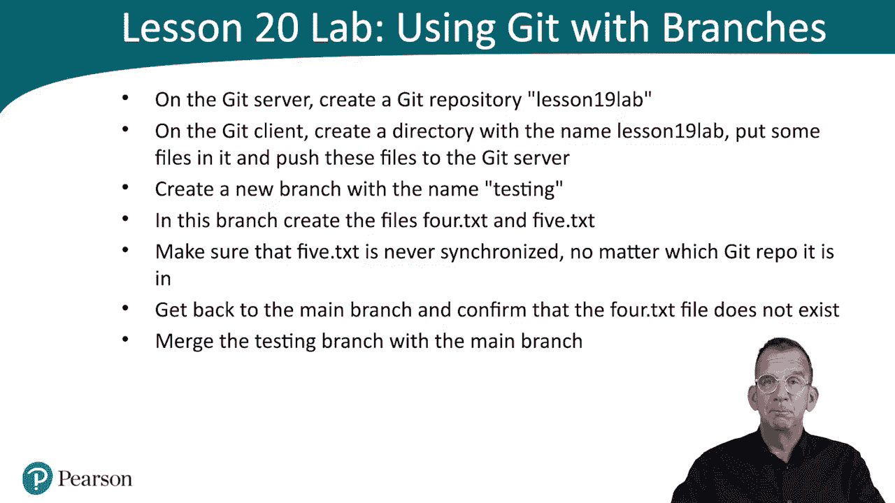

# CompTIA Linux+ V8：第20课：使用 Git 分支进行实验 🌿


在本节课中，我们将学习如何使用 Git 分支来管理不同版本的代码。本节课是一个动手实验环节，你需要在自己的 Linux 机器上操作 Git 客户端，连接到 Git 服务器，创建仓库、新建分支、提交文件，最后把分支合并回主分支。通过这些步骤，你可以把本课之前讲过的重要知识点全部过一遍，加深对 Git 分支机制的理解。




上一节我们介绍了 Git 的基本使用方法，本节中我们来看看如何通过实验来巩固这些知识。首先，我们需要在 Git 服务器上创建一个仓库，并在你的 Linux 客户端上进行相关操作。以下是具体的操作步骤。


1. 在 Git 服务器上创建一个名为 Lesson 19 La 的 Git 仓库。
2. 在你的 Linux 机器上，也就是 Git 客户端，准备好操作环境。


以上步骤完成后，你就拥有了一个可以用于练习的 Git 仓库，准备好往里面放文件了。


接下来我们要创建一个工作目录，并把文件推送到服务器上。以下是需要执行的操作。


1. 创建一个名为 Lesson 19 La 的目录。
2. 在这个目录里放入一些文件，内容随便写都可以。
3. 使用 Git 命令把这些文件推送到 Git 服务器上。


推送完成后，你的文件就已经存在于远程仓库中，接下来我们要开始分支的实验了。


现在我们要创建一个新的分支，并在里面尝试添加一些文件，看看分支之间的同步情况。以下是操作流程。


1. 使用命令 `git branch testing` 创建一个名为 testing 的新分支。
2. 切换到 testing 分支，使用命令 `git checkout testing`。
3. 在 testing 分支中创建名为 four text 和 five text 的文件。
4. 确保 five text 文件从未被同步到其他分支或服务器。
5. 使用命令 `git checkout main` 或者 `git switch main` 切换回 main 分支，也就是主分支。
6. 在 main 分支中确认 four text 文件依然不存在，因为它只在 testing 分支里创建过。
7. 使用命令 `git merge testing` 把 testing 分支合并到 main 分支。


核心命令可以参考下面的代码块：

```bash
git branch testing
git checkout testing
# 在 testing 分支中创建 four text 和 five text 文件
git checkout main
git merge testing
```


通过上面的操作，你已经完成了本课中几乎所有重要的内容，包括创建分支、在分支中添加文件、切换分支、检查文件是否存在，以及合并分支。这就是一个非常重要的实验，建议你认真操作一遍，祝你好运。




本节课中我们一起学习了如何使用 Git 分支进行版本控制，包括在服务器上创建仓库、在本地创建目录并推送文件、新建 testing 分支、在分支中操作文件、切换回主分支确认状态，最后将测试分支合并到主分支。希望这个实验能帮助你巩固 Git 分支的相关知识点。
