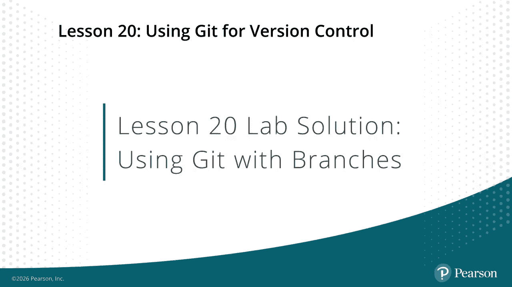
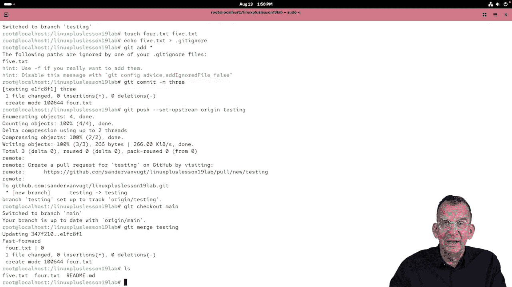

# CompTIA Linux+ 实操教程：20：使用 Git 分支操作实验解答 🌿

在本节课中我们将要学习如何在 GitHub 上创建新仓库，在 Linux 系统中初始化 Git 仓库，配置 SSH 远程连接，把代码推送到主分支，还要处理常见的远程地址错误。之后我们会创建新分支，提交文件并推送到远程，最后把分支合并回主分支。如果你是 Git 新手，不用担心，我会用大白话把每一步都讲清楚，保证你能听得懂。


## 第一部分：在 GitHub 创建仓库并推送到主分支 🌐

前面我们已经了解了 Git 的基础概念，本节中我们来看看如何把代码真正放到 GitHub 上。

在 GitHub 上新建仓库的时候，名字最好起得具体一些，这样以后找起来不会混淆，也不会和其他仓库搞混。比如这里就叫 Linux Plus Lesson 19 Lab，虽然名字有点长，但好记，而且一看就知道是干什么用的。

以下是创建仓库的基本步骤：

- 打开 GitHub 网站
- 点击新建仓库
- 输入仓库名称：Linux Plus Lesson 19 Lab
- 完成仓库创建


仓库在 GitHub 上建好了，接下来要在本地 Linux 系统里把环境准备好。先离开之前的 Git 仓库，创建一个新的文件夹，然后进去，把刚才从 GitHub 复制的命令粘贴进去，这样基本信息就都处理好了。

以下是在 Linux 中初始化仓库的命令：

```bash
mkdir "Linux Plus Lesson 19 Lab"
cd "Linux Plus Lesson 19 Lab"
echo "# Lesson 19 Lab" > README.md
git init
git add *
git commit -m "New repo commit"
```

mkdir 用来建文件夹，cd 用来进入文件夹，echo 把内容写进 README.md，git init 把当前目录变成 Git 仓库，git add * 把所有文件加到暂存区，git commit -m 提交并留下说明。


接下来要把本地仓库关联到 GitHub 上。这里有个重要的点，不能用 HTTPS 链接，因为 HTTPS 需要用户名和密码登录，而现在已经不能再用这种方式了。我们得用 SSH，这也是为什么之前要生成 SSH 密钥。如果第一次推送报错了，也不用慌，很可能是远程地址写错了，把斜杠写成了冒号，或者远程别名已经存在，都可以修正。

以下是配置远程并推送的关键命令：

```bash
git branch -M main
git remote add origin git@github.com:Shavt/Linux-Plus-Lesson-19-Lab.git
git push -u origin main
```

如果出错，提示 remote origin already exists，可以用下面的命令修正远程地址：

```bash
git remote set-url origin git@github.com:Shanavert/Linux-Plus-Lesson-19-Lab.git
git push -u origin main
```

git branch -M main 把分支改名为 main，git remote add origin 添加远程仓库，git push -u origin main 把代码推送到主分支。如果地址不对，用 git remote set-url 把已有的远程地址改掉，再推送一次就好了。


完成主分支的推送后，第一部分就结束了。接下来我们进入第二部分，学习如何使用 Git 分支。


## 第二部分：创建分支、提交文件并合并 🔀

刚才我们把代码推到了主分支，实际开发中我们通常不会直接在主分支上乱改，本节中我们来看看怎么建分支干活。

我们先创建一个叫 testing 的新分支，切换进去，然后新建两个文本文件，其中 5.txt 不想被 Git 追踪，就把它写进 .gitignore 里。接着把文件加到暂存区，提交一个版本，提交信息随便写什么都行。

以下是创建分支并提交文件的操作：

```bash
git branch testing
git checkout testing
touch 4.txt 5.txt
echo "5.txt" >> .gitignore
git add *
git commit -m "3"
```

git branch testing 建立新分支，git checkout testing 切换过去，touch 新建 4.txt 和 5.txt，echo 把 5.txt 写入 .gitignore 让 Git 忽略它，git add * 暂存所有文件，git commit -m "3" 提交。


提交完之后，要把这个新分支推到远程仓库，这样其他开发者也能看到和使用。推送完之后，我们切回主分支 main，把 testing 分支合并进来，最后用 ls 检查一下文件是否都在。

以下是推送分支并合并的命令：

```bash
git push --set-upstream origin testing
git checkout main
git merge testing
ls
```

git push --set-upstream origin testing 把新分支推到上游，git checkout main 切回主分支，git merge testing 把 testing 合并到 main，ls 列出当前目录文件，你应该能看到 4.txt 和 5.txt 都在。


到这里，整个实验就全部完成了。




本节课中我们一起学习了在 GitHub 创建仓库、在 Linux 初始化 Git、配置 SSH 远程、推送主分支、修正远程 URL 错误，以及创建测试分支、提交忽略文件、推送新分支并合并回主分支的完整流程。希望这些大白话能帮你把 Git 分支操作彻底搞明白。

