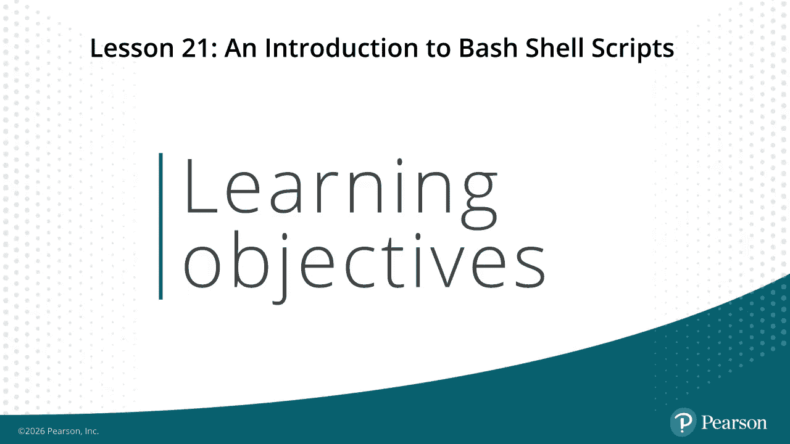

CompTIA Linux+：第5节：Bash脚本编程简介 🐚

在本节课中，我们将一起学习Bash脚本编程的基础知识。首先，我会告诉你什么是脚本编程，以及它在Linux系统中通常用来做什么。接着，我会说明本节课的教学范围，重点是Linux Plus考试中需要掌握的内容。最后，如果你对脚本编程感兴趣并想继续深入，我会给你一些进一步学习的建议。



### 什么是Bash脚本 📜

上一节课我们介绍了Linux命令行的基本用法，本节中我们来看看什么是Bash脚本编程。简单来说，脚本就是把一条条命令写在一个文件里，然后让shell逐行执行。你可以把它理解成给操作系统写的一份“待办事项清单”，系统会按照清单上的顺序一条条完成。

脚本可以用公式表示：

```text
脚本 = 多条shell命令的有序集合
```

例如，下面是一个最简单的Bash脚本示例，里面只包含两条命令：

```bash
#!/bin/bash
echo "你好，世界"
date
```

这个脚本的作用是先在屏幕打印一段文字，然后显示当前的日期和时间。保存成文件后，给它执行权限，就可以直接运行了。

### 本节课的教学范围 🎯

上一节我们了解了脚本的基本含义，本节中我们来看看本节课的具体范围和考试要求。我不会带你深入研究高级shell脚本的复杂细节，也不会讲解非常底层的脚本编程技巧。但我会确保你至少掌握Linux Plus考试中必须知道的脚本基础知识，这样你在考试时不会因为脚本相关的问题而丢分。

以下是本节课将重点涵盖的内容：

- 脚本的基本概念和作用
- 如何编写简单的shell脚本
- Linux Plus考试中考察的脚本知识点

### 进一步学习建议 📚


上一节我们说明了本节课的教学范围，本节中我们来看看如果你想进一步提升，可以参考什么学习资源。如果你希望了解更多脚本编程的内容，我可以热情推荐我的最佳脚本完整视频课程第二版。这套课程内容更全面，适合想要系统学习shell脚本的学习者。

本节课中我们一起学习了Bash脚本编程的简介。我们讨论了脚本的定义，看到了一个简单的脚本示例，明确了本节课的教学范围以及Linux Plus考试的要求，最后还了解了进一步学习的推荐资源。
