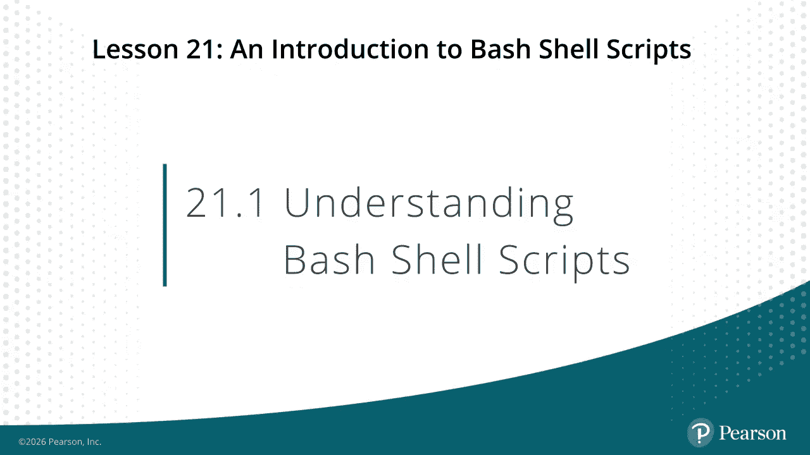
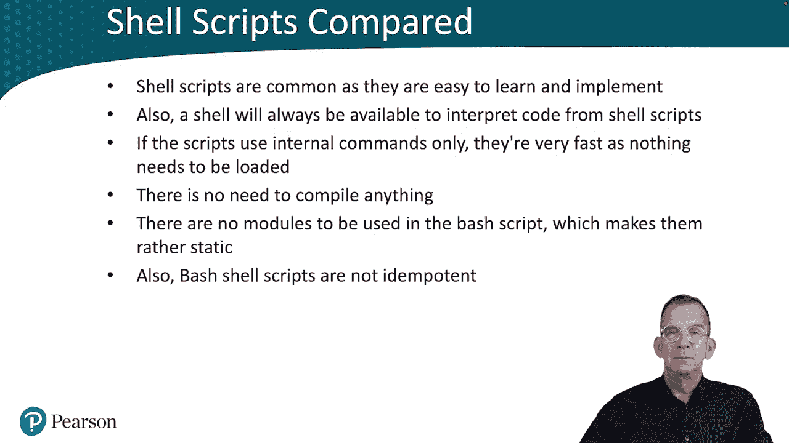

# CompTIA Linux+ V8：444.211：理解 Bash Shell 脚本 📜

在本节课中我们将要学习 Bash shell 脚本的基础知识。你会了解 shell 脚本究竟是什么，它和 Linux 中的 shell 以及 bash 有什么关系，还会看到变量和条件语句是如何让脚本变得更灵活的。我们也会解释为什么即使在非常精简的系统里，shell 脚本依然可用，并且简要讨论 shell 脚本的适用边界，以及什么时候可能需要转向 Python 之类的更高级语言。


## 什么是 shell 脚本



上一节我们介绍了课程的整体学习目标，本节中我们来看看 shell 脚本最基本的定义。

以下是 shell 脚本 的核心特点：

- shell 脚本可以很简单，它本质上就是一组按顺序依次执行的命令。
- 不需要复杂的编译过程，只需要把命令写在一起，系统就会自动化地逐一运行它们。

```bash
command1
command2
command3
```

执行顺序可以用简单的公式表示：

```
执行顺序 = 命令₁ → 命令₂ → ... → 命令ₙ
```

## shell 脚本的来源与 bash

上一节我们介绍了 shell 脚本的简单定义，本节中我们来看看它是从哪里来的，以及 bash 在其中扮演什么角色。

shell 脚本来自 shell，而 shell 是 Linux 上常见的命令解释器。bash 是标准 shell 的默认实现，正因为如此，用 bash 编写的 shell 脚本也可以很简单，就是把一些命令自动化地列出来。

```bash
#!/bin/bash
echo "这是一个简单的 bash 脚本"
```

## 变量与环境适应性

了解了脚本的来源之后，本节中我们来看看 shell 脚本如何处理不同环境。

以下是变量在脚本中的作用：

- shell 脚本经常使用变量。
- 有了变量，同一个脚本在不同环境下可以表现出不同的行为。
- 这样你就能从脚本中提取出特定于当前站点或系统的信息。

```bash
site=/var/www/example
echo "当前站点路径是 $site"
```

## 条件语句让脚本更复杂

上一节我们介绍了变量，本节中我们来看看如何让脚本的逻辑更丰富。

以下是常用的条件语句：

- for：用于循环处理一系列项目。
- if：用于根据条件判断执行哪段代码。
- case：用于多选一的分支判断。

加入这些语句后，脚本就不再只是简单的命令列表，而是能够做判断和循环的程序了。

## 为什么 shell 脚本常见且实用

掌握了基本语法之后，本节中我们来看看 shell 脚本为什么在 Linux 世界里如此普及。

shell 脚本很常见，主要因为它容易学习，也容易实现。另外，无论你使用什么样的 Linux 系统，总会有一个 shell 可用来解释并运行脚本代码。

## 最小化系统中的 shell 可用性

刚才提到 shell 始终可用，本节中我们来看看即使在最精简的系统里情况如何。

即使在你接触过的最精简的 Linux 发行版中，也一定会存在 B SH，也就是老式的兼容 shell。正因为有这个兼容 shell 存在，你随时都可以学习并使用 shell 脚本。

## 脚本运行的性能优势

系统兼容性清楚之后，本节中我们来看看 shell 脚本在运行效率上的好处。

以下几点解释了为什么 shell 脚本运行快速：

- 如果脚本只使用内置注释，就不需要从磁盘加载额外内容。
- shell 脚本不需要编译任何东西。
- 脚本中不需要加载模块，代码读起来也更简洁美观。

## shell 脚本的定位与后续学习

说完了优势，本节中我们来聊聊 shell 脚本在整体技术栈中的位置，以及接下来要学什么。

shell 脚本并不是唯一重要的工具，但正因为它简单实用，在 Linux 中永远会有一席之地，所以学习 shell 脚本很有必要。不过，也需要更高级的语言，比如 Python，来处理更复杂的任务。在接下来的几个视频中，你将学习如何设置高效的 shell 脚本。这里的目的是让你快速入门，而不是深入探讨所有可用选项，因为即使是简单的 shell 脚本，也可以做得相当高级。

## 总结



本节课中我们一起学习了 Bash shell 脚本的基础概念。我们了解了什么是 shell 脚本、它和 shell 与 bash 的关系、变量和条件语句如何增强脚本功能，以及为什么 shell 脚本在 Linux 系统中如此普遍且实用。同时也认识到，shell 脚本虽然重要，但面对更复杂的场景，仍然需要 Python 等更高级语言的支持。
