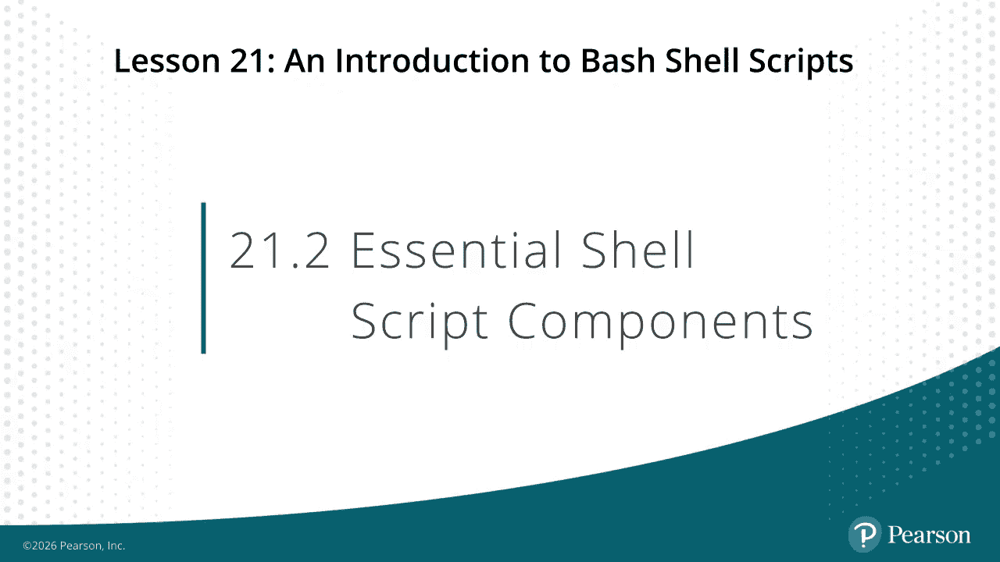
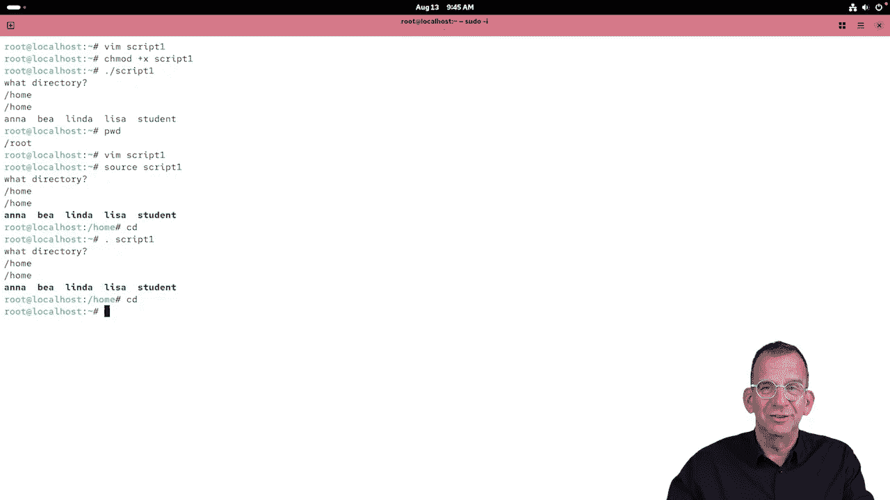

🐧 Linux Shell 脚本基础教程：05：212 核心 Shell 脚本组件




## 课程概述

在本节课中，我们将一起学习 Shell 脚本的核心组件。我会围绕几个实际的脚本示例来讲解整节内容，方便你直接跟随操作。我已经在幻灯片中准备好了第一个示例，接下来我会边写边解释，告诉你脚本在做什么，以及这些不同组件的具体作用。

我们先给脚本起一个简单的名字，叫做 script one。


## 脚本命名与文件扩展名

上一节我们初步认识了脚本示例，本节中我们来看看脚本的命名规则。

在 Shell 脚本命名时，你不需要添加扩展名。这是因为 Linux 操作系统非常强大，可以使用 `file` 命令检测任何文件的内容，从而判断文件到底是什么类型。你可以放心地直接使用脚本文件名，而不必在末尾加上 `.sh` 之类的后缀。


## Shebang 与解释器指定

了解了脚本命名之后，我们来看看每个脚本开头必须包含的内容。

每一个 Shell 脚本都应该以 Shebang 开头。Shebang 的作用是调用运行脚本的子 Shell 所使用的解释器。其原因在于，并非总是使用 Bash，也可能是其他 Shell。但你可能会从不同的 Shell 环境中运行脚本，这一行可以确保脚本中的代码会被 Bash 正确解释。特别是在使用更高级的特性时，这一点非常重要，因为高级特性在其他 Shell 中可能并不可用。


## 脚本注释编写

讲完 Shebang 之后，我们接着来看看如何在脚本中编写注释。

作为良好的编程习惯，你应该在 Shebang 后面添加注释，并使用井号 `#` 标记。注释相当于文档，这样以后你仍然能理解自己在做什么，其他人也能通过脚本中的文档搞清楚你想要实现什么。写好注释能让脚本更容易维护，也方便他人阅读你的代码。


## 使用 Here Document 输出文本

介绍完注释之后，我们来看看脚本中输出文本块的方法。

接下来，我们要使用一种被称为 Here Document 的结构。你可能会问，为什么不直接使用 `echo` 来在屏幕上打印消息，而要用 Here Document 呢？实际上，Here Document 也是在屏幕上打印消息，但它适合输出更多信息。它的结构是两个小于号 `<<` 后面跟一个关键字，这个关键字你可以随意定义。我习惯将这些关键字写成大写，但这不是强制性的，如果你习惯小写也完全可以。接着我们可以看到要发送给 `cat` 的文本，这些文本就会显示在屏幕上。

通常 `echo` 适用于单行输出，而如果你想在屏幕上显示更多内容，Here Document 就很有用。Here Document 的好处在于，你不需要定义每一行，而是定义一个应该显示的文本块。无论当前的屏幕分辨率如何，显示效果都会很好。


## 读取用户输入

讲完文本输出之后，我们来看看脚本如何等待用户输入。

脚本接下来会使用 `read` 命令。`read` 是脚本等待用户输入的方式。脚本会暂停运行，并将用户输入保存到一个变量中，这个变量的名字是 `there`。


## 变量定义与使用

读取用户输入之后，我们继续看看如何处理变量。

接下来我们将处理这个变量。在定义变量时，你只需要写出变量的名字；在使用变量的值时，需要在变量名前加上美元符号 `$`。这就是为什么脚本中会依次使用 `CD`、`PWD` 和 `LS`，然后使用 `exit 0`。

下面是变量使用的代码示例：

```bash
CD
PWD
LS
exit 0
```


## 脚本退出码

介绍完变量之后，我们来看看脚本结尾的退出码。

`exit 0` 实际上并非必需，但我在这里保留它，是想给你讲解退出码的概念。退出码会告诉父 Shell 脚本执行的成功或失败情况。如果一切正常，脚本会以退出码 `exit 0` 结束。你可以在父 Shell 中使用 `echo $?` 来检查一切是否正常。


## 赋予执行权限并运行脚本

讲完退出码之后，我们来看看如何让脚本真正运行起来。

现在脚本编写完成，我需要给它赋予执行权限，使用 `chmod +x script1`。之后就可以直接运行 `script1` 了。运行后，脚本会询问你想要进入哪个目录，比如输入 `/home`，你可以看到它确实进入了 `/home` 目录，并显示了该目录的内容，然后脚本结束。


## 子 Shell 与当前 Shell 的区别

运行脚本之后，你可能会发现一个有趣的现象，我们来看看背后的原因。

你可能会感到惊讶，脚本运行结束后，我却回到了根目录。这背后的原因是什么呢？当你运行一个脚本时，脚本是在子 Shell 中执行的，所有命令都在子 Shell 中发生。这就是为什么在脚本中切换目录，该目录更改在脚本上下文中是有效的，但不会影响父 Shell。


## source 命令与点命令

了解了子 Shell 的限制之后，我们来看看如何在当前 Shell 中执行脚本。

如果你希望脚本中的命令在父 Shell 中运行，你需要对脚本进行 `source` 操作。下面我来展示如何对脚本进行 source。

为了对脚本进行 source，我需要做一些修改。首先要删除 Shebang，简单原因是脚本被包含在当前 Shell 中，因此你会绑定到当前 Shell。我也不想保留 `exit 0`，因为这会关闭当前 Shell。在子 Shell 中使用 `exit 0` 没问题，因为子 Shell 无论如何都需要关闭；但在包含在当前 Shell 中的脚本里使用 `exit 0` 会关闭当前 Shell，这显然不可接受。

接下来我将使用 `source` 命令。执行 `source script1` 后，脚本会询问你想要进入哪个目录，输入 `/home`，你可以看到它已经永久更改了我的目录。因此，我需要手动返回原来的目录。

我还要向你展示另一种 source 脚本的方法，即点命令 `.`。第一次看到时你可能会感到惊讶，因为你可能习惯使用 `./` 来表示当前目录。但在这里，点号不代表当前目录，而是等同于 `source` 的命令。如你所见，它的作用完全一样。

这就是 script1 的全部内容，希望你喜欢。


## 总结



本节课中，我们一起学习了如何编写一个基础的 Shell 脚本，包括脚本命名、Shebang 的作用、注释编写、Here Document 的使用、读取用户输入、变量的定义与引用、退出码的含义、赋予执行权限并运行脚本，以及子 Shell 与父 Shell 的区别。我们还学习了如何使用 `source` 命令和点命令 `.` 在当前 Shell 中执行脚本，从而使目录更改生效。

