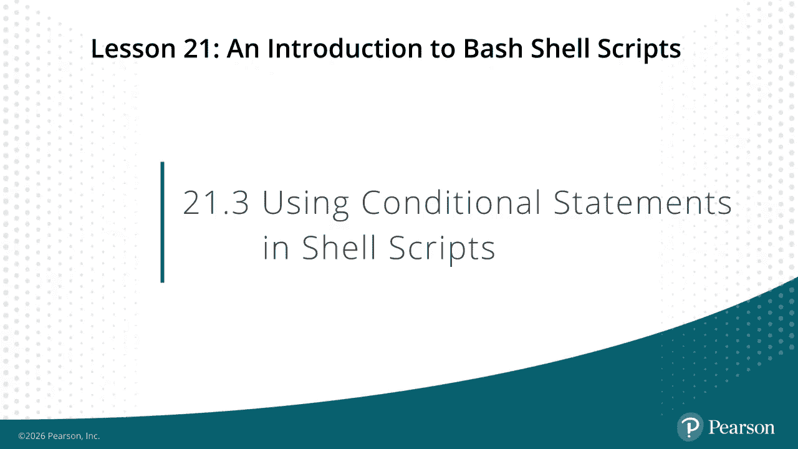
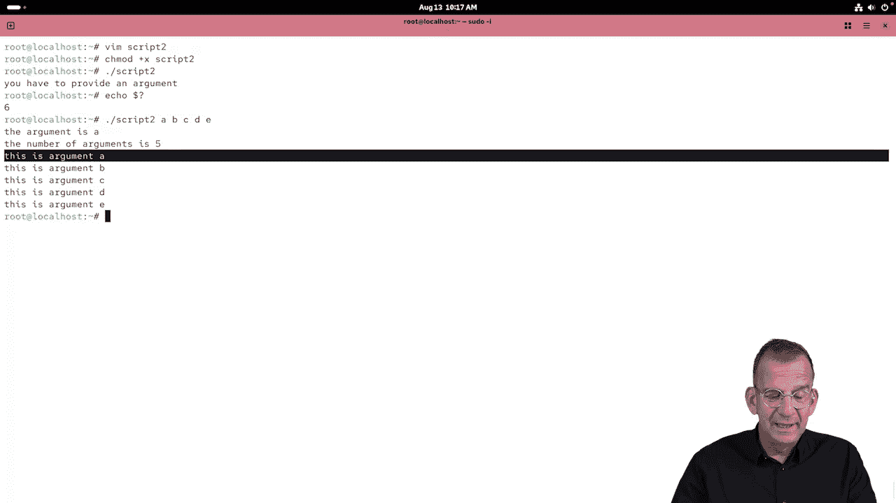

# 🐧 CompTIA Linux+ V8：213：在 Shell 脚本中使用条件语句




在本节课中，我们将学习如何在 Shell 脚本中使用条件语句。条件语句是 Shell 脚本里非常核心的一部分，它们让脚本可以根据不同的情况做出选择。没有条件语句，脚本只能一条条地顺序执行，没有任何灵活性。有了条件语句，脚本就可以判断文件是否存在、命令是否成功、用户是否传入了参数，然后决定接下来做什么。这使得自动化任务变得强大而实用。


条件语句是 Shell 脚本变得强大的关键。它允许脚本在运行时做判断，而不是死板地执行每一行命令。换句话说，脚本可以根据实际情况决定走哪条路径，这就像是给脚本装上了大脑。


在 Shell 脚本中，有几种常见的条件语句可以供你选择。以下是主要的条件语句列表：

- `if then else`：用于检查某个条件是否成立，如果成立则执行一段代码，否则执行另一段。
- `while`：只要特定条件保持为真，就反复执行某些命令。
- `until`：与 `while` 正好相反，它在条件为假时继续循环，直到条件变为真。
- `case`：用于对一系列元素求值，适合处理预期会传入的特定参数。
- `for`：允许你遍历一个范围或一组值，非常适合处理多个参数。


理解条件语句之前，我们需要先认识 `test` 命令。`test` 命令在 Shell 脚本中非常重要，因为它是大多数条件判断的基础。没有 `test`，`if` 语句就不知道该检查什么。


`test` 命令可以用来测试很多东西，这里列举几个常见的例子：

- `-z 字符串`：检查字符串的值是否为 0，也就是是否为空。
- 等号 `=`：用于比较两个字符串是否相同。
- `-eq`：用于比较两个整数是否相等。整数比较的好处是，你还可以使用 `-ge`（大于等于）和 `-le`（小于等于）。
- 文件测试：可以检查某个路径是块设备、字符设备、目录，还是文件是否存在，以及更多可测试的属性。


`test` 命令有两种完全等价的写法。下面是这两种写法的代码示例：

```bash
test -z $1
[ -z $1 ]
```

第一种写法直接使用 `test` 关键字，第二种写法使用方括号包裹条件。无论你选择哪种，它们的作用是一模一样的。在实际脚本中，方括号写法更常见，因为看起来更简洁，但你要知道它们本质上是同一个命令。


接下来我们来看一个完整的示例脚本，命名为 `script2`。和往常一样，脚本开头是 Shebang：

```bash
#!/bin/bash
```

然后我会留一个空行。留空行并不是强制要求，但这样做可以让脚本的不同部分更容易区分，阅读起来更舒服。

接着，脚本使用条件判断来检查是否提供了参数：

```bash
if [ -z $1 ]; then
    echo "you have to provide an argument"
    exit 6
fi
```

这里 `if [ -z $1 ]` 检查第一个参数 `$1` 是否为空。`-z` 就是 test 命令里检查字符串是否为空的选项。如果条件成立，也就是用户没有提供参数，脚本会打印提示信息，然后使用 `exit 6` 停止运行。

关于 `exit 6`，这里需要解释一下。如果脚本因为缺少参数而停止，按照惯例，退出码应该是非零值，用来告诉运行脚本的人出了问题。`exit 6` 就生成了退出码 6，而退出码 0 则通常表示一切正常。如果条件不成立，也就是用户提供了参数，脚本就会继续执行，打印出该参数：

```bash
echo $1
```

`$1` 是运行脚本时传入的第一个参数。


事实上，脚本还可以处理多个参数，而不仅仅是一个。为了演示这一点，我们可以扩展脚本，先打印参数的数量，然后遍历所有参数。以下是相关代码片段：

```bash
echo $#
for i in $@; do
    echo "this is argument $i"
done
```

这里 `$#` 是参数计数器，告诉你一共传入了多少个参数。`$@` 是所有参数的集合。`for i in $@` 会遍历集合中的每一个参数，每次遍历时，当前的值都会被保存在变量 `i` 里。因此 `echo "this is argument $i"` 会显示当前正在处理的参数值。


为了验证这些内容是否真正生效，我们可以实际运行一下 `script2`。首先需要给脚本添加执行权限：

```bash
chmod +x script2
```

然后直接运行脚本，不传任何参数：

```bash
./script2
```

此时你会看到提示信息，说你必须提供一个参数。这就是 `if [ -z $1 ]` 生效了。为了验证退出码，可以运行：

```bash
echo $?
```

`$?` 总是显示上一条命令的退出码，这里应该会显示 6，证明脚本确实以非零退出码结束了。

接下来，我们尝试传入多个参数：

```bash
./script2 A B C D E
```

运行后，你可以看到第一个参数是 `A`，对应 `$1`。同时，参数计数器会显示 5，而且 `for` 循环会依次打印每个参数，说明遍历运行正常。


通过这些条件语句，你可以在脚本中完成很多精彩的功能。无论是判断文件是否存在、检查命令是否成功，还是处理用户传入的任意数量参数，条件语句都让 Shell 脚本变得灵活而强大。




本节课中，我们一起学习了在 Shell 脚本中使用条件语句。我们介绍了 `if`、`while`、`until`、`case` 和 `for` 等常见条件语句，重点讲解了 `test` 命令及其两种等价写法，并通过 `script2` 示例演示了如何检查参数、使用退出码，以及如何遍历多个参数。希望这些内容能帮助你写出更智能、更实用的 Shell 脚本。
