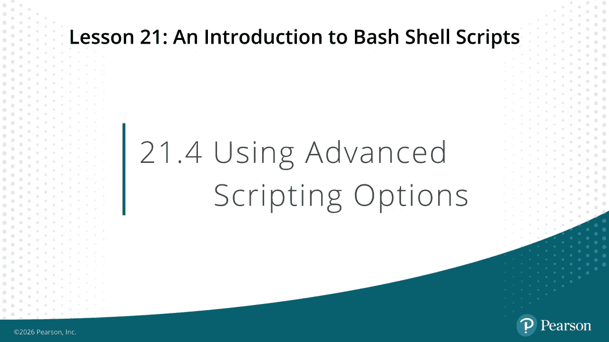
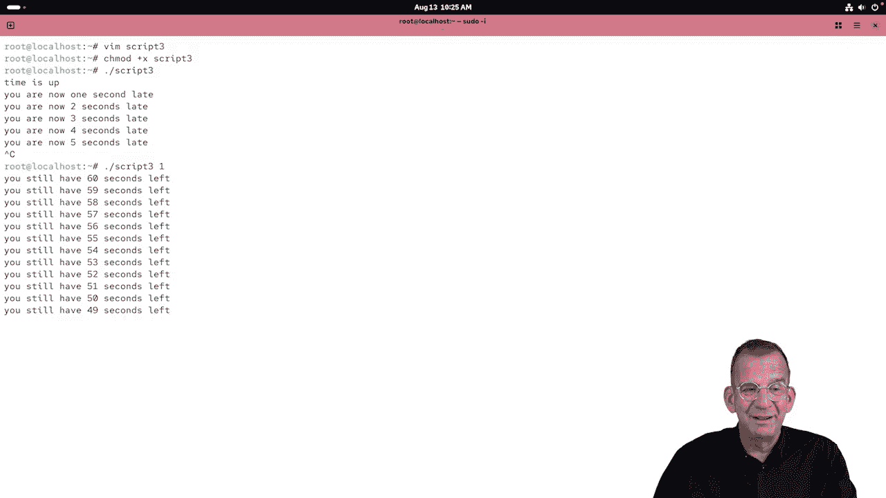

# CompTIA Linux+ V8：214：高级脚本选项 🐧




在本节课中，我们将学习如何在 Bash 脚本中使用一些高级选项，包括位置参数、自定义函数、循环判断以及逻辑运算符。通过一个实际的倒计时脚本，你会明白怎样让脚本更灵活、更好用。


## 一、脚本开头与位置参数 📝

上一节我们介绍了基础脚本写法，本节我们来看看如何处理脚本启动时传入的参数。以下是脚本的开头部分：

```bash
#!/bin/bash
counter=$1
```

这里的 `#!/bin/bash` 告诉系统用 Bash 来运行这个脚本。而 `$1` 是位置参数，也就是你运行脚本时在后面跟的第一个值。比如你输入 `./script3 10`，那么 `$1` 就是 10。


## 二、为什么要把参数复制给变量 🤔

在 Bash 中，你不能直接改变位置参数 `$1` 的值。如果你想在脚本里让这个数字不断减少，就得先把它存到一个普通变量里。以下是具体做法：

```bash
counter=$1
```

这样 `counter` 就拥有了 `$1` 的初始值，你之后可以随时修改 `counter`，而不用担心去碰原来的参数。之所以要这么做，是因为脚本启动时传入的参数是固定的，直接修改它们是不被允许的。


## 三、把秒数换算成更大的单位 🔢

有时候我们希望脚本按分钟来倒计时，而不是按秒。以下是把传入的数字乘以 60 的写法：

```bash
counter=$((counter * 60))
```

`$(( ))` 是 Bash 里做数学运算的方式。这里的意思是，把 `counter` 当前的值乘以 60，然后把结果重新赋给 `counter`。这样一来，如果你传入 1，脚本里就会把它当成 60 秒来处理，方便我们做分钟级的倒计时。


## 四、定义减一函数 ➖

写脚本时，经常需要重复执行同样的几行代码。这时候就可以定义一个函数，让调用更方便。以下是函数的定义：

```bash
minus1() {
    counter=$((counter - 1))
    sleep 1
}
```

这个函数叫 `minus1`，里面做两件事：第一，让 `counter` 减去 1；第二，让脚本暂停 1 秒。以后只要在脚本里写 `minus1`，就相当于执行这两步，不用每次都重新写一遍。把常用操作封装成函数，能让脚本代码更简洁，也更容易维护。


## 五、编写倒计时循环 🔄

接下来我们需要一个循环，让秒数不断减少，直到时间用完。以下是循环的判断条件：

```bash
while [ $counter -gt 0 ]
```

`-gt` 代表大于（greater than）。只要 `counter` 的值大于 0，循环就会继续执行。以下是循环体里的内容：

```bash
echo "you still have $counter seconds left"
minus1
```

每次循环，脚本先打印出还剩多少秒，然后调用 `minus1` 函数，让秒数减 1 并等待 1 秒。就这样，倒计时就开始运行了。这里有一个小细节需要注意，原脚本第一行可能有个拼写错误，运行时要记得检查一下。


## 六、判断时间是否到达 ⏰

循环结束后，我们需要知道时间到底到了没有。以下是判断逻辑：

```bash
[ $counter -eq 0 ] && echo "time is up"
```

`-eq` 表示等于（equal）。这里的 `&&` 是逻辑与运算符，意思是：只有当前面的测试为真，后面的 `echo` 才会执行。简单来说，如果 `counter` 等于 0，就打印 "time is up"。这种写法相当于把 if 语句压缩成了一行，代码更紧凑。


## 七、Bash 里没有严格的变量类型 🧠

有些编程语言（比如 Python）会严格区分整数和字符串，类型不符会报错。但在 Bash 脚本里，情况不一样。以下是说明：

```bash
[ $counter -eq 0 ]
```

虽然 `-eq` 是给整数用的，但 Bash 不会因为 `counter` 看起来像字符串而报错。它会根据上下文自动处理。所以你不需要太纠结变量是不是整数，只要值对得上就行。在 Bash 里，字符串形式的 0 和整数形式的 0 可以混用，不会像 Python 那样因为类型不对而报错。


## 八、处理晚了一秒的情况 🕒

有时候倒计时可能会晚一点结束，这时候 `counter` 可能会变成负数。我们不希望显示 "you are now -1 seconds late"，因为负一秒晚其实就是早了一秒。以下是处理方法：

```bash
while true
do
    echo "you are now ${counter#-} seconds late"
    minus1
done
```

这里用到了 `while true`，也就是一个永远为真的循环。`true` 命令总是会成功退出，退出码是 0，所以循环会一直跑下去。`${counter#-}` 是模式匹配操作符，`#-` 的意思是去掉字符串开头的减号。这样一来，就算 `counter` 是 -1，显示出来的也是 1，用户看到的就是 "you are now 1 seconds late"，而不会出现奇怪的负号。


## 九、运行脚本 🚀

脚本写好之后，需要给它执行权限，然后传入一个参数来运行。以下是具体的操作步骤：

- 使用 `chmod +x script3` 给脚本添加执行权限。
- 使用 `./script3 1` 运行脚本，并把 `1` 作为第一个参数传入。

如果你不传参数，脚本里的 `$1` 就是空的，`counter` 会是 0，脚本会直接打印 "time is up"。如果你传入 1，你就会看到一个漂亮的倒计时过程。这个脚本很实用，可以在课程休息时告诉大家还剩多少时间。


## 本节总结 📚



本节课中我们一起学习了高级脚本选项的使用方法。我们掌握了如何接收位置参数 `$1`，如何把参数复制给普通变量以便修改，如何使用 `$(( ))` 进行数学运算，如何定义和调用 `minus1` 这样的函数，如何用 `while` 循环和 `[ ]` 测试条件，如何用 `&&` 实现简洁的条件判断，以及如何用 `${counter#-}` 去掉字符串开头的减号。最后我们还演示了如何给脚本加执行权限并运行它。希望这些内容能帮助你写出更实用的 Bash 脚本。

