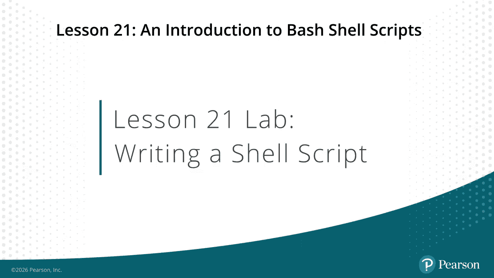
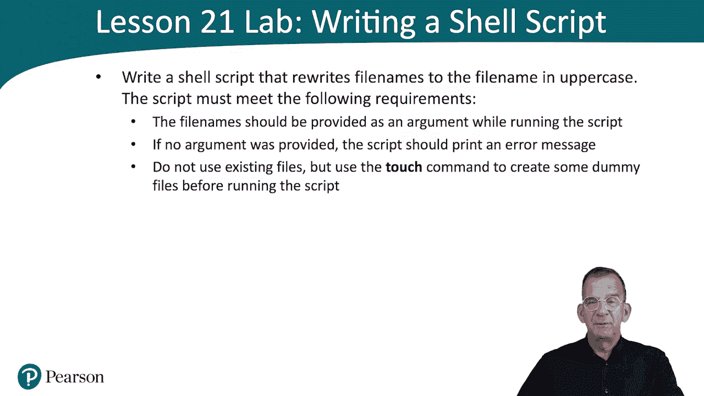

# CompTIA Linux+ V8：Lesson 21：编写 Shell 脚本 📝

又到了本节课的结束，是实验时间了。在本节课中我们将要学习如何编写一个简单的 Shell 脚本。这个脚本的作用是把文件名重写成大写形式。我们会一起看看这个脚本需要满足哪些基本条件，怎样在运行脚本时把文件名作为参数传入，如果没有提供参数脚本应该怎么做，以及为什么在练习之前要用 touch 命令创建一些临时测试文件，而不是直接去修改系统目录里的重要文件。所有内容都会用大白话讲解，希望初学者也能看懂。

下面我们先来看看本节实验的具体任务。


## 本节实验的任务

以下是本节实验需要完成的核心任务：



- 编写一个 Shell 脚本，把文件名改写为大写形式。
- 脚本在运行时，需要把文件名作为参数提供。
- 如果没有提供参数，脚本应该打印一条错误消息。
- 脚本本身不负责创建文件，运行脚本之前要先用 touch 命令准备好测试文件。

接下来，我们来看看脚本需要满足哪些具体要求。

## 脚本需要满足的要求

以下是脚本必须遵守的具体要求：

- 运行脚本的时候，文件名必须作为命令行参数传入。
- 如果用户没有提供参数，脚本需要打印错误信息并提示用法。
- 实验时不要使用已经存在的重要文件，建议先用 touch 命令创建一些临时文件。
- 脚本的功能只是修改文件名，不是用来创建新文件的。

你可能会问，为什么不能直接用现有文件，而要特意创建测试文件？下面解释一下原因。

## 为什么要先创建测试文件

以下是创建测试文件的原因和具体做法：

这样做的目的是避免不小心修改 /etc 目录或者其他重要目录里的文件内容，防止把系统搞乱。在正式运行脚本之前，你可以先执行 `touch file1` 来创建一个测试文件，然后再运行脚本，把这个文件的名字转换成大写。这样即使操作失误，也不会影响系统里的真实数据。祝你实验顺利。

理解了原因之后，我们可以用伪代码来梳理脚本的核心逻辑。

## 核心概念与代码示例

脚本的处理逻辑可以用下面的伪代码描述：

```
如果 没有提供参数:
    打印错误信息
否则:
    将参数指定的文件名转换为大写
```

在终端中，你可以按照下面的顺序进行操作：

```bash
touch file1
./script.sh file1
```

第一行命令创建一个名为 file1 的空文件，第二行命令运行脚本并把 file1 作为参数传进去，脚本会把这个文件名改成大写形式。

有了逻辑概念，我们可以按照下面的步骤来动手操作。

## 实验操作步骤

以下是实验的具体操作步骤：

1. 打开终端窗口。
2. 使用 touch 命令创建一个测试文件，例如输入 `touch file1`。
3. 编写 Shell 脚本，实现把文件名转换为大写的功能。
4. 运行脚本，并把创建好的文件名作为参数传入。
5. 检查文件名是否已经变成大写。

在动手操作之前，还有几点需要特别注意。

## 注意事项

以下是需要注意的几点：

- 脚本不应该自己创建文件，文件需要提前用 touch 命令准备好。
- 不要直接在 /etc 等重要目录里进行操作，以免损坏系统文件。
- 确保运行脚本时带上文件名参数，如果不带参数，脚本会打印错误提示。



最后，我们来总结一下本节课的内容。

本节课中我们一起学习了如何编写一个把文件名改为大写的 Shell 脚本。我们了解了脚本需要接收文件名作为参数，缺少参数时要打印错误信息，以及在练习时要用 touch 命令创建临时文件，避免修改系统重要目录里的内容。希望这些基础知识能帮助你入门 Shell 脚本编写。
