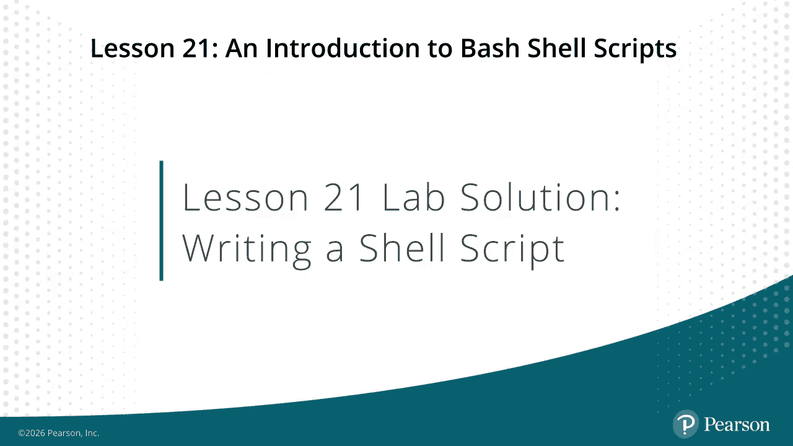
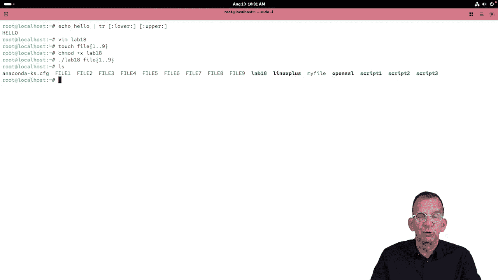

🐚 Linux系统管理：第21课：Shell脚本编写实验解答


本节课我们将学习如何编写一个Shell脚本，用来把一批文件的名字全部改成大写。这节课的核心任务是完成一个名为lab18的脚本，它能够接受用户提供的文件名，然后把这些文件重命名为大写形式。我们会一步一步地讲解脚本里的每一行代码，包括如何检查用户是否提供了参数，如何遍历所有传进来的文件名，以及如何利用命令替换来改变文件名的大小写。最后我们还会创建一些测试文件，运行脚本看看最终效果。无论你是刚开始学习Linux命令行，还是想要掌握Shell脚本编写的基础，这节课都会用最直白的方式把原理讲清楚，让你从零开始理解脚本的执行流程，并且能够独立完成类似的文件处理任务，而不需要依赖复杂的图形界面工具，也能在终端里高效地完成批量操作。




第一节：脚本的开头与解释器声明


上一节我们介绍了Shell脚本的基本概念，本节中我们来看看脚本应该怎么开始写。

一个完整的Shell脚本必须告诉系统用什么程序来运行它。在Linux里，我们通常在第一行写上特殊的声明，这就是脚本的开头部分。这行代码的作用是指定解释器，让操作系统知道应该用Bash来执行后面的所有指令。如果没有这一行，脚本可能无法正常运行，或者系统会用默认的方式去尝试执行，这会导致不可预期的结果。下面是脚本的第一行代码：

```bash
#!/bin/bash
```

这行代码看起来很简单，但它非常重要。井号和感叹号组合在一起叫做shebang，后面跟着Bash的路径。当你直接运行脚本文件时，内核会读取这一行，然后自动调用/bin/bash来解释脚本里的后续内容。我们可以把它理解为给脚本安装的一个“身份标签”，标明这个脚本属于Bash脚本家族，这样系统才不会混淆它应该交给哪个程序去处理。


第二节：检查用户是否提供了参数


在脚本开头声明好解释器之后，本节中我们来看看如何处理用户输入。

编写脚本时，最常见的情况是用户需要提供一些信息，比如要处理的文件名。如果用户直接运行脚本却不传递任何文件名，脚本应该提示错误并退出，而不是盲目继续执行，否则可能会产生错误的操作或者毫无意义的输出。下面这段代码用来检查第一个参数是否为空：

```bash
if [ -z "$1" ]; then
    echo "You have to provide at least one file name as argument"
    echo "Existing now"
    exit 3
fi
```

以下是这段代码的执行逻辑：

- if语句用来判断条件是否成立
- 方括号里的-z表示检查字符串长度是否为零
- $1代表用户传入的第一个参数
- 如果$1是空的，说明用户没有提供文件名
- 脚本就会打印错误提示，然后用exit 3退出

退出后面的数字3只是一个状态码，系统内部用它来区分不同的退出原因，这个数字具体是多少并不影响脚本的主要功能，只要程序能正常结束即可。fi关键字用来结束if语句，告诉脚本条件判断部分已经写完了，后面可以继续写其他内容。


第三节：遍历所有传入的参数


完成参数检查之后，本节中我们来看看如何处理多个文件名。

用户可能一次传递一个文件名，也可能一次传递多个。脚本需要能够把这些文件名全部处理一遍，不能只处理第一个，否则剩下的文件就不会被重命名，测试的时候就会发现只有部分文件变成了大写，这显然不符合我们的要求。在Shell里，$@这个特殊变量指代表떠所有传递给脚本的参数。我们可以用for循环把它们逐个取出来。下面是遍历参数的代码结构：

```bash
for i in $@
do
    # 对每个文件执行操作
done
```

以下是循环里各个部分的作用：

- for关键字表示开始一个循环
- i是循环变量，代表当前正在处理的那个文件名
- $@会展开成所有参数的列表
- do和done之间的命令会对每个参数执行一次

比如说用户传了file1、file2、file3，那么$@就代表这三个文件名。循环会依次把每个文件名赋值给i，然后执行do和done之间的命令。这样一来，不管用户给了多少个文件，脚本都能逐一处理，不会遗漏任何一个，也不会因为参数数量不同而出错。


第四节：文件重命名与命令替换


知道了如何遍历参数之后，本节中我们来看看如何把文件名改成大写。

循环里面的核心操作是重命名文件。mv命令用来移动或重命名文件，它需要两个参数：原来的文件名和新的文件名。原来的文件名就是循环变量i当前的值，而新的文件名需要把i里的小写字母转换成大写字母。这里就用到了命令替换，也就是把一个命令的输出结果当作另一个命令的参数。下面是具体的写法：

```bash
mv $i $(echo $i | tr [a-z] [A-Z])
```

这行代码拆解开来看，包含以下几个关键步骤：

- 第一部分$i就是当前文件名，比如file1
- 圆括号里面是命令替换
- 先用echo把当前文件名输出
- 然后用管道符|把结果传给tr命令
- tr命令的作用是字符转换，[a-z]代表所有小写字母，[A-Z]代表所有大写字母

所以整个命令替换的结果就是把file1变成FILE1。mv命令拿到这两个名字之后，就会把文件file1重命名为FILE1。这就是整个脚本最关键的一步，实现了从小写到大写的转换，也体现了Shell脚本中组合简单命令来完成复杂任务的思路。


第五节：创建测试文件并运行脚本


写好脚本之后，本节中我们来看看怎么测试它是否正常工作。

脚本写完并保存为lab18之后，我们不能直接运行，因为新创建的文件默认没有执行权限。我们需要先用chmod命令添加执行权限，然后准备一些测试文件，不然运行脚本也没有目标文件可以重命名，也就无法验证脚本是否真的把文件名改成了大写。下面是完整的测试步骤：

```bash
touch file1 file2 file3 file4 file5 file6 file7 file8 file9
chmod +x lab18
./lab18 file1 file2 file3 file4 file5 file6 file7 file8 file9
```

touch命令用来创建空文件，这里一次创建了file1到file9共九个文件。chmod +x lab18给脚本添加执行权限，+x表示添加可执行属性。最后用./lab18后面跟上所有文件名来运行脚本。脚本执行之后，原来的file1、file2等等都会被重命名成FILE1、FILE2等等。你可以用ls命令查看目录里的文件，确认所有文件名都变成了大写，这就说明脚本运行成功了，我们的实验解答也就完成了。


课程总结


本节课中我们一起学习了如何编写一个用于批量重命名文件的Shell脚本。



我们先在脚本第一行声明了#!/bin/bash，告诉系统用Bash来运行脚本。然后编写了参数检查逻辑，如果用户没有提供任何文件名，脚本会打印错误信息并退出。接着我们使用for循环和$@变量遍历所有传入的文件名，在循环内部利用mv命令和命令替换$(echo $i | tr [a-z] [A-Z])，把每个文件名从小写转换为大写。最后我们创建了测试文件，给脚本添加执行权限，并运行脚本验证效果。通过这节课的学习，你已经掌握了Shell脚本中条件判断、循环遍历、命令替换以及文件重命名的基本方法，这些都是后续编写更复杂自动化脚本的重要基础，也希望你能在实际操作中多加练习，熟练掌握这些命令的组合使用。

