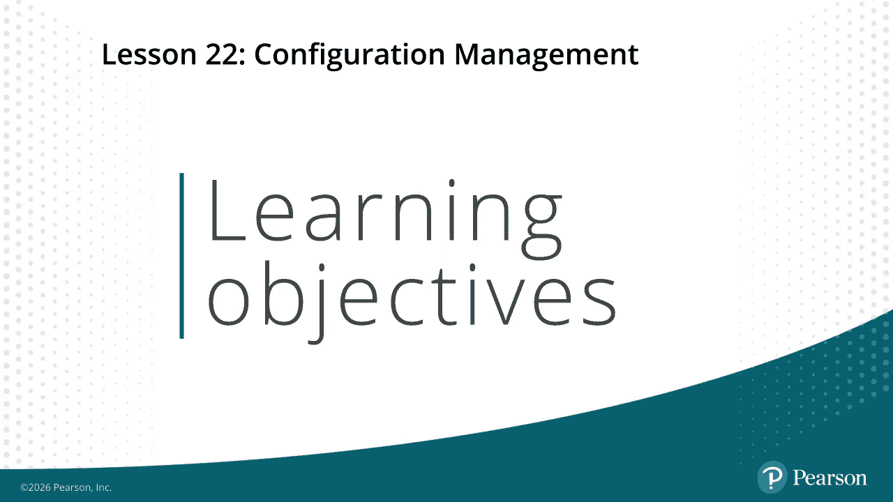
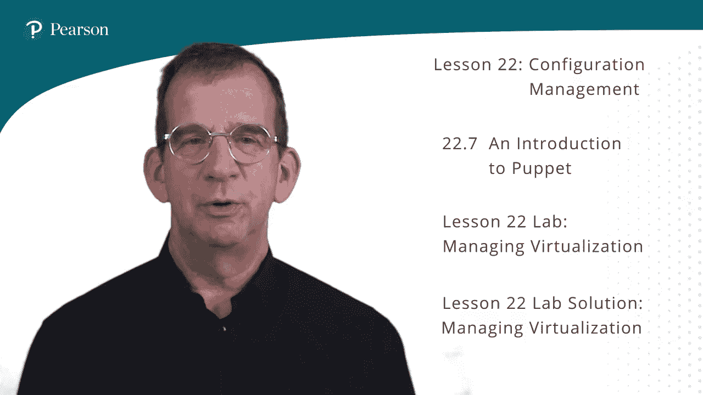

# CompTIA Linux+ V8：part5 p50：配置管理学习目标 📚


在本节课中，我们将一起学习配置管理的基本概念。配置管理是运维工作中非常重要的一部分，它帮助我们保持服务器和软件环境的一致性。无论你是刚接触Linux的新手，还是已经有一些经验的学习者，了解配置管理都能让你更好地掌握系统自动化的思路。接下来的内容会由浅入深，先解释什么是配置管理，再介绍市面上常见的解决方案，然后讲解CI/CD与配置管理的关系，最后重点讲解Ansible的使用方法，并简单提及Puppet，最后附带实验环节供你练习。


## 一、什么是配置管理 🔧



上一节我们简单介绍了Linux系统的基础知识，本节中我们来看看配置管理到底是指什么。配置管理简单来说，就是让多台服务器保持相同的配置状态，避免出现一台服务器设置正确，另一台却缺少某个软件包或参数错误的情况。在实际工作中，手动在每台机器上修改配置文件既浪费时间又容易出错，所以我们需要一套方法来自动化这个过程。

配置管理的核心可以用下面这个公式来理解：

**配置管理 = 目标状态 - 实际状态的差异自动修正**

也就是说，你先定义好希望服务器是什么样子的目标状态，然后配置管理工具会把当前状态调整到目标状态。比如你希望所有服务器都安装了Nginx并且开启80端口，配置管理工具就会检查每台服务器，发现没有安装就自动安装，发现端口没开就自动开启。


## 二、常见的配置管理解决方案 🛠️

上一节我们解释了配置管理的定义，本节中我们来看看市面上有哪些成熟的解决方案。不同的工具有不同的特点，有的适合小型团队，有的适合大规模企业环境，选择合适的工具能让你的运维工作事半功倍。

以下是几种常见的配置管理解决方案：

- **Ansible**：基于Python开发，不需要在被管理节点安装客户端，通过SSH连接执行任务，上手较快。
- **Puppet**：老牌配置管理工具，使用声明式语言定义系统状态，适合大规模复杂环境。
- **Chef**：使用Ruby编写的配置管理工具，以“配方”和“cookbook”组织管理内容。
- **SaltStack**：支持远程执行和状态管理，通信速度快，适合大规模节点管理。

这些工具的共同点在于，它们都让你用代码的方式描述服务器应该是什么样子，而不是一条条命令地去手动操作。


## 三、CI/CD与配置管理的关系 🔄

上一节我们介绍了不同的配置管理解决方案，本节中我们来看看CI/CD（持续集成/持续交付）与配置管理是如何结合的。CI/CD主要关注代码从开发到部署的自动化流程，而配置管理关注服务器环境的一致性，两者结合可以实现从代码提交到应用运行的全流程自动化。

你可以把它们的关系用下面这段伪代码来理解：

```
代码提交 -> 构建 -> 测试 -> 配置管理部署环境 -> 应用发布 -> 监控
```

在实际工作中，开发人员提交代码后，CI/CD系统会自动构建和测试，然后通过配置管理工具将应用部署到配置好的服务器上。这样一来，测试环境、预发环境和生产环境的服务器配置都保持一致，减少了“在我机器上能跑”这类问题。


## 四、使用Ansible进行配置管理 🖥️

上一节我们讲解了CI/CD与配置管理的关系，本节中我们来看看如何用Ansible进行实际的配置管理操作。Ansible是目前非常流行的开源配置管理工具，它不需要在目标服务器上安装任何代理程序，只需要SSH访问权限即可，这使得它特别适合初学者和中小型团队。

以下是使用Ansible进行配置管理的主要步骤：

1. **安装Ansible**：在控制节点上安装Ansible软件包。
2. **编写主机清单**：列出需要被管理的服务器IP地址或主机名。
3. **执行Ad-hoc命令**：运行简单的临时命令，比如检查服务器是否在线。
4. **编写Playbook**：用YAML格式编写剧本，定义一系列要执行的任务。
5. **运行Playbook**：让Ansible自动把多台服务器配置到你想要的状态。

下面是一个简单的Ansible Playbook示例，用于在目标服务器上安装并启动Nginx：

```yaml
- name: 安装并配置Nginx
  hosts: webservers
  become: yes
  tasks:
    - name: 安装Nginx软件包
      apt:
        name: nginx
        state: present
    - name: 启动Nginx服务
      service:
        name: nginx
        state: started
        enabled: yes
```

这个Playbook的意思是：在webservers组里的所有服务器上，使用root权限安装nginx，并确保Nginx服务已经启动并设置为开机自启。通过这种方式，你不需要登录每台服务器去手动输入安装命令，只需要运行一次Playbook，所有机器就都配置好了。


## 五、Puppet简介与实验环节 🧪

上一节我们重点讲解了Ansible的安装和使用方法，本节中我们来看看另一个经典工具Puppet，并介绍本节课的实验安排。Puppet和Ansible一样，都是用来自动化管理服务器配置的工具，不过Puppet通常需要在被管理节点安装代理，并且使用自己的声明式语言来描述系统状态。

在本节课的最后部分，你会找到一段关于Puppet的简短介绍视频，帮助你初步了解它的基本思想。除此之外，本节课还提供了一个动手实验以及对应的实验答案。实验让你有机会亲自操作配置管理工具，巩固刚才学到的理论知识，建议你不要跳过这一步，实际动手才是掌握技术最好的方法。




## 总结 📝

本节课中我们一起学习了配置管理的基本概念，了解了它是如何通过自动化手段保持服务器状态一致的。我们回顾了市面上常见的配置管理解决方案，包括Ansible、Puppet、Chef和SaltStack等。接着，我们探讨了CI/CD与配置管理的结合方式，看到了自动化部署流程中配置管理的作用。随后，我们详细学习了如何使用Ansible进行配置管理，包括安装、编写主机清单、执行Ad-hoc命令和编写Playbook，并给出了一个安装Nginx的示例代码。最后，我们简要介绍了Puppet，并说明了本节课附带的实验及答案。希望通过本节课的学习，你能对配置管理有一个清晰的认识，并能够开始尝试用Ansible来自动化管理你的服务器。

