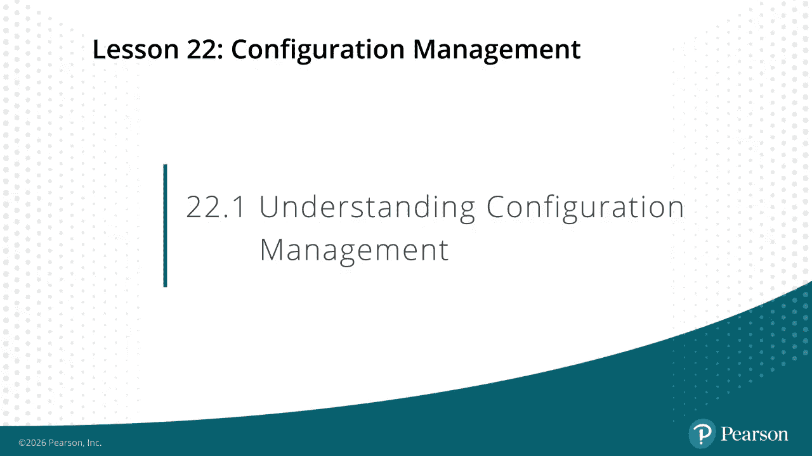
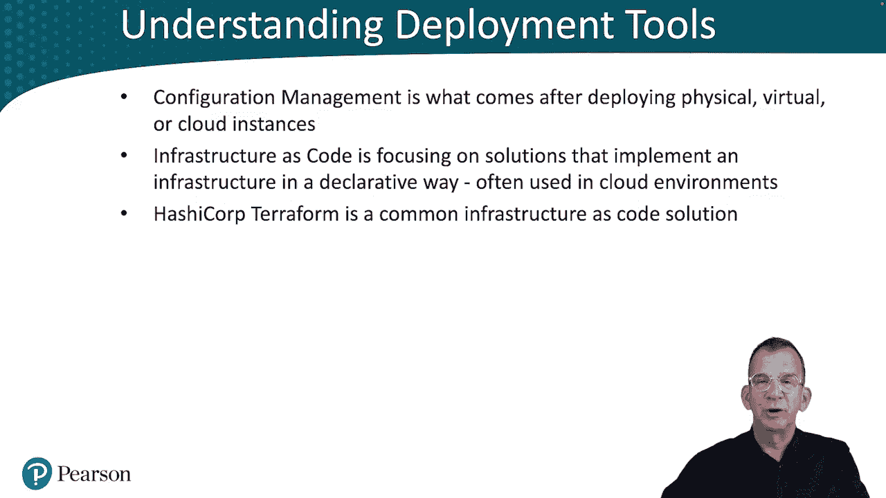

# 🖥️ Oreilly - CompTIA Linux+ V8：451.221：配置管理基础

在本节课中，我们将一起学习什么是配置管理，它的核心思想是什么，以及在实际工作中如何使用。你会了解到配置即代码的概念，理解清单文件的作用，还会看到配置管理与基础设施即代码之间的区别和联系。无论你是刚开始学习Linux运维，还是想复习相关知识点，这节课都会用简单的语言把这些内容讲清楚，帮助你建立起完整的概念框架。

---


## 什么是配置管理

上一节我们可能聊过了系统部署的基础知识，本节中我们来看看配置管理到底是什么。简单来说，配置管理就是把系统的配置当成代码来管理，而不是每次都登录服务器手动敲命令，或者在图形界面里一个一个点选设置。这样做的好处是，你可以把想要的系统状态写下来，然后让工具自动帮你达成这个状态，不用担心漏掉步骤，也不怕记不清之前改过什么。



配置管理的核心理念可以用下面这个公式来概括：

`期望状态 = 清单文件中定义的配置`

你也可以用下面这段代码来理解整个流程：

```text
配置即代码 (Configuration as Code)
       ↓
   编写清单文件 (Manifest)
       ↓
   描述期望的系统状态
       ↓
   对比当前状态与期望状态
       ↓
   自动修正差异
```

在实际操作中，你会编写一个清单文件，里面详细说明你希望托管资产保持什么样的状态。这里的托管资产可以是服务器、容器或者云实例。比如说，你希望某个软件包已经安装，某个服务正在运行，某个配置文件的内容是特定的样子。清单文件里写的，就是这个“期望状态”。

然后，配置管理工具会读取这个清单，把它跟目标机器当前的实际状态做对比。如果发现两者不一致，工具就会自动采取措施，把机器调整到清单里描述的那个状态。这样一来，不管你管理多少台服务器，只要用同一个清单，它们就都能保持一致的配置，不会出现这台装了软件、那台没装，或者这个版本和那个版本不一样的混乱情况。

期望状态通常使用声明式配置语言来定义。所谓声明式，就是你只需要说出“我想要什么结果”，不需要详细说明“具体怎么做步骤”。比如你只需声明“这个服务应该处于运行状态”，而不需要去写“先检查进程，如果没运行就启动它”这种具体的操作步骤。

---

## 配置管理的工作方式

刚才我们介绍了配置管理的基本概念和期望状态的概念，本节中我们来看看配置管理工具在实际工作时，通常分为哪几种不同的方式。

配置管理解决方案主要可以分为两大类，以下是常见的分类方式：

- 推送式（Push-based）：管理服务器主动把配置推送到目标机器上，不需要在目标机器上安装专门的代理程序。
- 拉取式（Pull-based）：目标机器定期从管理服务器拉取最新的配置清单，然后在本地应用，通常需要在目标机器上安装一个代理（Agent）。

有些解决方案需要在被管理的机器上安装代理程序，而有些解决方案则不需要。安装代理的好处是功能更强大，能做更细致的控制；不需要代理的方案部署起来更轻量，适合临时或者不方便安装额外软件的场景。

你可以把推送式理解为“主管下发任务”，把拉取式理解为“员工自己去领任务”。两种方式各有优劣，具体选哪种要看你的基础设施规模和安全要求。

---

## 配置管理在部署后的作用

前面我们讲了配置管理的工作模式，本节中我们来看看配置管理通常在什么时候介入。

配置管理是在部署物理机、虚拟机或者云实例之后才开始发挥作用的。也就是说，先有机器，再有配置。当你在云平台上创建了一台新的虚拟机，或者在数据中心装好了新的物理服务器之后，这时候系统通常还是一个干净的初始状态，并没有安装你需要的软件，也没有配置好网络、用户、安全策略等等。

这时候配置管理工具就登场了。它会根据你事先写好的清单，把这些新部署的机器配置成你想要的样子。比如安装Web服务器、配置防火墙、部署应用程序等等。没有配置管理的话，你可能需要登录每一台新机器，手动重复一遍相同的设置过程，既浪费时间又容易出错。

---

## 基础设施即代码与配置管理

刚才我们讨论了配置管理在部署后的作用，本节中我们来看看另一个密切相关的概念，也就是基础设施即代码。

基础设施即代码（Infrastructure as Code，简称IaC）专注于以声明式的方式来定义和创建基础设施资源。它常用于云环境中，比如你需要在云平台上创建虚拟网络、负载均衡器、数据库实例等等。与其手动在云控制台里点来点去，不如把基础设施的定义写成代码文件，这样不仅可以版本控制，还能重复使用。

常见的基础设施即代码解决方案有下面这个：

- HashiCorp Terraform：一种广泛使用的基础设施即代码工具，支持多个云平台，可以用声明式语言定义云资源。

需要注意的是，虽然基础设施即代码和配置管理是两个不同的概念，但它们之间有重叠之处。有些配置管理解决方案也具备基础设施即代码的能力，也就是说，它们不仅能配置已经存在的机器，还能帮你创建新的云资源或者虚拟机。

你可以把基础设施即代码理解为“盖房子的蓝图”，把配置管理理解为“房子盖好之后的装修和家具摆放”。两者配合使用，才能让整个IT环境实现真正的自动化。

---



## 总结

本节课中，我们一起学习了配置管理的基本概念，了解了配置即代码和清单文件的作用，还掌握了期望状态与当前状态对比的原理。我们还介绍了推送式和拉取式两种配置管理方式，并讨论了代理程序的使用情况。最后，我们学习了配置管理在部署实例之后的应用场景，以及基础设施即代码与配置管理之间的关系，重点认识了HashiCorp Terraform这个常见工具。希望通过这节课，你能对配置管理有一个直观的认识，并在后续的Linux运维学习中灵活应用这些知识。
