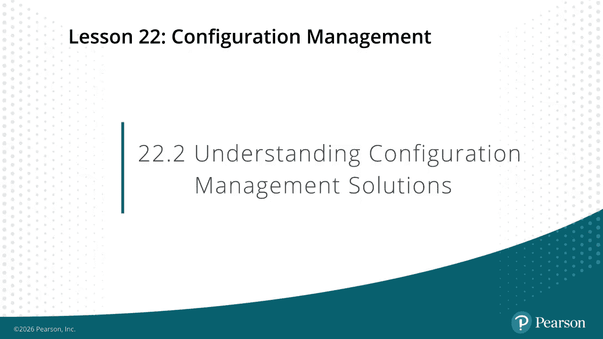
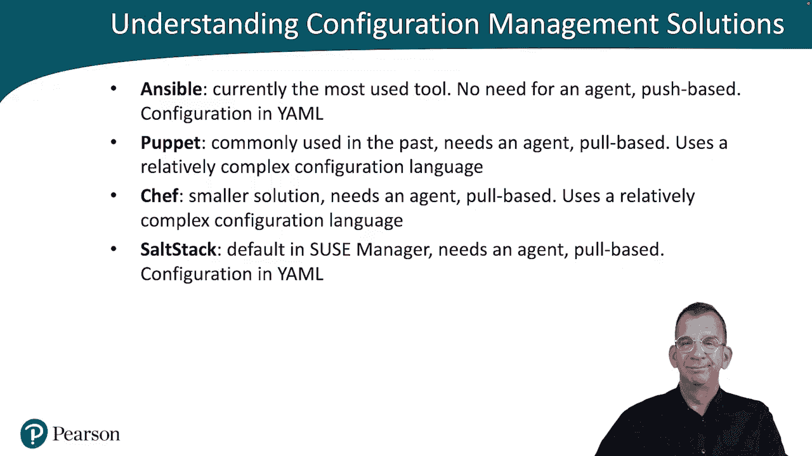

# CompTIA Linux+ V8：452：理解配置管理解决方案 🖥️

在本节课中我们将要学习什么是配置管理，以及市面上常见的几种配置管理解决方案。配置管理简单来说，就是让一台或者很多台服务器保持你想要的状态，而不是手动去一台台修改配置。如果你管理的机器越来越多，手动改就会非常麻烦，这时候就需要自动化工具来帮忙完成重复性工作。


配置管理的核心思想可以用下面这个简单公式来表示：



`期望状态 = 配置管理工具自动应用的设置`

或者用代码块来更直观地看一下：

```text
管理目标：让受管机器保持在“期望状态”
工具作用：自动下发配置，无需逐台登录操作
```

接下来我们来看看具体有哪些工具可供选择。市面上其实不少方案，但最常用的只有几个。

## Ansible 🚀

上一节我们介绍了配置管理的基本概念，本节中我们来看看第一个工具 Ansible。Ansible 目前是使用最广泛的配置管理工具之一。它最大的特点是不需要在被管理的机器上安装任何代理程序，也就是通常说的 agent。它通过 SSH 进行连接，属于推送式模式，也就是说控制主机主动把配置推送到目标机器上。

以下是 Ansible 的主要特点：

- 不需要安装 agent，依赖 SSH 进行远程连接
- 基于推送模式，由控制节点主动发送配置
- 配置使用 YAML 编写，语法简单，容易阅读和理解

对于初学者来说，YAML 就像是一种带缩进的配置文件，类似下面这样：

```yaml
- name: 安装 nginx
  apt:
    name: nginx
    state: present
```

## Puppet 🎭

在了解完 Ansible 之后，我们再看看 Puppet。Puppet 曾经在 Ansible 变得流行之前非常主流，属于比较老牌的配置管理解决方案。它和 Ansible 有明显的区别，最主要的一点就是 Puppet 需要在被管理的资产上安装 agent，也就是一段你需要手动部署的软件。

以下是 Puppet 的工作方式：

- 需要在每台受管机器上安装 agent 软件
- 属于拉取模式，agent 会自动去获取配置
- 目的是确保受管机器处于期望状态
- 使用的配置语言相对复杂，不像 YAML 那么直白

简单来说，Puppet 的运行逻辑可以用代码描述如下：

```text
agent 定期向主服务器请求最新配置
主服务器下发配置
agent 本地应用配置，使机器达到期望状态
```

## Chef 🍳

介绍完 Puppet 后，我们来看看 Chef。Chef 是一个规模相对较小的解决方案，同样需要安装 agent，并且也是基于拉取模式的。它的配置语言也比较复杂，和 Puppet 有点像，但在行业中的普及程度不如 Ansible 和 Puppet，算是一个小众但存在的选择。

以下是 Chef 的基本特征：

- 需要安装 agent
- 基于拉取模式
- 配置语言相对复杂
- 市场占有率较小，不是主流大方案

## SaltStack 🧂

最后我们要说的是 SaltStack。SaltStack 常被用于 SUSE Manager 这样的管理方案中，它也需要安装 agent，属于基于拉取模式，配置内容使用 YAML 编写。不过尽管它也用 YAML，但在实际使用中不如 Ansible 那么受欢迎。

以下是 SaltStack 的特点：

- 需要安装 agent
- 基于拉取模式
- 配置使用 YAML 语言
- 常用于 SUSE Manager 等场景

## 为什么 Ansible 更受欢迎 📈

在对比完这些工具之后，你可能会问，为什么大家都推荐 Ansible？原因其实很简单。Ansible 不需要安装 agent，直接通过 SSH 等默认的远程控制协议就能工作，这大大降低了使用门槛。而且它的配置全部基于 YAML，初学者很容易上手。相比之下，Puppet 和 Chef 都需要装 agent，配置语言也更复杂，所以在自动化运维领域，Ansible 成了很多人的首选。

以下是几种工具的简单对比总结：

| 工具 | 是否需要 Agent | 模式 | 配置语言 | 流行程度 |
|------|---------------|------|----------|----------|
| Ansible | 不需要 | 推送式 | YAML | 非常高 |
| Puppet | 需要 | 拉取式 | 复杂 | 较高（过去很火） |
| Chef | 需要 | 拉取式 | 复杂 | 较低 |
| SaltStack | 需要 | 拉取式 | YAML | 中等 |

## 本节总结 ✅



本节课中我们一起学习了配置管理的基本概念，以及 Ansible、Puppet、Chef 和 SaltStack 这几种主流的配置管理解决方案。我们了解到 Ansible 因为无需 agent、基于 SSH 且使用 YAML 配置，而成为目前最常用的工具；Puppet 和 Chef 虽然曾经或目前也有使用，但都需要安装 agent 并且配置语言相对复杂；SaltStack 则主要用于特定场景如 SUSE Manager。希望通过本节内容，你能对配置管理工具有初步认识，并能根据实际需求选择合适的方案。

