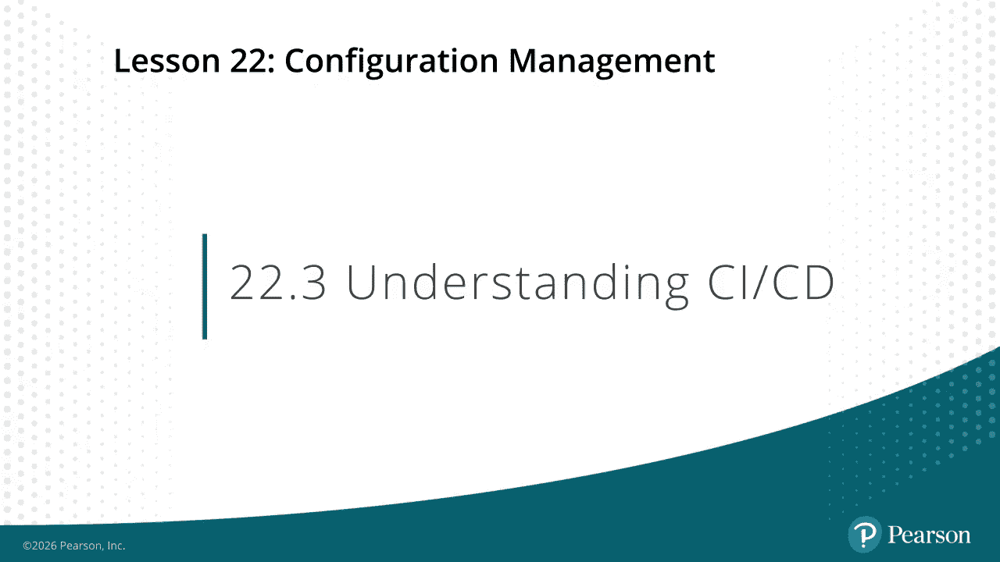
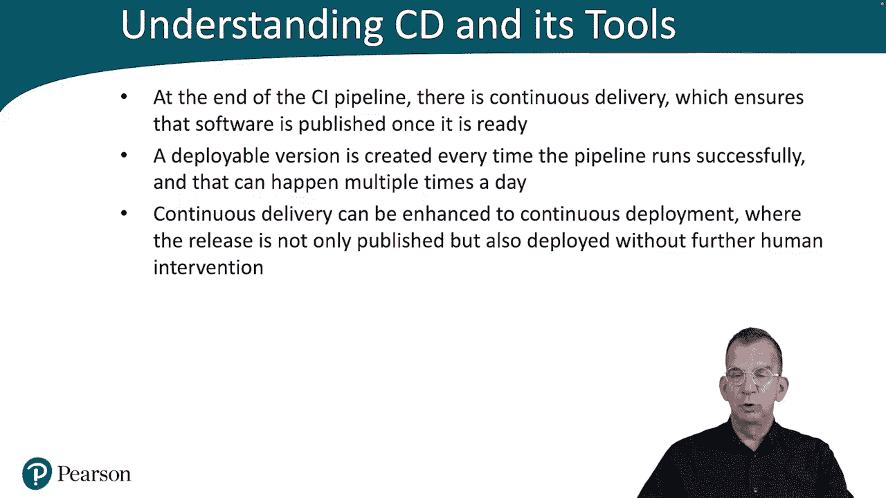

# CompTIA Linux+ V8：5.53：理解 CI/CD 🚀




在本节课中我们将要学习 CI/CD 是什么，它在 DevOps 运维中扮演什么角色，持续集成和持续交付的具体区别，以及常用的自动化工具有哪些。内容会用大白话讲解，适合初学者快速上手，不用担心之前没有相关基础。


## 一、什么是 CI/CD 🛠️


首先我们来看看 CI/CD 的核心定义，理解它为什么被称为 DevOps 的核心要素。

CI/CD 是持续集成和持续交付的缩写，有时候也被称为持续部署。它是 DevOps 的核心要素，作用是强制实现应用程序构建、测试和部署的自动化。简单说，就是让代码从写出来到运行在服务器上的全过程，尽量不用人工干预，由系统自动完成。CI/CD 流水线是现代 DevOps 运营的支柱，整个流程像一条流水线，代码经过一个又一个阶段，最后变成可运行的软件。

可以用下面的公式来表示这个概念：

```text
CI/CD = 持续集成（Continuous Integration） + 持续交付/持续部署（Continuous Delivery/Deployment）
```


## 二、持续集成（CI）及其工具


上一节我们介绍了 CI/CD 的整体概念，本节中我们来看看持续集成具体是怎么回事。

在持续集成阶段，所有开发者每天多次将代码更改合并到中央仓库，目的是确保代码保持一致性。Git 是常用于此目的的仓库技术，开发者可以在自己的分支上开发，完成后再合并到主代码中，这部分内容在课程第 19 节中也有讲解。CI 自动化用于监视仓库中的变更，一旦检测到新代码，就会触发后续流程。有多种方法可以实现自动监视，以下是常见的几种选择：

- Docker 镜像仓库上的 Webhook，能自动检测变更并更新应用程序。
- Jenkins，这是非常常见的 CI/CD 解决方案。
- 在 Kubernetes 中集成良好的 TactL，或者 GitLab Actions，也可以用于 CI。

当 CI 自动化完成后，提交的变更必须经过验证，验证过程发生在流水线中，流水线会经过不同的阶段，确保代码质量达标。


## 三、持续交付与持续部署（CD）


上一节我们介绍了持续集成和 CI 相关工具，本节中我们来看看 CD 部分，也就是持续交付和持续部署。

CD 基于频繁的代码变更，自动化软件发布流程。为此，CD 包含自动化的基础设施配置和部署。这里需要注意一个概念区别，CD 可以代表持续交付，也可以代表持续部署。

持续交付的意思是，配置或代码已经准备好并可供使用，但最后的实施步骤仍然需要人工完成。而持续部署则是全自动完成的，包括部署环节，不再需要人工介入。

换句话说，每次流水线成功运行时，都会创建一个可部署的版本，并且每天可以发生多次。持续交付可以进一步增强为持续部署，此时软件不仅被发布，而且在无需进一步人工干预的情况下自动部署。


## 四、常用 CI/CD 工具总结


前面几节我们分别讲了 CI 和 CD 的原理，本节中我们来看看实际开发中常用的哪些工具。

在 CI 环节，常用的工具包括版本控制系统 Git，用于管理代码分支和合并；Jenkins，作为流行的 CI/CD 平台；GitLab Actions，与 GitLab 仓库集成紧密；TactL，适合在 Kubernetes 环境中使用。这些工具共同组成了自动化流水线的基础，帮助团队实现代码的快速集成、测试和发布。下面是一个简单的命令示例：

```bash
# 查看 Git 分支状态
git status

# 触发 Jenkins 构建（示例）
jenkins-cli build job-name
```




本节课中我们一起学习了 CI/CD 的定义、持续集成的工作方式、持续交付与持续部署的区别，以及 Git、Jenkins、GitLab Actions 和 TactL 等常用工具。希望这些内容能帮助你初步理解 DevOps 中自动化流水线的基本思想。

