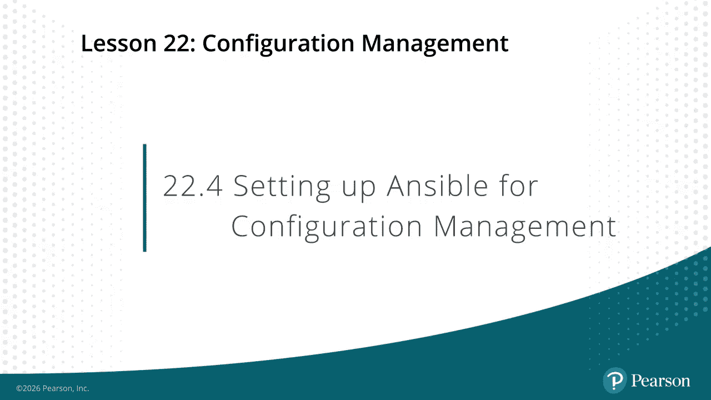
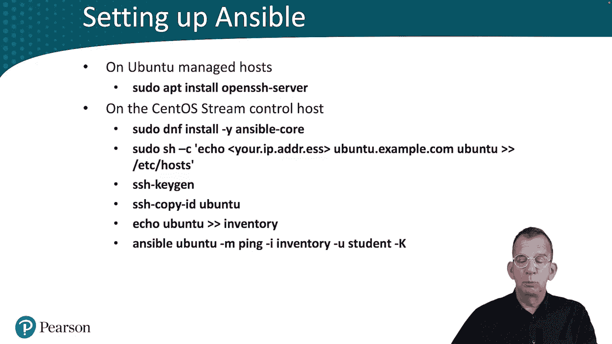

# CompTIA Linux+ V8：05：设置Ansible进行配置管理🖥️




在本节课中，我们将一起学习如何设置Ansible进行配置管理。Ansible是一种自动化运维工具，它的核心思想就是把你想要的系统状态推送到很多台被管理的机器上，而不需要在每台机器上逐一操作。不管你是刚接触Linux自动化，还是希望在实际工作中快速上手，这篇教程都会用大白话把每一步都讲清楚。我们会先聊聊控制主机和被管主机各自需要满足什么条件，接着看怎么安装软件、怎么配置SSH、怎么编写清单文件，最后运行第一条Ansible命令，验证环境是否已经搭好。


## 了解Ansible配置管理的基本需求📋


在正式动手之前，我们得先明白Ansible到底需要什么样的环境。下面我们来看看控制主机和被管主机各自需要满足哪些条件。


控制主机是你下达指令的地方，被管主机是被配置的目标。控制主机可以是几乎任何系统，包括各种Linux发行版，甚至Windows或macOS都可以。不过因为Ansible是Red Hat公司的产品，在Red Hat系发行版上集成起来通常更顺手一些。


在控制主机上，你需要为所有被管节点配置主机名解析，除非你打算直接用IP地址来访问它们。此外，还要生成SSH密钥，并把公钥复制到被管主机，这样控制主机上的Ansible用户就能顺利连过去，不用每次都输密码。


实际上，在控制主机上只需要做三件事：安装Ansible软件、创建清单文件，然后就差不多完成了。


以下是控制主机需要准备的几项内容：

- 安装Ansible核心包，例如使用dnf或apt。
- 配置主机名解析，或者直接记录IP地址。
- 生成SSH密钥对，并把公钥分发给被管主机。
- 创建一个清单文件inventory，列出所有被管主机。


## 配置被管主机的环境🛠️


上一节我们介绍了控制主机的要求，本节中我们来看看被管主机这边该怎么准备。


被管主机就是被Ansible管理的机器。在这些机器上，你需要确保已经安装了Python。现在大多数Linux发行版的最小安装包里都自带Python，所以通常不需要特别操作，只有那些极其精简的云镜像可能没有。


另外，被管主机必须开启SSH访问，并且得有一个拥有sudo权限的用户。如果你希望操作更简单，可以配置免密码的sudo权限；如果你更在意安全，也完全可以在推送配置时使用密码认证，Ansible都支持。


以下是被管主机需要满足的条件：

- 已安装Python，大多数系统自带，只需确认即可。
- 已启用SSH服务，允许远程连接。
- 存在一个具有sudo权限的普通用户。
- 可选地配置免密sudo，或者准备好在运行Ansible时输入密码。


## 在被管主机上安装OpenSSH服务器🔐


有了基本条件之后，我们进入实际操作。本节我们以Ubuntu为例，看看被管主机该怎么装SSH服务器。


如果你使用的是Ubuntu桌面版，默认并没有安装OpenSSH服务器，所以需要手动装上。使用下面这条命令即可：

```bash
sudo apt install openssh-server
```


安装好之后，这台机器就可以接受远程SSH连接了。如果是Ubuntu服务器版，通常出厂时就已经预装了SSH，就不需要再装了。




## 在控制主机上安装Ansible并配置主机名解析⚙️


被管主机准备好了，接下来我们回到控制主机，安装Ansible软件并让它认识被管主机的名字。


你不需要以root用户身份操作，用一个普通用户，比如student，就可以了。先安装Ansible核心包：

```bash
sudo dnf install -y ansible-core
```


安装完成后，可以用下面这条命令快速检查版本，确认Ansible真的装好了：

```bash
ansible --version
```


输出中应该能看到类似Ansible 2.16.14的版本号。


然后，我们要让控制主机通过主机名，而不是IP地址，找到被管主机。假设被管主机的IP是192.168.29.146，我们想把它称为ubuntu.example.com，短名叫ubuntu。可以把这条记录写入/etc/hosts：

```bash
sudo sh -c "echo 192.168.29.146 ubuntu.example.com ubuntu >> /etc/hosts"
```


这里有个小技巧：因为命令里包含重定向符号`>>`，直接用sudo可能会出问题，所以我们用`sudo sh -c`把整条命令包起来，放在双引号里执行，这样重定向也能正常工作。以后只要你在sudo里使用带有重定向或管道的复杂命令，都可以照着这个方法做。


## 配置SSH密钥认证🔑


主机名解析设置好了，控制主机和被管主机就能通过名字互相访问了。本节我们来设置SSH密钥，让Ansible能更方便地登录被管主机。


我们还是用student用户来演示。先用ssh-keygen生成一对公钥和私钥：

```bash
ssh-keygen
```


然后把公钥复制到被管主机：

```bash
ssh-copy-id ubuntu
```


这里需要输入一次被管主机的密码。复制完成后，你就可以用`ssh ubuntu`直接登录进去了，登录后用`exit`退出来，这就说明无密码认证已经配置成功。


## 创建清单文件并运行第一条Ansible命令▶️


SSH密钥也配好了，万事俱备只欠东风。本节最后一步，我们要创建Ansible的清单文件，然后运行第一条命令来验证连通性。


Ansible的清单文件inventory是用来记录所有被管主机的，没有它Ansible只知道本机localhost。我们把刚才的Ubuntu主机写进清单：

```bash
echo ubuntu >> inventory
```


现在可以用一个临时命令测试一下了。我们使用ping模块，指定清单文件和用户：

```bash
ansible ubuntu -m ping -i inventory -u student
```


这里`-i inventory`告诉Ansible使用当前目录下的inventory文件；`-u student`表示使用student用户连接。如果你希望在远程主机上提权时输入sudo密码，可以加上`-K`参数，虽然这个演示里不是必须的，但我还是顺便展示一下。


运行命令后，系统会提示输入sudo密码，输入正确之后，你应该能看到ping模块返回的成功结果。这意味着你已经成功运行了第一条Ansible命令。


## 本节总结


本节课中我们一起学习了如何设置Ansible进行配置管理。我们先了解了控制主机和被管主机的基本要求，然后在被管主机上安装了OpenSSH服务器，在控制主机上安装了Ansible并配置了主机名解析，接着设置了SSH密钥认证，最后创建了清单文件并运行了第一条`ansible -m ping`命令。至此，你的Ansible控制环境就已经搭建完毕，可以开始管理你的Linux主机了。
