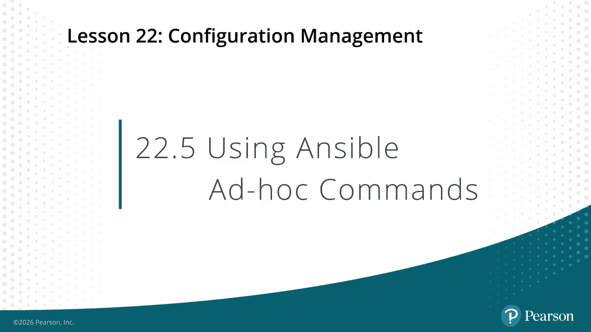
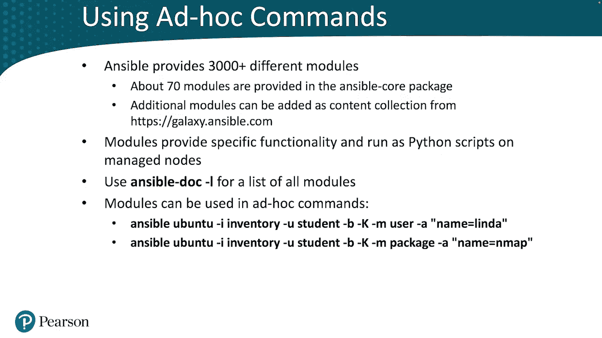
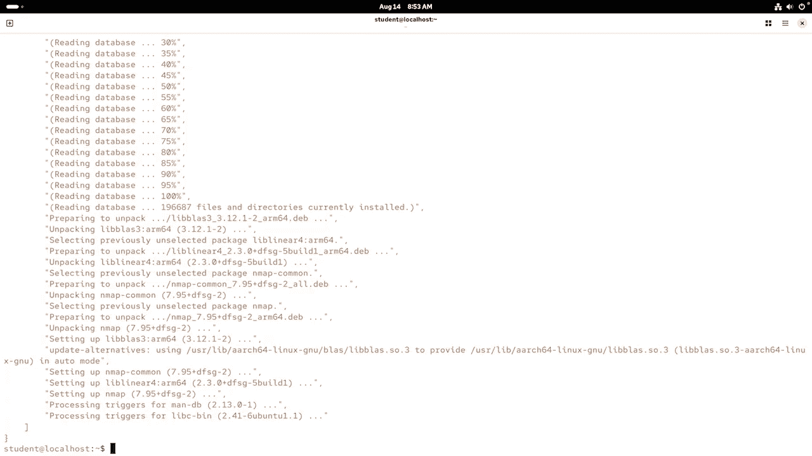

# Oreilly - CompTIA Linux+ V8：05：使用 Ansible 临时命令 🛠️




在本节课中，我们将一起学习 Ansible 的临时命令，也就是 Ad-hoc Commands。这节课的内容比较基础，非常适合刚接触 Ansible 的初学者。你会了解到 Ansible 自带多少个模块，这些模块从哪里来，怎么在命令行里直接使用它们，而不需要编写复杂的剧本文件。我们还会通过几个实际的例子，看到如何在远程主机上创建用户和安装软件，并且了解幂等性这个听起来高大实但实际上很简单的概念。


## 一、Ansible 模块的数量和来源 📦

在正式开始使用临时命令之前，我们先来聊聊 Ansible 模块本身。模块是 Ansible 执行具体操作的基本单位，没有模块，Ansible 就无法在远程主机上做任何事情。Ansible 提供的模块数量非常多，总数已经超过了 3000 个。不过，当你安装 Ansible 核心包时，默认包含的模块大约只有 70 个左右。如果这 70 个模块无法满足你的需求，还可以从 Ansible 社区网站下载额外的内容集合，也就是 Content Collections。这些内容集合是通过 HTTPS 协议提供的，官方社区网站是 galaxy.ansible.com。

每个模块都负责一项具体的功能，底层实现其实就是 Python 脚本。这也正好解释了为什么使用 Ansible 时需要 Python 环境，因为模块在被管理节点上运行时，依赖 Python 来执行具体的操作逻辑。


## 二、如何查看可用的模块列表 🔍

了解了模块的数量和来源之后，接下来的问题是，我们怎么知道具体有哪些模块可以使用呢？Ansible 提供了一个非常方便的命令，可以列出所有可用的模块，帮助你快速找到需要的功能。这些列出的模块，都可以直接在临时命令中使用。

以下是查看所有模块的命令示例：

```bash
ansible-doc -l
```


## 三、使用临时命令创建用户 👤

现在我们已经知道怎么查找模块了，那么怎么实际使用它们呢？临时命令允许你不写剧本文件，直接在命令行中调用 Ansible 模块。下面是一个具体的例子，演示如何在远程主机上创建一个名为 Linda 的用户。

以下是这条命令的各个部分含义：

- `ansible Ubuntu`：指定要管理的主机组或主机名为 Ubuntu。
- `-i inventory`：使用当前目录下的 inventory 文件作为主机清单。
- `-u student`：使用 student 用户账号进行连接。
- `-b`：使用提权特权，也就是以 root 身份执行操作。
- `-k`：提权时提示输入密码。
- `-M user`：调用 user 模块。
- `-a "name=Linda"`：传递参数，指定要创建的用户名为 Linda。

执行这条命令后，Ansible 会在远程主机上创建 Linda 用户。输出结果会显示 `changed` 为 true，说明任务已经成功完成，系统状态发生了变化。


## 四、幂等性：重复执行不会出错 🔄

刚才我们成功创建了 Linda 用户，那么如果你再次运行完全相同的命令会发生什么呢？这就是我们要介绍的幂等性概念。幂等性是 Ansible 的一个核心特性，意思是如果远程主机的当前状态已经符合你想要的状态，Ansible 就会什么都不做，不会重复创建，也不会报错。



可以用下面的公式来理解：

```
当前状态 == 期望状态 → 不需要执行任何操作
```

回到刚才的例子，如果你再次运行创建 Linda 用户的命令，输出会显示 `changed` 为 false，并提示用户已经存在，不需要任何工作。这就是幂等性在起作用，它保证了重复执行不会导致意外的副作用，让自动化运维更加安全可靠。


## 五、使用 package 模块安装软件 📥

除了创建用户，Ansible 模块也可以用来安装软件包。package 模块非常灵活，它可以在不同的 Linux 发行版上安装软件，不需要你关心底层是用 apt 还是 yum，Ansible 会自动处理这些差异。

以下是安装 nmap 软件包的命令示例：

```bash
ansible Ubuntu -i inventory -u student -b -k -M package -a "name=nmap"
```

安装软件包可能需要一点时间，因为远程主机需要下载并解压软件包，但命令执行完成后，nmap 就会出现在远程主机上，随时可以使用。


## 六、command 模块与最佳实践 ⚖️

有时候你可能找不到专门的 Ansible 模块来完成某个任务。这时候可以用 command 模块，直接在远程主机上运行普通的 Linux 命令。command 模块是一个兜底方案，适用于那些没有现成模块的情况。

不过 Ansible 有一条黄金法则：只要有专用模块可用，就应该优先使用专用模块，而不是命令模块。专用模块通常更安全，也更符合 Ansible 的设计理念，能够更好地处理幂等性和错误恢复。


## 总结



本节课中，我们一起学习了 Ansible 临时命令的基本用法。我们知道 Ansible 核心包里大约有 70 个模块，总数超过 3000 个，额外模块可以通过 galaxy.ansible.com 获取。我们学习了如何用 ansible-doc 查看模块，如何用 user 模块创建用户，如何用 package 模块安装软件，还掌握了幂等性这个重要概念，并了解了 command 模块与专用模块的选择原则。希望这些内容能帮助你快速上手 Ansible 的临时命令。

