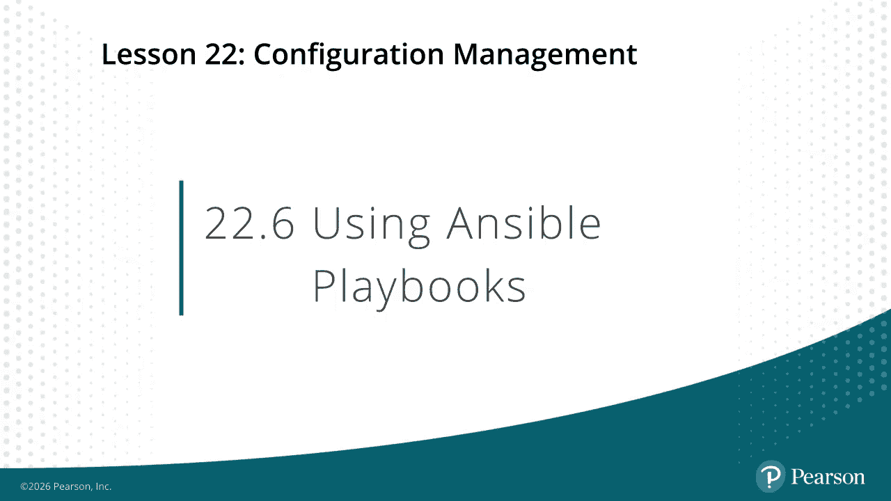
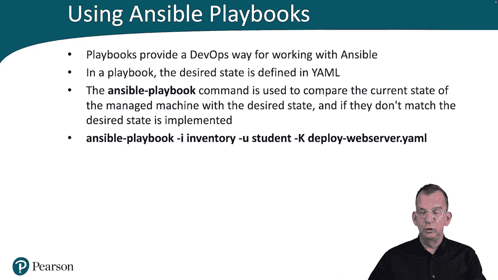
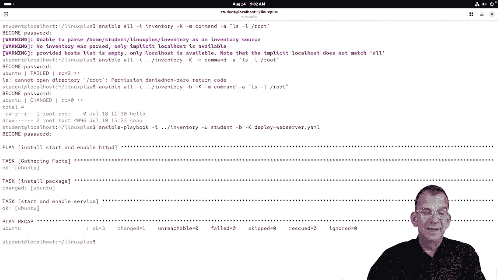

# CompTIA Linux+ V8：p56：使用 Ansible Playbooks ⚙️

在本节课中我们将要学习 Ansible Playbooks 的基本概念，理解它是如何以 DevOps 的方式帮助我们管理机器状态的，并掌握如何获取、阅读和运行一个实际的 Playbook，最后还会学习如何排查运行过程中常见的权限问题，确保你能够顺利完成自动化部署任务。

---

上一节我们介绍了 Ansible 的基础命令用法，本节中我们来看看 Ansible Playbook 是如何工作的。Playbook 是 Ansible 中用来定义“期望状态”的核心文件。所谓期望状态，就是我们希望被管理机器达到的配置样子，比如某个软件包必须安装、某个服务必须运行处于启动状态。Ansible 会把机器当前的实际状态和这个期望状态做对比，如果两者不一致，就会自动去修复，把机器配置成我们想要的样子。

可以用下面这个公式来理解这个过程：

`当前状态 != 期望状态 → 自动应用期望状态`



---

以下是运行 Playbook 的典型命令格式，你可以直接参考。

```bash
ansible-playbook -I inventory -U students -K deploy_web_server.yml
```

这里 `-I` 指定清单文件，`-U` 指定远程登录用户，`-K` 会提示输入提权密码。

要访问课程提供的 Playbook，我们需要先从 Git 仓库把代码下载到本地。使用 `git clone` 命令把仓库拉取下来，然后进入对应目录，就能看到 Playbook 文件了。

以下是克隆仓库并进入目录的命令示例：

```bash
git clone https://github.com/summernervanvert/Linux_plus.git
cd Linux_plus
```

克隆完成后，你会得到一个名为 `Linux_plus` 的目录，在这个目录里找到名为 `deploy_web_server.yml` 的文件，这就是我们要用的 Playbook。

这个 Playbook 是用 YAML 语言写出来的。在 YAML 里面，缩进非常重要，因为它用来表示父对象和子对象之间的从属关系。文件开头有一个 play header，告诉我们这个 Playbook 会在所有主机上执行，然后是一个任务列表。第一个任务用 apt 模块安装 Apache2 软件包的最新版本，第二个任务用 service 模块确保 Apache2 服务处于启动状态，并且设置为开机自启，这样目标机器重启后服务也会自动起来。

以下是 Playbook 中主要任务的简要说明：

- 安装 Apache2 软件包，使用 apt 模块，保持最新版本。
- 启动 Apache2 服务，并设置开机自启，使用 service 模块。

运行 Playbook 时，我们使用 `ansible-playbook` 命令。因为 Playbook 文件里面已经写好了要针对哪些主机执行，所以不需要再单独指定主机名。由于没有预设默认用户，需要用 `-U student` 指定远程用户，并用 `-K` 提示输入提权密码。

以下是运行命令的完整示例：

```bash
ansible-playbook -I inventory -U student -K deploy_web_server.yml
```

第一次运行的时候，可能会遇到“找不到 inventory 文件”的错误。这是因为 inventory 清单文件并不在当前目录里。解决办法也很简单，把 `-I` 后面的路径改成 `./inventory`，告诉 Ansible 去当前目录下的 inventory 文件查找主机列表。

修改后的命令如下：

```bash
ansible-playbook -I ./inventory -U student -K deploy_web_server.yml
```

重新运行之后，你可能会在远程 Ubuntu 机器上看到几条错误消息，错误信息里会提示“could not open lock”这类问题。这通常是权限不足引起的，普通用户没有权限去修改系统级的锁文件。

为了确认是不是权限问题，我们可以举另一个例子来测试。使用 `ansible all` 命令，指定 inventory、指定命令模块，去列出根目录下的内容，看看权限是否足够。

以下是权限测试命令：

```bash
ansible all -I inventory -M command -a "ls -l /root" -K -U student
```

执行的时候，系统会先提示输入提权密码。如果不加特殊选项，运行结果会提示“权限不足”。这里有个关键点：Ansible 要想使用提权权限，必须加上 `-B` 选项，`B` 代表 become，也就是切换到超级用户执行。只有同时加上 `-B` 和 `-K`（提示输入提权密码），命令才能正常工作。

以下是带提权选项的测试命令：

```bash
ansible all -I inventory -M command -a "ls -l /root" -B -K -U student
```

加上 `-B` 之后，`ls -l /root` 就能正常运行了，说明问题确实出在提权上。

回到刚才的 Playbook，我们需要做同样的调整，给 `ansible-playbook` 命令也加上 `-B` 和 `-K` 选项。输入提权密码之后，Ansible 就会开始收集目标机器的各种属性，这些属性可以在 Playbook 的条件判断里使用。接着它会安装软件包、启动并启用服务，等这些步骤全部完成，Playbook 就执行完毕了。

---



本节课中我们一起学习了 Ansible Playbook 的基本原理，了解了它如何对比当前状态和期望状态并自动修复配置，学会了如何从 Git 仓库获取并阅读 YAML 编写的 Playbook，掌握了运行 Playbook 的命令方法，也学习了如何排查和解决运行过程中的权限问题，通过添加 `-B` 和 `-K` 选项成功完成了 Web 服务器的部署任务。

