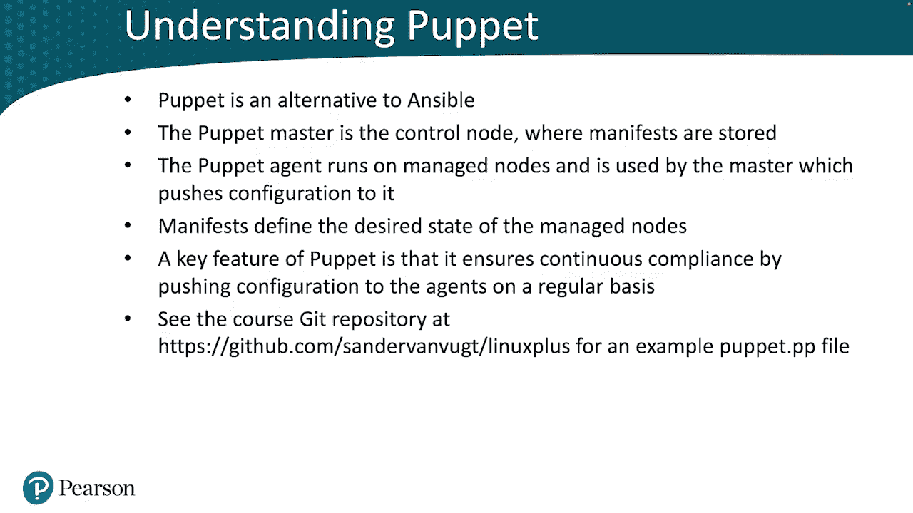
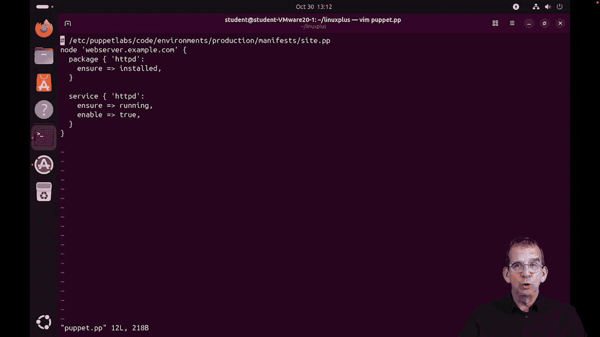

CompTIA Linux+ V8：05：Puppet 核心组件简介 🧩


在本节课中，我们将学习 Puppet 的核心组件，搞清楚 Puppet 是什么，它和 Ansible 有什么不同，以及 Puppet 的配置文件长什么样。这部分内容对理解 Linux 自动化运维非常重要，尤其是当你需要管理大量服务器时，手动配置已经不现实了，所以我们需要一种工具来帮助我们统一管理所有机器的状态。


什么是 Puppet


Puppet 是一种自动化配置管理工具，它可以看作是 Ansible 的替代方案。在 Ansible 变得非常流行之前，Puppet 曾经是行业里非常主流的选择，很多公司都在用它来管理服务器。如果你现在接触自动化运维，了解 Puppet 的基本思想对你以后学习其他工具也会有帮助。


Puppet Master 与 Manifests


在 Puppet 的架构中，Puppet Master 是一个控制节点，所有的配置定义都存放在这个节点上。这些配置定义被称作 Manifests，也就是清单文件。Manifests 的作用是描述被管理系统的期望状态，简单来说，就是告诉 Puppet 你希望每台服务器最终变成什么样子，比如哪些软件应该安装，哪些服务应该运行。


Puppet Agent 与配置下发


Puppet Agent 运行在被管理的节点上，它负责从 Puppet Master 接收配置并应用到本地。Puppet Master 会主动把配置推送给 Agent，这样管理员就不需要一台台登录服务器去操作了。整个流程可以用下面的关系来表示：

```text
Puppet Master -> 推送配置 -> Puppet Agent -> 应用到被管节点
```


Puppet 与 Ansible 的两个根本区别


Puppet 和 Ansible 虽然都是自动化工具，但它们有两个根本的不同之处：

以下是 Puppet 与 Ansible 的主要区别：

- Puppet 需要在被管理节点上安装 Agent 软件，而 Ansible 不需要。
- Puppet Master 可以主动把配置推送给 Agent，而 Ansible 通常是通过 SSH 连接去执行任务。


Manifests 与 Playbooks 的类比


Manifests 定义了被管节点的期望状态，它们的作用类似于 Ansible 中的 Playbooks。如果你之前学过 Ansible，那么你可以把 Manifests 想象成 Playbook 的 Puppet 版本，都是用来描述“目标系统应该是什么样”的文件。


持续合规性




Puppet 的一个关键特性是，它可以通过定期向 Agent 推送配置来确保持续合规。这意味着即使有人手动修改了服务器上的某个设置，Puppet 也会在下次周期性检查时，把配置还原回期望状态，保证系统始终符合管理员定义的标准。


Puppet 配置文件示例


你可以查看相关的代码仓库，找到 Puppet 配置文件的示例。Puppet 的标准文件扩展名是 .pp，例如 site.pp 就是一个典型的 Puppet 配置文件。

以下是一个极其简单的 Puppet 配置文件示例，用于确保 Web 服务器已安装并且正在运行：

```puppet
# site.pp
package { 'httpd':
  ensure => installed,
}

service { 'httpd':
  ensure => running,
}
```


Puppet 文件的语法


Puppet 配置文件不像 Ansible 使用 YAML 格式，Puppet 使用的是一种明显更复杂的语法。初学者刚开始看的时候可能会觉得不太直观，但只要理解了它的资源声明方式，后面编写配置就会容易很多。




在本节课中，我们一起学习了 Puppet 的核心组件，包括 Puppet Master、Puppet Agent 和 Manifests，了解了 Puppet 与 Ansible 在安装 Agent 和配置下发方式上的区别，还看到了一个简单的 .pp 配置文件示例。希望这些内容能帮助你建立对 Puppet 的初步认识。

