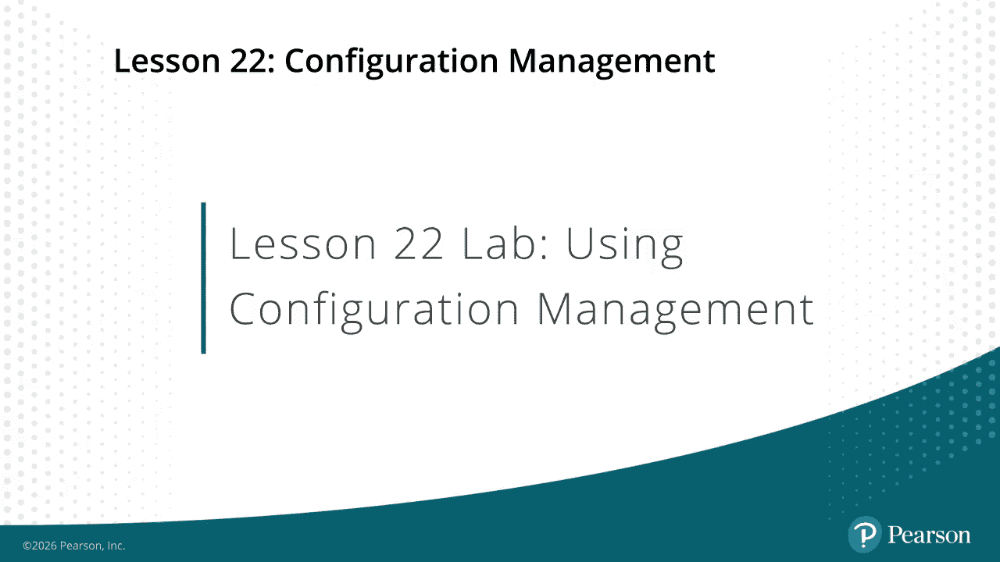
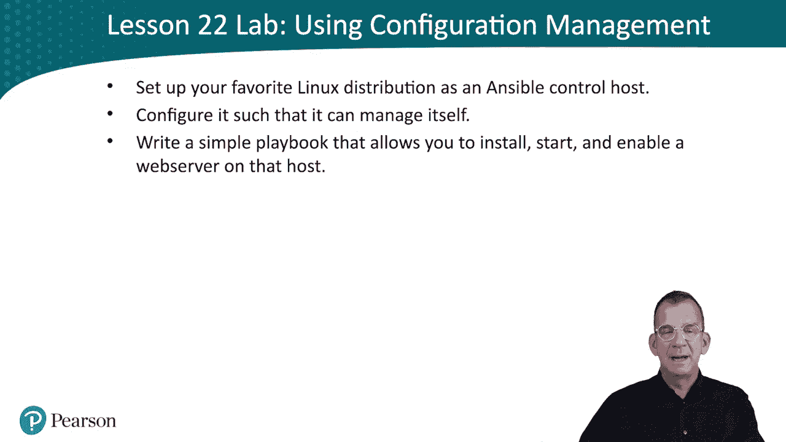

CompTIA Linux+ V8：第22课：使用配置管理实验

👨‍💻 本节课概述

在本节课中，我们将一起学习如何使用配置管理工具来简化Linux系统的日常运维工作。具体来说，我们会把其中一台Linux机器设置成Ansible控制主机，然后让它来管理自己，最后编写一个简单的Playbook，在本机上安装、启动并开机自启一个网页服务器。通过这个实验，你可以亲身体验配置管理是如何让重复性的系统操作变得自动化和可重复的，即使你是初学者，也能跟着步骤一步步完成。

---\n\n

🖥️ 第一节：什么是Ansible控制主机

上一节我们介绍了配置管理的基本概念，本节中我们来看看Ansible控制主机到底是做什么用的。

简单来说，Ansible控制主机就是那个“发号施令”的机器。你不需要在每台被管理的服务器上安装客户端程序，只需要在控制主机上安装Ansible，然后通过SSH去连接其他机器就行了。就好比你坐在办公室里，用一台电脑远程控制家里的几台服务器，不需要跑到机房去一台一台地操作。

在这次实验中，我们把控制主机和被管理的主机设为同一台机器，也就是说，这台Linux发行版既要下指令，又要执行指令。这种做法非常适合初学者练手，因为你不需要准备多台虚拟机，一台就够了。


Ansible控制主机与被管理主机的关系可以用下面的公式来描述：

```text
控制主机 (Ansible installed) --SSH--> 被管理主机 (目标系统)
```



当控制主机和被管理主机是同一台时，关系就变成了：

```text
本机 (Ansible控制主机) --本地连接--> 本机 (被管理目标)
```

---\n\n

📦 第二节：设置你喜欢的Linux发行版

本节我们来看看如何把一台Linux发行版配置成Ansible控制主机。以下是具体步骤：

- 先确认你的系统已经安装了Python，因为Ansible依赖Python才能正常运行。
- 使用系统自带的包管理器安装Ansible软件包，比如在基于Red Hat的系统上用dnf，在基于Debian的系统上用apt。
- 安装完成后，运行`ansible --version`命令检查版本信息，确认Ansible已经就绪。

安装完成后，你需要确保控制主机可以通过SSH连接到自己。这意味着你要在本机上开启SSH服务，并且允许本地主机以免密码或者密钥方式登录。不过为了实验方便，我们也可以直接在Ansible配置里指定使用本地连接方式，避免复杂的SSH秘钥设置。

---\n\n

⚙️ 第三节：配置控制主机管理自己

在上一节我们安装好了Ansible，本节中我们来看看如何让这台机器管理自己。

要让Ansible控制主机管理自己，最简单的方法就是把本机添加到Ansible的主机清单里。主机清单是一个文本文件，里面记录了Ansible需要管理哪些机器。我们可以把`localhost`写进去，并且告诉Ansible使用本地连接而不是SSH，这样就不需要配置复杂的网络信任关系了。

以下是一个典型的主机清单示例：

```ini
[webservers]
localhost ansible_connection=local
```

有了这个清单，Ansible就知道接下来要对谁下指令了。这时候你可以试着运行一个简单的命令来测试连通性，比如用`ansible all -m ping`看看本机是否能正常响应。如果看到返回的pong消息，就说明控制主机已经可以管理自己了。

---\n\n

📝 第四节：编写简单的Playbook

前面我们把控制主机配置好了，并且验证了它能管理自己，本节中我们来看看如何编写一个简单的Playbook来安装网页服务器。

Playbook就是Ansible的“任务清单”，用YAML语言写成，里面列出了你想要在目标机器上完成的一系列操作。在这个实验里，我们要做的任务非常明确：安装网页服务器软件，启动它，并且设置为开机自启。下面是一个可以直接使用的示例代码：

```yaml
---
- name: Install and start a web server
  hosts: localhost
  become: yes
  tasks:
    - name: Install web server package
      ansible.builtin.package:
        name: httpd
        state: present

    - name: Start and enable web server
      ansible.builtin.service:
        name: httpd
        state: started
        enabled: yes
```

这段代码的意思是：先在本机上安装名为httpd的软件包，然后启动httpd服务，并且把它加入开机自启列表。运行完这个Playbook之后，你就可以打开浏览器，访问本机的80端口，看看网页服务器是否已经正常工作了。



---\n\n

📚 本节课总结

本节课中我们一起学习了如何把一台Linux发行版设置成Ansible控制主机，如何配置它来管理自己，以及如何编写一个简单的Playbook来安装、启动并启用网页服务器。通过这个实验，你应该已经掌握了配置管理的基本操作流程，理解了控制主机与被管理主机的关系，并且学会了使用Ansible Playbook来自动化系统任务。希望这些内容能帮助你在实际工作中更高效地管理Linux系统。

