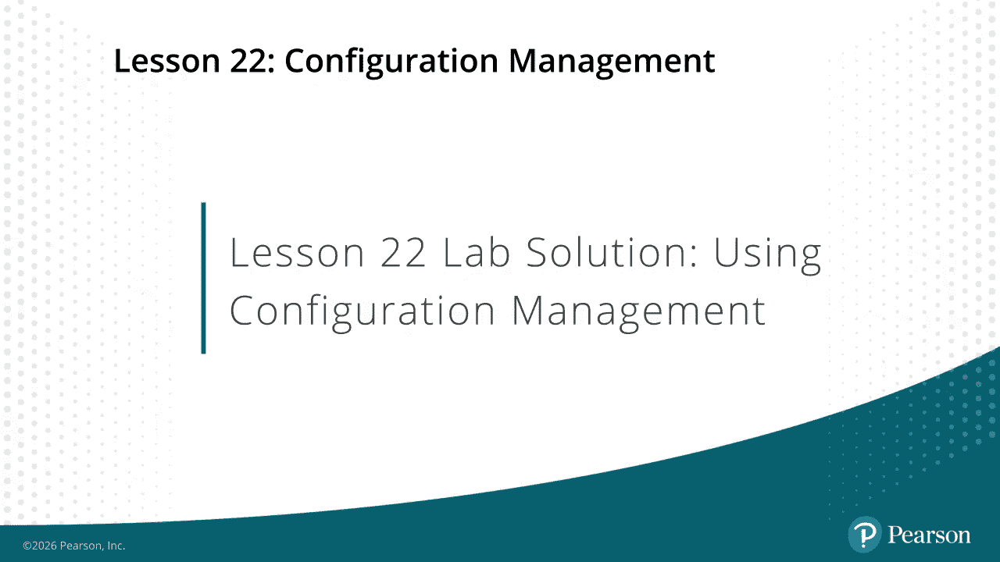
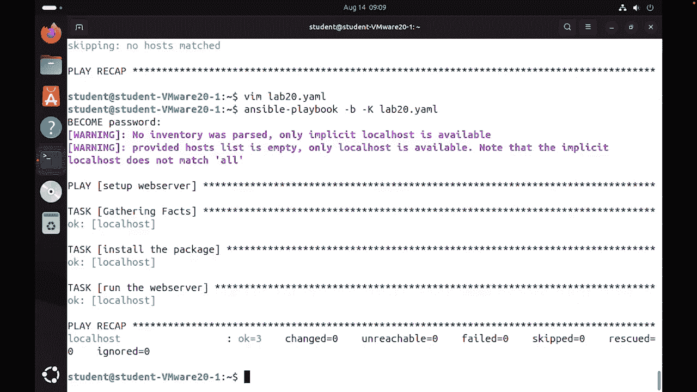

⚙️CompTIA Linux+ V8：第22课：使用配置管理实验解答



在本节课中，我们将学习如何把 Ubuntu 桌面版设置成 Ansible 控制主机，并使用配置管理工具来管理本机。我们会一步步配置 SSH 免密登录，运行第一个 Ansible 测试，编写第一个 Ansible 剧本，安装并启动 Apache2 服务器，最后验证配置是否生效。通过这个实验，你将掌握使用 Ansible 进行基础配置管理的完整流程。


### 第一步：准备 Ansible 控制主机

首先，我们来看看如何准备 Ansible 控制主机。

在这个实验中，我将使用 Ubuntu 桌面版作为 Ansible 控制主机，你也可以在自己的机器上按照同样的步骤操作。Ansible Core 软件包在很多发行版的官方软件仓库里都有提供，所以安装起来非常方便。我们需要先使用 sudo 获取超级用户权限，然后安装所需的软件包，这就完成了控制主机的基础准备工作。

以下是安装命令：

```bash
sudo apt update
sudo apt install ansible-core
```


### 第二步：配置本地 SSH 免密登录

上一节我们介绍了如何安装 Ansible Core，本节中我们来看看如何让控制主机管理自己。

虽然听起来有点好笑，但 Ansible 完全可以用来管理本机。即使只使用 localhost，我们也需要配置 SSH，否则无法通过 SSH 连接到本地主机。第一步是生成 SSH 密钥对，第二步是把公钥复制到本地主机，这样就可以不用输入密码就通过 SSH 登录 localhost 了。因为当前用户已经拥有超级用户权限，所以不需要额外处理权限问题。而且 localhost 始终可用，所以我们不需要编写主机清单文件。

以下是配置命令：

```bash
ssh-keygen
ssh-copy-id localhost
```


### 第三步：运行第一个 Ansible 测试

配置好 SSH 之后，本节中我们来看看如何运行第一个 Ansible 测试，确认控制主机能否正常与本地主机通信。

执行 ansible localhost -m ping 命令。你会看到一条警告，说没有发现主机清单，只有隐含的 localhost 可用。这正是我们需要的结果，说明配置正确，Ansible 已经能够与本地主机进行通信了。

以下是测试命令：

```bash
ansible localhost -m ping
```


### 第四步：编写 Ansible 剧本

上一节我们完成了基础连通性测试，本节中我们来看看如何编写 Ansible 剧本，定义要在本机上完成的任务。

使用 vim 创建名为 lab20.yml 的文件。在剧本中，我们要定义剧本名称、目标主机以及具体任务。第一个任务是安装软件包，在 Ansible 中应该尽量使用最具体、最合适的模块，所以这里选择 apt 模块来安装 apache2。第二个任务是管理服务，使用 service 模块来启动 Apache2 并设置开机自启，这样 web 服务器就会按我们期望的方式运行。

以下是剧本内容：

```yaml
- name: set web server
  hosts: localhost
  tasks:
    - name: install packets
      apt:
        name: apache2
        state: present
    - name: start apache2
      service:
        name: apache2
        state: started
        enabled: yes
```


### 第五步：使用 ansible-doc 查看模块参数

编写剧本时经常会遇到参数不确定的情况，本节中我们来看看如何使用 ansible-doc 查看模块说明。

我不太确定 service 模块的具体参数，因此使用 ansible-doc service 命令查询。文档告诉我们，enabled 参数是布尔值，state 参数可以是 started、stopped、reloaded 等。有了这些信息，我们就可以继续完成剧本编写，设置 state 为 started，enabled 为 true，确保服务既启动又开机自启。

以下是查询命令：

```bash
ansible-doc service
```


### 第六步：运行剧本并验证结果

上一节我们介绍了如何查阅模块文档，本节中我们来看看如何运行剧本并验证结果。

使用 ansible-playbook 命令运行剧本，需要加上 -b 参数获取提权，加上 -k 参数提示输入密码。不需要指定主机清单，因为 Ansible 会使用当前用户名和隐含的 localhost。第一次运行时，可能会提示主机名不匹配，这时需要检查剧本中的 hosts 字段，确保写的是 localhost 而不是拼写错误的 local hosts。修改后再次运行，输入密码，你会发现任务显示为 ok，原因很简单：当前状态已经符合剧本中定义的期望状态，Ansible 不需要做任何改变，这也体现了配置管理的幂等性特点。

以下是运行命令：

```bash
ansible-playbook -b -k lab20.yml
```


### 总结



本节课中，我们一起学习了如何把 Ubuntu 桌面配置成 Ansible 控制主机，设置 SSH 免密登录，运行第一个 Ansible 测试，编写并运行 Ansible 剧本，安装并启动 Apache2 服务。通过这个实验，你已经掌握了使用 Ansible 进行基础配置管理的方法。
