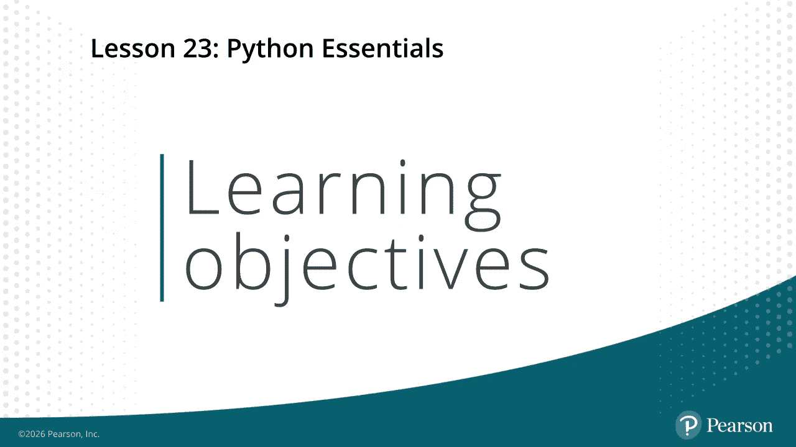
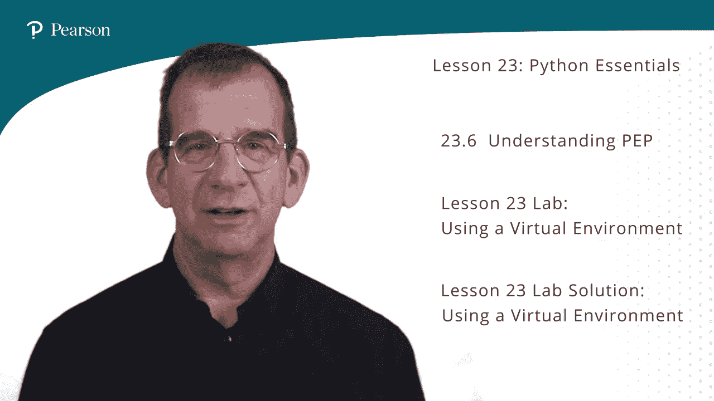

# Python Essentials：第 1 课：Linux 管理中的 Python 基础 🐍


在本节课中，我们将学习 Python 脚本提供的不同功能。这节课的重点不是教你怎么编写 Python 脚本，而是让你了解在 Linux 系统上管理 Python 时需要掌握的实用技能。


## 课程概述 📋


接下来我们先来看看本节课的具体安排，以下是详细内容：



- 设置 Python 虚拟环境，并学习 pip 中的位和包相关知识
- 探索如何使用模块
- 学习数据类型和数据结构
- 探索模块和包
- 了解 PEP（Python 增强建议）
- 在课后实验中使用 Python 虚拟环境完成示例练习


## 设置虚拟环境与位和包 🛠️


上面我们介绍了本节课的学习目标，本节我们来看看如何设置 Python 虚拟环境。

虚拟环境可以看作是一个独立的 Python 运行空间，里面的包和设置不会干扰系统自带的 Python，代码表示如下：

```python
# 创建虚拟环境
python -m venv myenv

# 激活虚拟环境
source myenv/bin/activate
```

在这个环境里，你可以放心地安装和管理各种 Python 包，不会影响到操作系统本身。我们还会学习位和包的基础知识，帮助你理解 Python 在 Linux 系统中是如何运行的。


## 使用模块 📦


在了解了虚拟环境之后，本节我们来看看模块的使用方法。

模块本质上是一个包含 Python 代码的文件，你可以在其他程序中导入它，代码表示如下：

```python
import math
print(math.sqrt(16))
```

通过使用模块，你可以直接调用别人写好的功能，而不需要从头开始编写所有代码。这对于 Linux 系统管理员来说非常有用，因为很多系统管理工具都是基于 Python 模块构建的。


## 数据类型和数据结构 🔢


学习完模块的使用后，本节我们来看看 Python 中的数据类型和数据结构。

常见的数据类型包括整数、字符串、列表和字典等，代码表示如下：

```python
# 整数
age = 25

# 字符串
name = "Linux"

# 列表
fruits = ["apple", "banana", "cherry"]

# 字典
user = {"name": "admin", "role": "root"}
```

数据结构决定了数据在计算机内存中的组织方式，掌握这些基础知识能帮助你编写出更高效的系统管理脚本。


## 模块和包 📚


前面我们介绍了数据类型和数据结构，本节我们继续探索模块和包。

包可以看作是多个模块的集合，通常用于组织较大的项目，代码表示如下：

```python
from package.module import function
```

合理使用模块和包，能让你的 Python 代码结构更清晰、更易于维护，这也是 Linux 管理员需要掌握的重要技能之一。


## PEP（Python 增强建议） 📄


在了解了模块和包之后，本节我们来看看 PEP。

PEP 的全称是 Python Enhancement Proposal，也就是 Python 增强建议，代码表示如下：

```python
# PEP 8 是 Python 代码风格指南示例
# 使用 4 个空格进行缩进
def my_function():
    pass
```

PEP 定义了 Python 语言的规范和最佳实践，遵循这些标准能让你的代码更符合社区习惯，也更容易被其他人阅读。


## 课后实验 🧪


在完成上面所有内容之后，本节我们来看看课后实验。

你将使用 Python 虚拟环境完成一个示例练习，把本节课学到的所有知识点串联起来进行实践。




## 本节总结 ✅


本节课中我们一起学习了 Python 脚本的不同功能，重点掌握了在 Linux 上管理 Python 所需的技能，包括虚拟环境设置、模块使用、数据类型和结构、模块与包以及 PEP 规范。


