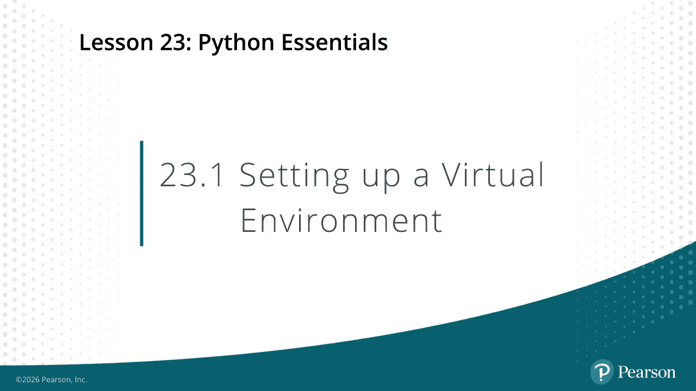
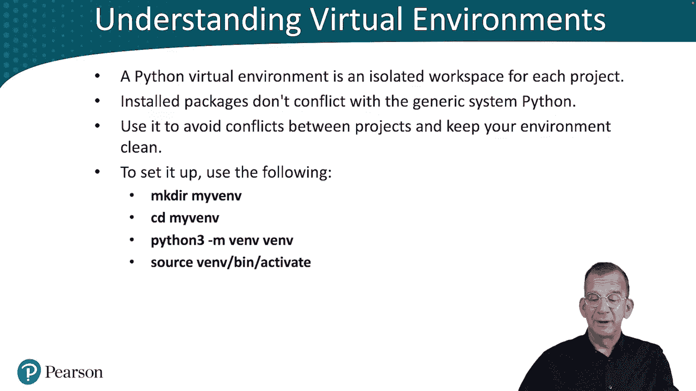

# Oreilly CompTIA Linux+ V8：231：🐍 设置Python虚拟环境

## 课程概述

在本节课中我们将要学习关于Python虚拟环境的基础知识。首先我们会聊聊为什么在准备Linux Plus认证的时候，了解Python是非常必要的。接着我们会解释什么是Python虚拟环境，它能帮我们解决什么实际问题。最后我们会一步步演示如何在Linux系统中创建并激活一个虚拟环境，让你的开发环境保持整洁。


## 为什么Linux Plus需要学习Python



上一节我们介绍了Linux系统的基础命令，本节中我们来看看Linux Plus认证中为什么特别强调Python的原因。Python是Linux系统中主要的脚本语言之一。这句话的意思是，很多系统工具和自动化任务都是用Python写的。它背后支撑着很多应用程序。如果你不了解Python，可能会在日常运维工作中遇到麻烦。所以学习Python不仅是为了通过考试，也是为了更好地理解Linux系统是如何运转的。

## 什么是Python虚拟环境

刚才我们说到了Python的重要性，那实际使用Python开发时，经常会遇到一个棘手的问题。A Python virtual environment is an isolated workspace that can be used for each project to make sure that these projects have its own dependencies。用大白话来说，Python虚拟环境就是一个独立的工作空间。每个项目都可以拥有自己的虚拟环境，里面安装的库和工具只属于这个项目。这样做的好处非常直观，就是让每个项目拥有自己的依赖项。So install packages don't conflict with generic system python and also not with each other。也就是说，你安装的第三方包既不会和系统自带的Python发生冲突，也不会和其他项目的包打架。You can use it to avoid conflicts between products and to keep your environment clean。使用虚拟环境还能帮你避免不同产品之间的依赖冲突，让整个开发环境保持干净整齐，不至于变成一团乱麻。

核心概念可以用下面这个简单的公式来理解：

```text
Python虚拟环境 = 隔离工作空间 + 项目独立依赖 + 避免包冲突
```

## 如何设置Python虚拟环境

现在我们已经明白了虚拟环境的作用，下面进入实操环节。To set it up。要设置Python虚拟环境，你需要按照顺序执行几条命令。

### 第一步：创建项目目录

下面是具体操作步骤，请仔细跟随。use the following，start by creating a directory as in MD my VN。第一步，你需要先创建一个文件夹，用来存放你的虚拟环境。在Linux终端中，可以使用类似下面的命令：

```bash
mkdir myVn
```

执行完这个命令后，你就创建了一个名为myVn的目录，后续的操作都会在这个目录里面进行。

### 第二步：进入项目目录

创建好目录之后，你需要切换到这个目录里面去。then you use C my VN to change directory into the virtual environment。具体操作如下：

```bash
cd myVn
```

这条命令的作用是把当前工作目录切换到myVn，这样你接下来创建的虚拟环境文件就会放在这个地方，而不是散落在系统的其他位置。

### 第三步：创建虚拟环境

进入目录之后，就可以正式创建虚拟环境了。And then you can use command Python 3 minus MvN VN。which will open the virtual environment。使用下面的命令来初始化虚拟环境：

```bash
python3 -m venv VN
```

这条命令会在当前目录下创建一个名为VN的虚拟环境文件夹。里面包含独立的Python解释器和相关的库文件，相当于为这个项目专门搭建了一个小型的Python运行环境。

### 第四步：激活虚拟环境

虚拟环境创建好之后，还需要把它激活才能使用。a final step is where you are going to source the command VN s activate that all activate the virtual environment。你需要执行激活脚本：

```bash
source VN/bin/activate
```

激活之后，你的终端提示符通常会发生变化，表示你已经进入了虚拟环境。and you will be there until you exit the virtual environment。这意味着你会一直待在这个虚拟环境里面，直到你手动退出为止。在这个状态下，你用pip安装的所有包都会只影响当前的虚拟环境，不会污染系统的Python。



## 课程总结

本节课中我们一起学习了Python在Linux Plus认证中的重要性，也了解了什么是Python虚拟环境。我们学习了如何创建目录、进入目录、使用python3 -m venv命令创建虚拟环境，以及使用source命令激活它。通过这些步骤，你可以为每个项目建立独立的Python环境，避免依赖冲突，保持系统整洁。
