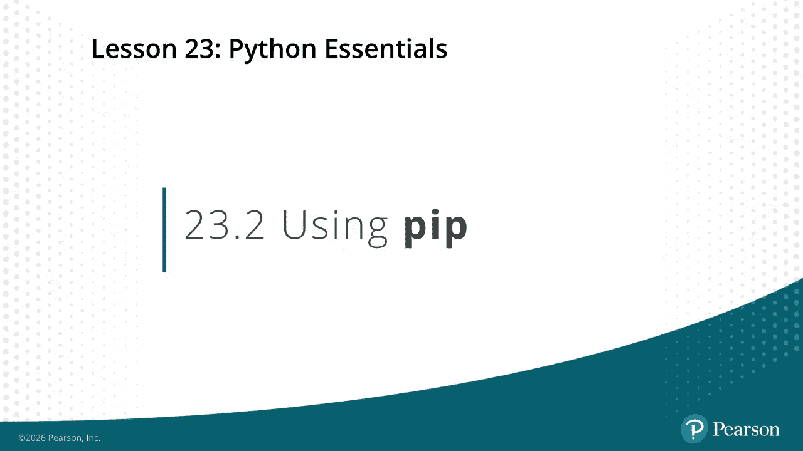
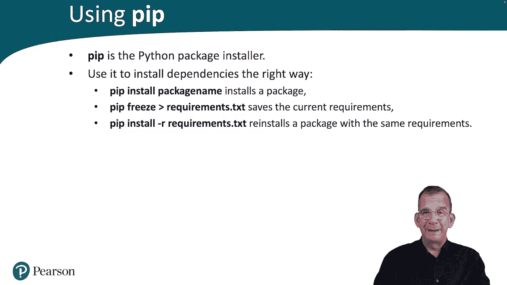

# Oreilly CompTIA Linux+ V8：462.232：使用 Pip 🐍


在本节课中我们将要学习 Pip 这个工具到底是干什么的，怎么用它来安装 Python 包，怎么把当前环境的依赖保存到文件里，以及怎么用这个文件重新安装同样的包。这些内容对初学者非常实用，因为 Python 开发离不开各种第三方库，而 Pip 就是管理这些库的标准方式。我们会用大白话把每一步都讲清楚，确保没有基础的朋友也能看懂。


## 什么是 Pip


Pip 是一个专门用于安装 Python 包的工具。你可以把它理解为 Python 世界里的应用商店命令行版本，专门负责把你需要的代码库下载到本地。



它和 Linux 系统里常见的包管理器比如 apt 或 dnf 是分开的，也就是说你不能用 apt 来安装 Python 包，也不能用 dnf 来管理 Python 的依赖，这时候就需要 Pip 出场了。

以下是 Pip 的核心定义：

- Pip 是 Python 官方推荐的包安装程序。
- 它专门处理 Python 第三方库的下载、安装和卸载。
- 它与系统级包管理器（如 apt、dnf）并行工作，不冲突。


## 使用 Pip 安装包


在了解了 Pip 是什么之后，接下来我们看看怎么用它来安装一个 Python 包。操作非常简单，只需要在终端里输入安装命令即可。

以下是安装包的命令格式：

```bash
pip install <包名>
```

这里的 `<包名>` 就是你想安装的 Python 库的名称，比如 requests、numpy 或者 pandas。执行这条命令后，Pip 会自动从 Python 包索引里下载对应的库，并把它安装到你当前的 Python 环境中。


## 保存当前依赖列表


安装完各种 Python 包之后，通常需要把当前环境里所有已安装的包及其版本号保存下来，方便以后迁移或备份。这时候就要用到 Pip 的 freeze 功能了。

以下是保存依赖的命令：

```bash
pip freeze > requirements.txt
```

这条命令的意思是，把当前环境中所有已安装包的名称和版本号输出到一个叫 requirements.txt 的文件里。这个文件就像是一张清单，记录了你项目依赖的确切版本。


## 使用依赖列表重新安装包


有了 requirements.txt 文件之后，你就可以在另一台电脑或者重新配置的环境里，按照同样的清单把所有包装好。不需要一个包一个包地手动安装，Pip 可以一次性处理。

以下是重新安装依赖的命令：

```bash
pip install -r requirements.txt
```

这里的 `-r` 参数表示从指定文件读取依赖列表，Pip 会读取 requirements.txt 里的每一行，并按照记录的版本重新安装对应的包。这样就能保证不同环境里的依赖保持一致。




## 总结


本节课中我们一起学习了什么是 Pip，怎么用它安装 Python 包，怎么用 pip freeze 把依赖保存到 requirements.txt，以及怎么用 pip install -r 根据清单重新安装包。这些是 Python 开发中最基础也最常用的操作，掌握之后你就可以方便地管理项目所需的第三方库了。


