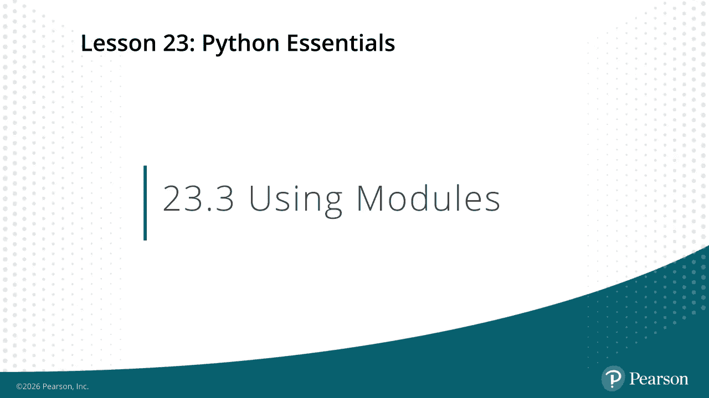
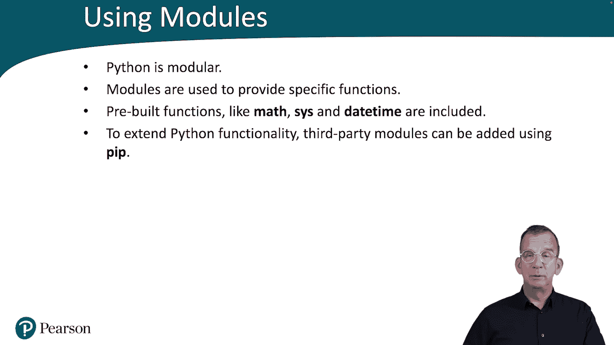

# 🐍 CompTIA Linux+ V8：5：使用模块 (Using Modules)

在本节课中我们将要学习 Python 模块的基础知识。我们会聊聊 Python 为什么天生支持模块化，模块里面到底能提供什么功能，哪些模块是默认自带不用安装的，还会说说怎么通过 pip 安装别人写的第三方模块，让 Python 能做更多事情。这里提到的 Bton modules 实际上就是指 Python 模块，后面内容中会统一用 Python 模块来表达，方便初学者理解。

## Python 天生就是模块化的


首先，我们先来看看什么是模块化，以及 Python 是如何做到天生模块化的。

Python 这门语言设计之初就把模块化当作核心特性。简单来说，模块化就是把代码拆成一个个独立的文件，每个文件负责一件事，这样你写代码的时候不用全部塞在一个文件里，也方便后来复用。你可以把模块想象成工具箱里的不同工具，需要锤子就拿锤子，需要螺丝刀就拿螺丝刀，不需要一次性把所有工具都抱在怀里。



核心用法如下：

```python
import 模块名
```

## 模块提供具体功能

上一节我们介绍了 Python 天生模块化的特点，本节中我们来看看模块具体能提供什么功能。

每个模块里面都装着一些具体的功能函数，你把模块导入进来之后，Python 就知道怎么处理这些新功能了。比如有些模块帮你做数学运算，有些帮你处理日期，有些帮你处理文件。使用模块的意思就是告诉 Python：“嘿，我要学这些额外的技能，请把它们加进来。”原文中说的 teach Python about additional features，就是这个意思。

以下是模块能提供的功能类型：

- 数学计算功能
- 日期和时间处理功能
- 文件和系统操作功能
- 网络通信功能

## 默认自带的模块

了解了模块能提供什么功能之后，我们再看看哪些模块是不需要安装就能直接使用的。

Python 安装好以后，自带一批常用模块，你直接 import 就能用，不用额外下载。原文里提到的像 math、cis 和 daytime 这样的模块，就属于默认包含在内的预构建模块。也就是说，你打开 Python 就能用它们，不需要上网找安装包，也不需要配置复杂的环境。

以下是默认包含的模块示例：

- math
- cis
- daytime

## 使用 pip 安装第三方模块

内置模块虽然方便，但功能有限，如果你需要更多功能，就得安装第三方模块。

当自带的模块不够用的时候，你可以去网上下载别人写好的模块，然后安装到自己的 Python 里。最常用的方法就是使用 pip 安装器。原文中的 BIP Pack installer 指的就是 pip。pip 就像是一个自动下载器，你告诉它想要哪个模块，它就会帮你把模块下载下来并安装好，让你的 Python 功能立刻变强大。

核心命令如下：

```bash
pip install 模块名
```



## 总结

本节课中我们一起学习了什么是模块，Python 为什么天生模块化，模块能提供哪些具体功能，哪些模块是默认自带的，以及如何用 pip 安装第三方模块。希望这些内容能帮你初步理解 Python 模块的使用方法。

