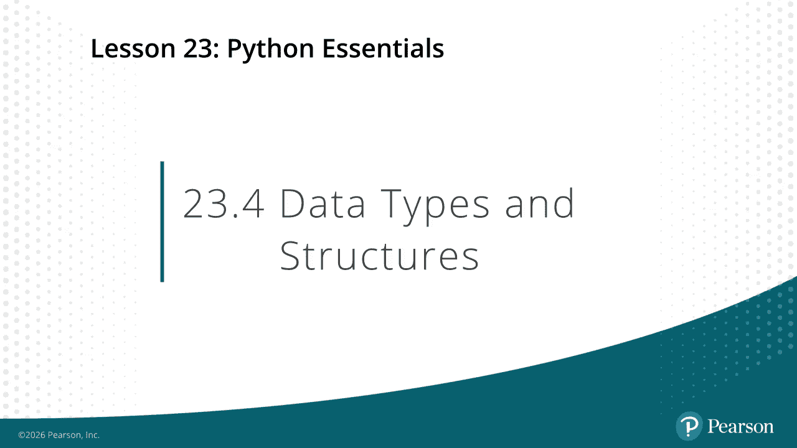
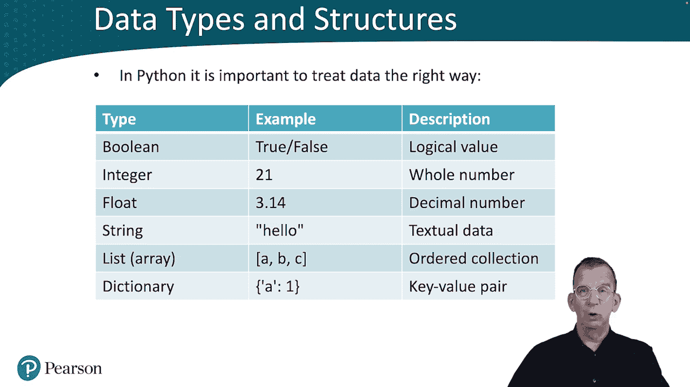

# Python基础教程：05：常见数据类型与结构🐍

在本节课中我们将要学习Python中最常见的几种数据类型和数据结构。无论你是刚开始接触编程，还是已经写过一些简单的代码，理解数据在计算机中是如何被表示和存储的，都是学习好Python的重要基础。本节内容会把抽象的概念用大白话讲清楚，并通过具体的例子展示每种类型在实际代码中的写法，方便你快速上手。




在正式介绍具体类型之前，我们先来看看Python中的布尔值。布尔值是Python中最简单的数据类型之一，它只用来表示逻辑上的对错。在编程语境中，布尔值通常只有两种可能，要么成立，要么不成立，也可以理解为开启或者关闭。下面是布尔值的典型表达形式：

```python
True
False
```

以下是布尔值的常见含义：
- True 表示条件成立，也就是“是”或“开启”
- False 表示条件不成立，也就是“否”或“关闭”


布尔值能够帮助程序做出判断，接下来我们进入下一种基础类型，即整数。整数就是没有小数部分的完整数字，在日常生活中我们也叫它整数。它是Python中处理数量、编号和计数时最常用的类型。下面是一个整数的简单示例：

```python
21
```

整数的主要特点可以用这个公式来概括：

整数 = ..., -2, -1, 0, 1, 2, ...

整数适合表示人数、年龄、楼层号这类不需要精确到小数点后面的数值。有了整数之后，我们还需要一种能够处理小数的类型。


在介绍完整数之后，本节中我们来看看浮点数。浮点数是用来表示带有小数的数值的，在Python中我们用小数点来分隔整数部分和小数部分。这种类型在处理测量值、金额或科学计算时非常有用。下面是一个浮点数的示例：

```python
3.14
```

浮点数可以用如下方式理解：

浮点数 = 整数部分 . 小数部分

比如 3.14 中的 3 是整数部分，14 是小数部分，中间用点号连接。有了浮点数，我们就能更精确地描述世界上的许多量了。


掌握了数字类型以后，本节中我们来看看字符串。字符串是Python中用来表示文本的数据类型，它把一段文字封装起来，让程序能够读取、修改和输出文字内容。在写代码时，必须把字符串放在一对双引号里面，这样Python才能识别它是字符串而不是变量名或其他指令。下面是一个典型的字符串示例：

```python
"hello"
```

字符串的识别规则如下：
- 只要内容被双引号包围，Python就会把它当成字符串
- 即使里面看起来像数字，只要加了双引号，也会被当作字符串处理

例如，下面这个例子虽然里面是数字，但因为加了双引号，所以也是字符串：

```python
"21"
```

字符串让我们能够在程序中处理名字、地址、提示信息等各种文本数据。


学完字符串之后，本节中我们来看看列表。列表在Python中也叫作数组，它是一种可以把多个项目装在一起的有序集合。你可以把列表想象成一个购物清单，里面可以放名字、数字或者其他数据，每个项目之间用逗号分隔，整个列表放在方括号内部。下面是一个列表的示例：

```python
["A", "B", "C"]
```

列表的基本写法如下：
- 用方括号 [ ] 包裹整个集合
- 每个元素之间用英文逗号分隔
- 列表里的元素可以重复，也可以是不同类型的数据

列表让我们能够一次性管理多个相关的数据，而不是为每个数据单独定义一个变量。


介绍完列表以后，本节中我们来看看字典。字典是一种存储键值对的数据结构，每个数据都由两部分组成，一部分是键，用来查找；另一部分是值，是键对应的具体内容。你可以把字典想象成真实的字典，查某个单词就是查键，解释就是值。字典使用花括号来表示，里面的键和值之间用冒号分隔。下面是一个字典的示例：

```python
{"A": 1}
```

字典的核心结构可以表示为：

{键: 值, 键: 值, ...}

字典的特点如下：
- 每个键在同一个字典里必须是唯一的
- 通过键可以快速找到对应的值
- 整个字典用花括号 { } 包裹

字典非常适合存储具有对应关系的信息，比如用户名和密码，或者商品编号和价格。


在学习完基本类型以后，本节中我们来看看如何把它们组合在一起使用。Python允许我们把列表和字典混合使用，构造出更复杂的数据结构来满足实际开发的需求。比如，你可以创建一个列表，而列表里的每一个元素本身就是一个字典。下面是一个字典列表的示例：

```python
[{"A": 1}, {"B": 2}]
```

组合数据结构的特点如下：
- 外层是方括号，表示这是一个列表
- 列表里的每一项用花括号表示，说明每一项都是一个字典
- 这样既能保持列表的顺序，又能用字典的键值方式管理每个项目的详细信息

通过这种嵌套方式，我们可以表示学生名单、产品目录或者任何需要层级关系的数据集合。




最后，本节中我们要强调一个非常重要的原则。在编写Python程序时，识别出数据的正确类型，并根据类型采取相应的处理方式，是写出可靠代码的关键。如果你把字符串当成整数来做数学运算，或者把布尔值当成列表来遍历，程序就会报错或产生错误结果。因此在开发过程中，养成先确认数据类型、再决定怎么处理的习惯，能够帮你避免很多低级问题。


在本节课中我们一起学习了Python中常见的数据类型和数据结构。我们分别介绍了用于表示对错的布尔值、没有小数的整数、带小数的浮点数、用于文本的字符串、用于集合的列表，以及用于键值对存储的字典。此外还学习了如何把列表和字典组合使用，构建更复杂的数据结构。希望这些内容能帮你建立起对Python数据类型的直观认识，为后续编程学习打下坚实基础。

