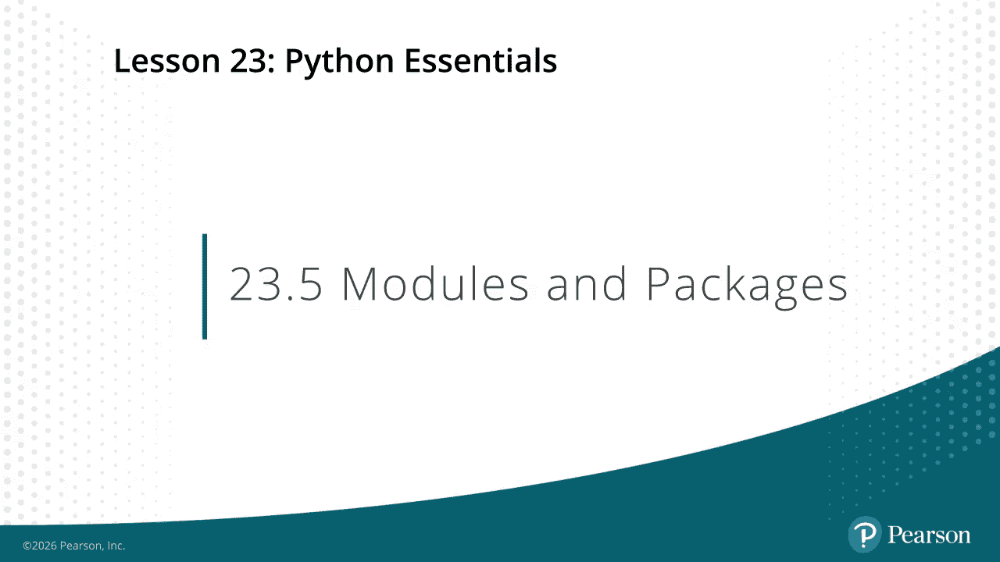
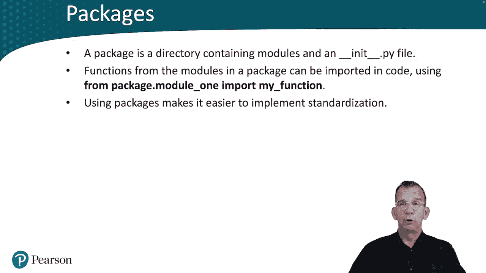

# CompTIA Linux+ V8：5：模块与包 📦




在本节教程中，我们将一起学习 Python 中的模块与包。模块和包是 Python 程序组织代码的基础方式，掌握它们能帮助你把零散的代码整理得更清晰，也能让不同的文件之间互相调用。接下来我们会逐步介绍什么是模块，如何在代码中定义和使用模块，接着讲解什么是包，包的目录结构应该怎样组织，最后讨论使用包带来的标准化优势以及 Python 可扩展性的来源。

上一节我们可能介绍过一些基础的 Python 语法，本节中我们来看看模块的概念。模块是包含代码的文件，你可以把它理解为一个专门存放功能代码的容器。比如我们可以把一个常用的函数写在模块里，这样其他地方需要的时候就可以直接引用，而不需要重复写一遍代码。

以下是模块的代码示例：
```python
# greeting.py
def say_hello(name):
    return "hello " + name
```

刚才我们看到模块是代码文件的概念，本小节中我们通过一个具体的例子来说明模块的实际样子。这里我们看到一个名为 greeting 的模块，它里面定义了一个名为 say hello 的函数。这个函数的作用是说 hello 加上名字，其中 name 是一个变量，会在调用时传入具体的值。

以下是模块中函数的定义方式：
```python
def say_hello(name):
    return "hello " + name
```

上面我们定义了模块里的函数，本小节中我们看看如何在别的文件里把它用起来。你可以在另一个文件中使用 import greeting 语句，这会把 greeting 模块导入到当前程序中。导入之后，你可以使用模块名 greeting 调用其中的 say hello 函数，比如说你想打印名字 En，就可以这样写。

以下是导入并调用模块的代码示例：
```python
import greeting
print(greeting.say_hello("En"))
```

前面几个小节我们介绍了模块的定义和使用，本小节中我们来看看包是什么。包是一个完整的目录，里面包含多个模块，还必须包含一个名为 __init__.py 的文件。这个文件告诉 Python 这个目录应该被当作一个包来处理，而不是普通的文件夹。

以下是包的目录结构示例：
```
mypackage/
    __init__.py
    module_one.py
```

刚才我们了解了包的目录结构，本小节中我们看看如何从包里面导入具体的函数。包中模块里的函数可以在代码中使用 from 包名.模块名 import 函数名 的方式来导入，这样你就可以直接使用那个函数了，而不需要先导入整个模块。

以下是从包中导入函数的代码示例：
```python
from package.module_one import my_function
```

前面我们学习了包的结构和导入方式，本小节中我们聊聊为什么要使用包。使用包能让实现代码标准化变得更加容易，因为你可以把相关的模块放在同一个目录里，统一管理。包也是 Python 取得成功的重要原因之一，正是因为有了包的机制，Python 才变得非常容易扩展，开发者可以方便地添加新功能或者复用已有的代码。



本节教程中我们一起学习了模块与包的基本概念。我们了解了模块是包含代码的文件，学会了如何定义模块中的函数，以及如何在其他文件中导入和使用模块；接着我们介绍了包是含有模块和 __init__.py 文件的完整目录，掌握了从包中导入函数的方法；最后我们讨论了包在实现代码标准化和提升 Python 可扩展性方面的作用。希望这些内容能帮助你更好地组织 Python 代码。
