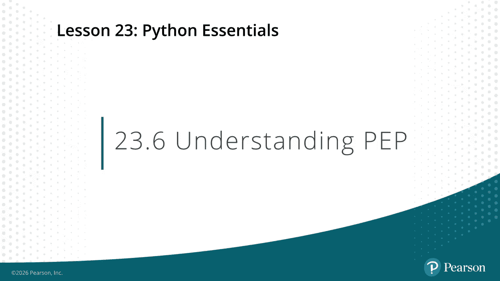
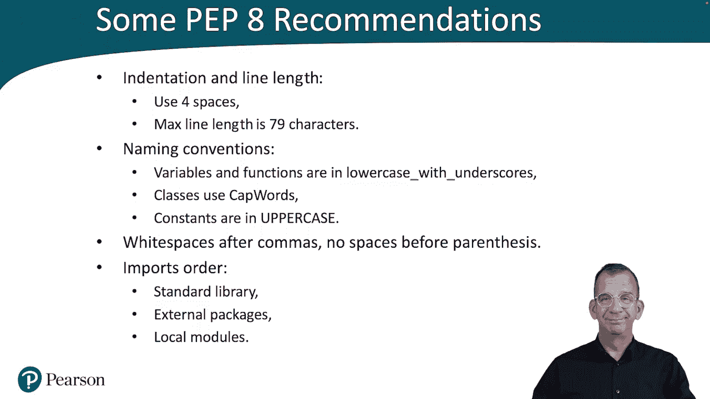

# Python编程规范：第1节：PEP 8代码规范详解 🐍

在本节课中，我们将一起学习什么是PEP，以及为什么PEP 8是Python编程中的重要规范。你将了解它的核心作用，以及在实际编写代码时需要注意的缩进、命名和导入顺序等细节。内容会尽量用大白话来解释，让初学者也能快速上手。


首先，我们来看看PEP到底是什么。



PEP的全称是Python Enhancement Proposal，中文意思是Python增强提案。它包含指南和提出的改进建议。PEP 8是目前的版本，它定义了Python代码的编写风格，目的是确保不同项目之间保持一致性。简单来说，它就是Python社区公认的编码最佳实践。Python的标准库本身也遵循这个标准。作为程序员，你在编写代码时，最好也遵循它，这样你的代码会更容易被其他人阅读和维护。

上一节我们介绍了PEP的基本概念，本节中我们来看看关于缩进和行长度的具体建议。

以下是关于缩进和行长度的核心要求：

- 缩进请使用四个空格。
- 每一行的最大长度建议不超过79个字符。

代码示例如下：

```python
# 正确的缩进方式，使用四个空格
def greet_user():
    print("你好，欢迎学习Python")
```

公式描述如下：

```
缩进空格数 = 4
最大行长度 <= 79 个字符
```

这样设置的好处是，代码在不同编辑器中显示效果一致，不会因为制表符和空格混用而出现排版混乱。

缩进和行长度搞定之后，本节中我们来看看变量、函数和类的命名规范。

以下是PEP 8推荐的命名方式：

- 变量和函数：全部小写，单词之间用下划线分隔。
- 类：每个单词首字母大写，中间不加下划线。
- 常量：全部大写，单词之间用下划线分隔。

代码示例如下：

```python
# 变量和函数使用小写加下划线
user_name = "张三"
def calculate_total_price():
    pass

# 类使用大驼峰命名
class UserAccount:
    pass

# 常量使用全大写加下划线
MAX_CONNECTION_COUNT = 100
```

这样命名的好处是，一眼就能看出这是变量、函数、类还是常量，代码的可读性会更高。

除了命名规范，PEP 8还对空格的使用提出了明确建议，本节中我们来看看具体细节。

以下是关于空格的注意事项：

- 逗号后面要加一个空格。
- 左括号前面不要加空格。

例如，在写函数调用或列表时，要注意这些细节，避免出现不必要的空格导致代码风格不统一。

空格问题讲完后，本节中我们来看看导入语句的排列顺序，这是PEP 8中非常重要的一条建议。

以下是推荐的导入顺序：

1. 标准库模块。
2. 外部安装的第三方包。
3. 当前项目中的本地模块。

代码示例如下：

```python
# 第一部分：标准库
import os
import sys

# 第二部分：外部第三方包
import requests
import numpy as np

# 第三部分：本地模块
from my_project import utils
from my_project.models import User
```

按照这个顺序编写导入语句，可以让代码结构更清晰，方便其他人快速了解代码依赖了哪些外部资源。



在本节课中，我们一起学习了PEP的含义，以及PEP 8作为Python编码规范的核心作用。我们具体了解了缩进应使用四个空格、行长不超过79个字符，变量和函数用小写下划线、类用大驼峰、常量用全大写，逗号后加空格且括号前不加空格，以及标准库、第三方包和本地模块的导入顺序。希望这些内容能帮助你养成规范的编码习惯，编写出更整洁、更易维护的Python代码。
