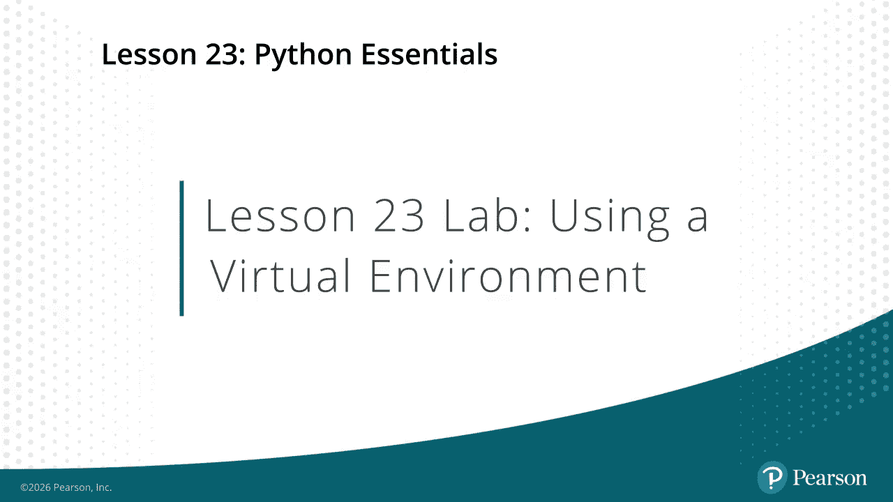
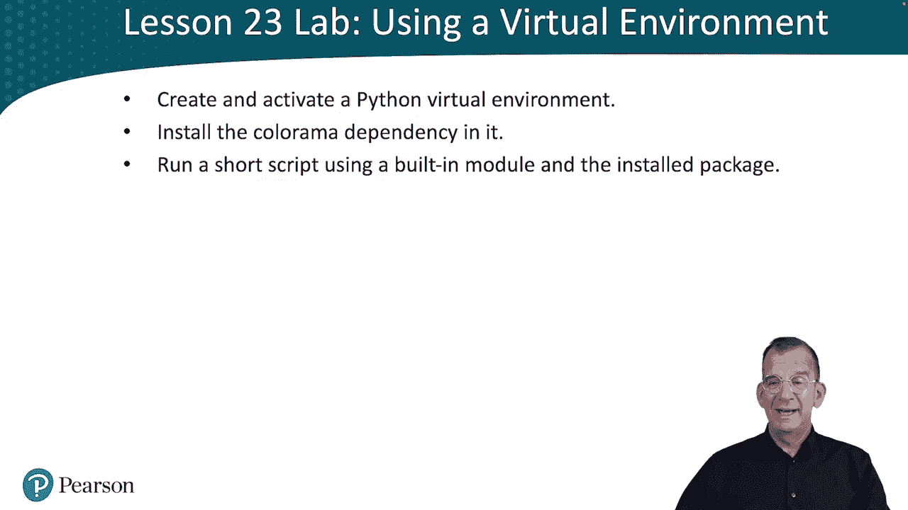

# 🐧 CompTIA Linux+ V8：Lesson 23 Lab：🖥️ 使用虚拟环境

## 一、课程概述

在本节课中，我们将一起学习怎么在Linux系统里搭建和使用Python虚拟环境。虚拟环境听起来可能有点高深，其实它就是一个单独的文件夹，里面放着自己的一套Python和第三方包，这样你做实验的时候，就不会把全局的Python环境弄乱。不管你之前是否写过Python代码，这节课都适合你看，因为重点在于理解虚拟环境的使用流程，而不是写多么复杂的程序。现在是动手实验的时候了，在这次实验里，我们会学习如何使用虚拟环境。


## 二、创建并激活 Python 虚拟环境



上一节我们介绍了Linux基础命令的使用，本节中我们来看看如何为Python搭建独立的运行空间。如果你还不会写Python脚本，完全不需要担心，这次实验更像是一场演示。如果你已经会写Python脚本，那就自己动手去做，如果你还不会，没关系，直接看实验答案，跟着操作一遍就行，这样也能练习一点Python基础知识。那么实验现在开始，第一步，你需要创建并激活一个Python虚拟环境。

核心概念用代码描述如下：

```bash
python -m venv myenv
source myenv/bin/activate
```

这行命令的意思是，告诉Python创建一个名为myenv的虚拟环境，然后激活它，让终端后面运行的所有Python命令都在这个环境里执行。

以下是创建和激活虚拟环境的操作步骤：

1. 打开终端，进入你准备存放项目的文件夹。
2. 输入创建虚拟环境的命令，回车等待完成。
3. 输入激活命令，这时你会发现终端提示符前面多出了环境名称，说明已经进入虚拟环境了。

激活之后，你安装的任何库都只会存在于这个虚拟环境里面，不会影响到系统自带的Python。

## 三、安装依赖并运行示例脚本

在上一小节中，我们已经创建并激活了Python虚拟环境，接下来需要在这个环境里安装所需的依赖包，然后运行一小段代码来验证一切正常。第二步，在这个虚拟环境里面安装colorma依赖包，第三步，运行一段简短的Python脚本，这个脚本会使用Python自带的内置模块，还有刚才安装的In包。

核心概念用代码描述如下：

```bash
pip install colorma
python demo_script.py
```

第一条命令用于把colorma这个依赖包下载到当前虚拟环境中，第二条命令用来运行脚本，脚本内部会调用Python内置模块和刚才安装的In包。

以下是具体的操作步骤：

1. 确保虚拟环境已经处于激活状态。
2. 使用pip命令安装colorma依赖包。
3. 编写或打开一个简短的Python脚本，让它导入内置模块和In包。
4. 运行脚本，观察输出结果，确认没有报错。

通过这种方式，你就完成了一个基于虚拟环境的Python小实验。



## 四、课程总结

本节课中我们一起学习了怎么在Linux上创建并激活Python虚拟环境，也学习了怎么在这个环境里安装colorma依赖包，最后运行了一段使用内置模块和In包的简短脚本。虚拟环境是Python开发中非常实用的工具，掌握它能帮你把不同项目的依赖包隔离开来，避免版本冲突。
