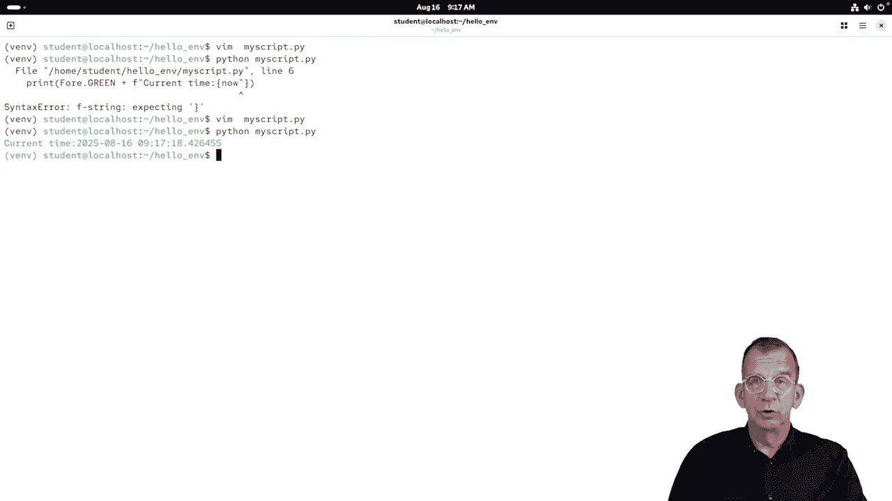

# CompTIA Linux+ V8：23：使用虚拟环境 🖥️


在本节课中我们将要学习如何在 Linux 系统中创建和使用 Python 虚拟环境，并通过一个简单的脚本实验来演示完整的操作流程。虚拟环境可以让每个项目拥有独立的依赖包，避免不同项目之间的包版本冲突，这是 Python 开发中非常基础且重要的一项技能。


首先，我们需要为虚拟环境创建一个专门的目录。这就像是给项目准备一个独立的“房间”，里面安装的包不会干扰系统其他部分。下面是具体的操作步骤：


我们首先使用 mkdir 命令来创建目录，目录名可以设置为 hello_venv：


```bash
mkdir hello_venv
```


创建好目录之后，需要进入该目录。使用 cd 命令切换到 hello_venv 目录中，然后执行 python3 -m venv 命令来初始化虚拟环境。这个命令会在当前目录下生成一套完整的虚拟环境目录结构：


```bash
cd hello_venv
python3 -m venv venv
```


执行完成后，你可以使用 tree 命令查看 venv 目录下的所有内容，确认目录结构已经正确生成。虚拟环境的核心目录结构可以简要表示为：


```text
venv/
├── bin/
├── lib/
├── pyvenv.cfg
└── ...
```


通过上面的命令，我们完成了虚拟环境目录的创建。接下来我们来看看如何激活这个环境，使其真正生效。


创建好虚拟环境之后，下一步就是激活它。激活后，终端会使用虚拟环境中的 Python 解释器和安装包，而不是系统默认的环境。这是非常重要的一步，否则后续安装的模块可能会写入系统目录，造成混乱。


我们使用 source 命令来激活虚拟环境，具体路径是 venv/bin/activate：


```bash
source venv/bin/activate
```


激活成功后，命令行提示符通常会显示虚拟环境的名称，比如 (venv)，这表示当前已经进入虚拟环境模式。此时再执行 python 或 pip 命令，作用的都是虚拟环境内的程序，不会影响系统自带的 Python 环境。


完成激活之后，我们就可以开始安装项目所需的第三方模块了，下面我们来看具体的安装过程。


环境激活之后，接下来要安装脚本运行需要的模块。这里我们要安装的是 colorama 模块，它可以让终端输出带颜色的文本，让脚本运行结果更直观。


使用 pip install 命令进行安装：


```bash
pip install colorama
```


安装过程中可能会提示 pip 有一个新版本可用。如果你不需要立即升级 pip，可以暂时忽略这个提示。当然，如果你想升级 pip 到最新版本，也可以使用下面的命令：


```bash
pip install --upgrade pip
```


不过在本次实验中，当前的 pip 版本已经足够使用，没有必要特意升级。模块安装完成后，通常需要记录下当前环境所依赖的所有包，这样其他人或者其他机器就可以一键重现同样的环境。


下面是生成依赖文件的操作介绍：


我们需要把当前环境中已经安装的所有模块及其版本“冻结”到一个文件中，通常命名为 requirements.txt。这样做的目的是方便后续部署或共享项目，他人只需执行 pip install -r requirements.txt 就能安装完全相同的依赖包。


使用 pip freeze 命令生成依赖文件：


```bash
pip freeze > requirements.txt
```


依赖文件生成之后，环境准备工作就算告一段落了。接下来我们进入实验的核心部分，来编写一个简单的 Python 脚本。


有了虚拟环境和依赖文件之后，就可以开始写脚本了。我们创建一个名为 myscript.py 的文件，并在文件开头用注释说明脚本名称。注释是给人看的说明，Python 解释器会忽略它，不影响程序运行。


脚本的第一步是导入需要的模块。这里我们导入两个模块，一个是 Python 内置的 datetime 模块，用来获取当前日期和时间；另一个是刚刚安装的 colorama 模块中的 Fore 类，用来控制输出颜色。


下面是脚本的导入部分：


```python
import datetime
from colorama import Fore
```


导入完成后，我们定义一个变量 now，用来保存当前的日期和时间。调用 datetime.datetime.now() 就可以获取当前的时间点：


```python
now = datetime.datetime.now()
```


脚本的核心部分是使用 print 函数输出当前时间，并且将文字设置为绿色。这里使用了 f 字符串来格式化输出内容，把 now 变量的值嵌入到字符串中。


为了演示如果代码写错会发生什么，我故意在脚本中制造了一个小错误。下面是包含错误的打印语句示例：


```python
print(Fore.GREEN + f"Current time: {now}"
```


注意到上面的代码少了一个右括号，而且双引号的位置也不对，这会导致 Python 报错。


脚本编写完成后，下一步就是尝试运行它，看看是否能正确输出绿色的当前时间。


运行脚本时，我们直接使用 python 命令后跟脚本文件名：


```bash
python myscript.py
```


运行后，Python 解释器会检查代码语法。由于我们故意留下了语法错误，Python 会提示哪里不对，并且指出问题出在右双引号的位置上。这很好理解，右双引号应该放在右括号的后面，而不是前面。


修复这个错误非常简单，只需要把右双引号移到括号之后即可。修改后的正确代码如下：


```python
print(Fore.GREEN + f"Current time: {now}")
```


再次运行脚本，你会看到终端以绿色字体打印出当前的日期和时间。这意味着虚拟环境、模块安装和脚本运行都已经成功完成。


下面是运行成功后的效果说明：




- 脚本会输出当前日期和时间
- 输出文字显示为绿色
- 表明 colorama 模块已经正确加载并生效


通过这个简单的实验，我们验证了整个虚拟环境的使用流程是否通顺。


本节中我们一起学习了如何创建虚拟环境目录、如何激活虚拟环境、如何安装所需模块、如何冻结依赖项、如何编写简单的 Python 脚本，以及如何运行脚本并修复常见的语法错误。希望这节课能帮助你掌握在 Linux 上使用 Python 虚拟环境的基本方法。

