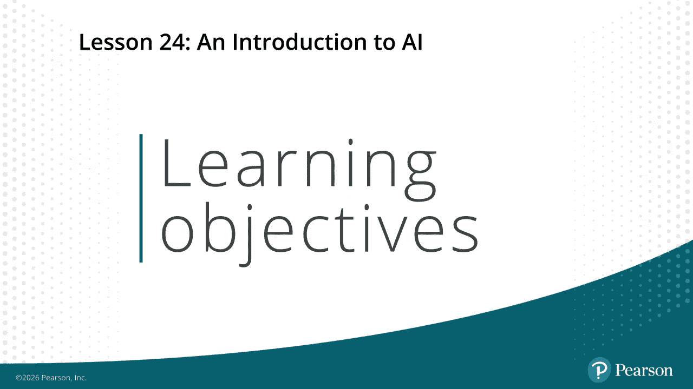

# 🤖 CompTIA Linux+ V8：第5部分第69页：AI学习目标


在本节课中，我们将要学习人工智能（AI）在Linux系统管理中的基本概念。这节课的内容主要围绕AI对Linux管理员的具体意义展开，帮助你理解人工智能技术在日常运维工作中的定位和作用，让你明白学习这些内容对实际工作有什么帮助。


本节内容首先会介绍AI在Linux运维中的角色，让你明白这项技术能够为系统管理工作带来什么样的实际帮助。




以下是AI在Linux系统管理中的主要作用：

- 协助自动化处理日常的系统监控工作
- 分析服务器日志并快速定位故障原因
- 优化系统资源分配，提升整体运行效率


了解完AI的作用之后，接下来我们将重点看看AI在实际管理工作中的具体使用场景，并学习相关的最佳实践与治理规范，这些内容能帮助你更好地理解AI怎么落地到Linux环境里。


以下是Linux系统管理中常见的AI使用场景：

- 智能日志分析与异常检测
- 自动化补丁管理与系统更新
- 预测性硬件故障预警
- 资源使用量预测与容量规划


除了掌握使用场景，学习AI的最佳实践和治理规范同样重要，这能帮助你在使用AI时更加安全合规，避免在实际操作中出现不必要的问题。


以下是AI治理与最佳实践的核心要点：

- 数据隐私保护与合规要求
- AI模型的可解释性与审计追踪
- 访问控制与权限最小化原则
- 定期评估AI输出结果的准确性


在掌握了基础概念和应用场景之后，接下来我们将进入更具体的技术内容，学习如何编写有效的AI提示词，这是让AI更好地为你服务的关键技能。


AI提示词编程的核心公式可以表示为：

```text
有效提示词 = 明确的任务描述 + 具体的上下文信息 + 期望的输出格式
```


提示词编程的具体操作步骤如下：

- 首先明确你希望AI完成什么任务
- 接着提供足够的背景信息和约束条件
- 然后指定你希望得到的回答格式
- 最后根据AI的回答调整提示词并重新尝试


学完提示词编程之后，我们还需要了解生成式AI的组成部分，以及在Linux系统上托管生成式AI的基本要求，为后续的实验操作打下基础。


在Linux上托管生成式AI需要满足以下条件：

- 足够的计算资源，尤其是GPU支持
- 兼容的操作系统环境和依赖库
- 稳定的网络连接用于模型下载和更新
- 充足的存储空间用于保存模型文件


生成式AI的基本架构可以用简单的代码结构来描述：

```python
GenAI系统 = 输入接口 + 大语言模型 + 输出处理 + 反馈机制
```


最后，本节课的末尾将安排实验环节，并提供相应的实验参考答案供你对照学习，帮助你检查自己的理解是否正确。


本节课中我们一起学习了AI在Linux系统管理中的角色与应用场景、AI治理与最佳实践、提示词编程的基础方法，以及生成式AI的组成部分和在Linux上的托管要求。

