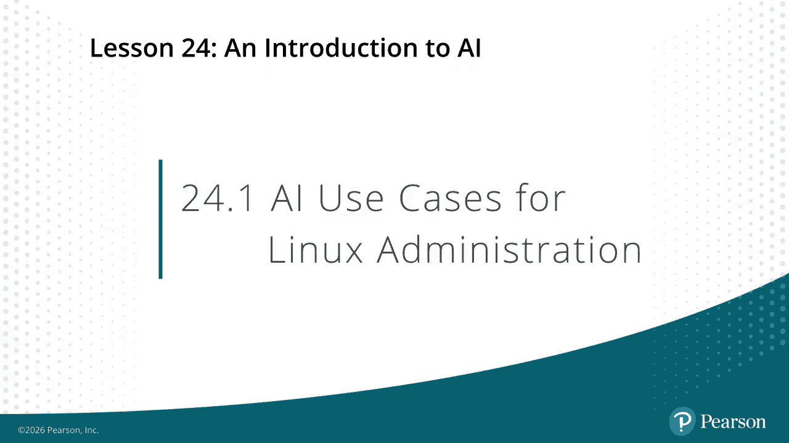

# CompTIA Linux+ V8：Part5 P70：241 AI Use Cases for Linux Administration 🐧

在本节课中，我们将要学习Linux系统管理中的AI应用场景。作为一名Linux系统管理员，日常工作中要面对大量的系统日志、性能数据和安全记录，如果完全靠人工去阅读和分析，不仅速度很慢，还很容易漏掉重要的异常信息。本节内容的目标是帮助你理解，为什么现在越来越多的Linux管理工作开始引入人工智能，AI具体能在哪些环节提供帮助，以及在实际使用这些工具时需要注意哪些问题。我们会先从管理员面临的数据挑战说起，然后说明AI能够发挥什么作用，接着介绍几个常见的工具示例，最后提醒你在信任AI之前必须进行人工确认。




## 为什么Linux管理员需要AI 📊

现代Linux系统在运行过程中会产生非常多的运行数据，包括系统日志、监控指标、安全审计记录等等。这些数据的数量非常大，靠人工逐条去读和分析并不总是容易，很多关键的异常信息可能就埋在成千上万行普通日志里面，很难被人工快速发现。

这时候AI技术就可以派上用场了。AI在Linux运维中的核心作用，可以用下面这个简单公式来描述：

```text
AI辅助运维 = 在故障发生前检测异常 + 解读日志消息 + 推荐解决方案
```

换句话说，AI不仅能够在系统出现严重故障之前提前发现异常迹象，还能帮助管理员理解那些晦涩难懂的日志消息，并给出针对性的解决建议。这意味着管理员不需要完全凭经验猜测问题出在哪里，而是可以借助机器的能力来缩小排查范围，把处理故障的时间缩短下来。


## AI在Linux管理中的具体作用 ⚙️

根据具体的运维需求，可以选择不同的AI工具来完成工作。不同的场景对应不同的技术方案，管理员需要根据实际情况来决定使用哪一种，而不是盲目地套用同一个工具。

其中，生成式AI解决方案是比较常见的一类应用方式。这类方案擅长处理非结构化信息，并能够为具体的运维任务提供建议。它的优势可以用下面这个表达来概括：

```text
生成式AI = 识别不规则模式 + 匹配对应解决方案
```

也就是说，生成式AI非常擅长发现系统行为中的不规则之处，并把这些异常情况与已知的解决方案关联起来，从而为管理员提供可以直接参考的处理思路。


## 常见的AI工具示例 🛠️

以下是几个在实际Linux发行版和运维工具中已经应用的AI示例，供你参考。

- 在RHEL 10系统中，有一个命令行助手，它提供C命令作为关于命令行用法的聊天客户端。请注意，使用这个功能确实需要注册。你可以使用类似这样的命令，来编写一个脚本去完成你想要做的任何事情：

  ```bash
  see write a script that <你想要脚本完成的任务>
  ```

- S Linux使用SEO Alert，它使用SEO Linux AI来分析审计消息并推荐解决方案。这个工具的作用是自动扫描安全审计日志，找出潜在的安全问题，并给出相应的修复建议。

- Ansible也引入了AI能力，它拥有Ansible Lightspeed。Ansible Lightspeed是一个AI系统，可以帮助自动生成Ansible剧本。下面是一个伪代码示例，说明它的工作方式：

  ```yaml
  - name: 使用Ansible Lightspeed生成剧本
    ai_assistant:
      task: "配置Nginx服务器"
      output: playbook.yml
  ```


## 使用AI时的注意事项 ⚠️

在所有这些应用场景中，AI可能表现得非常出色，但你始终需要对AI的输出进行验证。这是因为AI可能会遗漏关键要点，或者给出不完全准确的建议，不能完全代替人的判断。

最终的决策过程可以用下面这个简单公式来表示：

```text
最终决策 = AI建议 + 管理员人工确认
```

也就是说，AI只是一个辅助工具，它能提供线索和方案，但不能替代管理员的判断。当AI给出建议后，你需要亲自检查，确保AI做的是正确的事情，避免因为盲目信任AI而导致系统配置错误或者安全隐患。


## 本节总结 📝


本节课中，我们一起学习了Linux系统管理中的AI应用场景。我们了解到现代Linux系统产生的数据量非常大，人工分析并不总是容易，因此AI可以在故障发生前检测异常、解读日志消息并推荐解决方案。我们还介绍了几个具体的工具示例，包括RHEL 10的命令行助手、S Linux的SEO Alert，以及Ansible的Ansible Lightspeed。最后，我们强调了在使用AI时必须进行人工验证，确保AI的建议确实符合实际需求，避免盲目依赖自动化输出。
