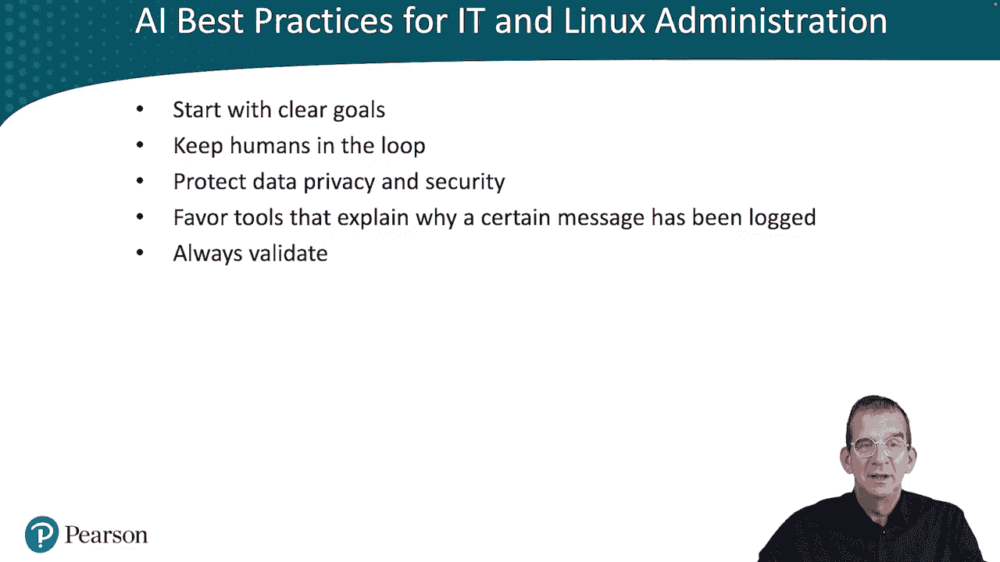

🤖 CompTIA Linux+ V8：05：AI 使用最佳实践

在本节课中我们将要学习使用人工智能时需要注意的最佳实践。人工智能技术现在被广泛应用于各种工作场景，很多新手在刚开始接触时容易产生误解。如果不了解基本的使用原则，很容易得到错误的结果，甚至不小心泄露重要信息。本节内容专门为初学者准备，不需要任何人工智能方面的先修知识。我们会用最简单的语言把每一个要点讲清楚，帮助你养成安全可靠地使用 AI 的习惯，避免走弯路。

首先，我们来看看使用 AI 的第一条基本原则。

## 1. 先确定明确的目标

AI 的全称是人工智能，但这里的“智能”并不像人类那样能够理解你的真实想法。AI 无法猜测你心里在想什么，所以你必须把要求说清楚。如果你给的指令模糊不清，AI 给出的答案也可能跟你预期的完全不同。在下达任何指令之前，花一点时间想清楚自己到底想要什么，这能节省后面修改的时间，也能减少沟通成本。

以下是设定目标时需要注意的几点：
- 用简单直接的语言描述任务
- 说明你希望得到什么样的输出格式
- 必要时提供背景信息和限制条件

`AI输出质量 = 输入指令的清晰程度 × 目标的明确程度`

了解了如何下达指令之后，接下来我们需要讨论人工验证的问题。

## 2. 始终让人类参与验证

AI 不应该完全接管决策过程，必须有人类参与其中来检查结果。无论 AI 看起来多么专业，它也有犯错的时候，所以你不能盲目信任它的输出。每一条 AI 生成的建议都需要人工过一遍，确认它确实做了正确的事情，而不是看起来正确但实际上错了。只有人类把关，才能降低出错的概率。

以下是人工验证的具体做法：
- 检查 AI 给出的每一条命令或建议
- 对比官方文档确认技术细节
- 在测试环境中先运行，确认无误后再应用到生产环境

```
if AI_建议:
    人工检查(建议)
    确认正确()
    然后执行()
```

除了验证结果，使用 AI 时还需要特别注意数据的隐私和安全。

## 3. 保护数据隐私与安全

很多 AI 工具会从用户的输入中学习，比如 ChatGPT 会记录你发送的提示词。如果你把敏感数据，比如密码、密钥或者公司内部文档，发送给 AI，这些信息可能会被用来训练模型，或者被其他人看到。这对你的数据隐私是非常不利的，一旦泄露很难挽回。所以在使用 AI 之前，先想清楚哪些内容可以发送，哪些绝对不能发送，养成良好的数据保护习惯。

以下是保护隐私的几条建议：
- 不要在提示词中包含真实的密码或密钥
- 不要上传包含个人身份信息的文件
- 优先选择能够解释日志记录原因的工具
- 查看工具的隐私政策，了解数据会被如何使用

`敏感数据 ∉ 提示词`

最后，我们来看看最关键的一条，也就是在使用 AI 解决方案之前的验证步骤。

## 4. 使用前务必验证 AI 输出

这是整篇教程中最重要的一点。绝对不要直接复制粘贴 AI 给出的解决方案，然后立刻使用。AI 可能会写出看起来很完美但实际上完全错误的代码或命令。如果你不做验证就直接运行，可能会导致系统故障或安全漏洞，后果可能非常严重。正确的做法是，先仔细检查 AI 生成的内容，理解每一行的作用，确认没有问题之后再决定是否采用。



以下是验证步骤的清单：
- 通读 AI 生成的全部内容
- 理解每条命令的具体功能
- 在隔离环境中进行测试
- 确认没有副作用后再部署

```
复制粘贴() -> 禁止
适当验证() -> 必须
AI可能错误() -> 永远记住
```


在本节课中我们一起学习了使用 AI 的四条最佳实践。首先要设定明确目标，因为 AI 不能猜测你的意思；其次要始终让人类参与验证，防止 AI 接管决策；第三要保护数据隐私和安全，不要把敏感信息发给 AI；最后也是最重要的一点，在适当验证之前，永远不要直接复制粘贴 AI 的解决方案。掌握这些原则后，你就可以更安全、更高效地在工作中使用人工智能工具了。
