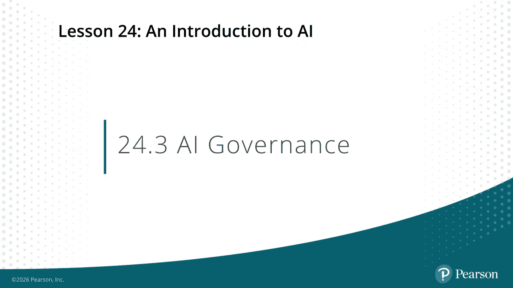
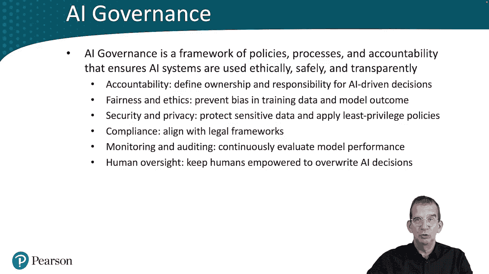

# 🤖 AI治理详解：第1课：什么是 AI 治理


在本节课中，我们将一起学习什么是 AI 治理，以及它包含哪些核心部分。AI 治理是人工智能领域中非常重要的话题，因为随着 AI 系统被越来越多地应用到实际工作中，我们需要确保这些系统的使用方式是安全、合规且可控的。本节课会用大白话把抽象的概念讲清楚，帮助初学者快速理解 AI 治理的基本框架。




AI 治理是一套政策、流程和问责机制的框架，目的是确保 AI 系统以合乎伦理、安全且透明的方式被使用。如果没有这样的框架，AI 系统可能会做出不可解释的决定，或者泄露敏感信息，从而带来严重的风险。下面我们把这个框架拆解开来看。


AI 治理的核心可以用下面这个公式来概括：

**AI治理 = 政策 + 流程 + 问责机制**


下面是 AI 治理框架中包含的主要组成部分：


- **问责（Accountability）**：明确 AI 驱动决策的所有权和责任归属。简单来说，就是要规定谁对 AI 的决策负责，不能让责任变得模糊不清。
- **公平与伦理（Fairness and Ethics）**：防止训练数据和模型输出中出现偏见。也就是说，AI 不应该因为数据问题而歧视某些人群。
- **安全与隐私（Security and Privacy）**：保护敏感数据，并在敏感环境中应用最小权限策略。只有授权人员才能接触到重要数据。
- **合规（Compliance）**：与法律框架保持一致，并进行相应的监控。企业必须遵守所在国家或地区的相关法律法规。
- **持续演进（Continuous Evolution）**：持续监测模型性能。一个今天表现良好的模型，未来一个月可能就不再适用当前的情况，因此需要不断更新和调整。
- **人工监督（Human Oversight）**：确保人类始终拥有推翻 AI 决策的权限。无论 AI 多么先进，人类都必须保留最终的否决权。


问责机制的具体含义是，你需要为 AI 驱动的决策定义明确的所有权和责任。这意味着在 AI 系统做出任何决定之后，必须能够追溯到具体的负责人或团队，而不是让决策悬空。此外，背后应该始终有人类参与，不能完全交给机器自动运行而毫无人工介入。


公平与伦理的重点在于防止训练数据和模型结果中的偏见。如果训练数据本身带有歧视，那么模型学习出来的规律也可能带有歧视，这会导致不公平的输出结果。因此，在构建 AI 系统时，必须检查数据质量，确保模型对不同群体一视同仁。


安全与隐私的核心是保护敏感数据，并在敏感环境中应用最小权限策略。最小权限策略意味着只给用户完成工作所需的最低权限，不要多给。这样可以降低数据泄露或被滥用的风险，保障用户隐私不被侵犯。可以用下面这段伪代码来理解：

```text
if 用户需要访问数据:
    只授予完成当前任务所需的最低权限
else:
    拒绝访问
```


合规的含义是，你需要使 AI 系统与法律框架保持一致，并进行持续监控。不同的行业和地区有不同的法律要求，企业必须确保自己的 AI 应用符合这些法规，否则可能面临法律处罚。


持续演进强调的是模型性能的不断进化。一个模型在今天可能表现很好，但到了下个月，周围的环境和条件可能已经发生变化，原来的模型可能就不再适用了。因此，需要持续监测和更新模型，使其始终适应当前的实际情况。


人工监督的作用在于始终赋予人类推翻 AI 决策的权限。无论 AI 系统多么智能，人类都必须随时拥有覆盖或修改 AI 决策的能力，防止机器做出错误或危险的选择而无人能够干预。可以用下面这个公式表示：

**人工监督 = 人类随时拥有推翻 AI 决策的权限**


如果你确保上述所有原则都得到了尊重和执行，就能以更好的方式使用 AI。这意味着你的 AI 系统不仅更可靠，而且更安全、更合规，也更容易获得用户和监管机构的信任。在实际工作中，遵循这些原则可以帮助你避免很多不必要的麻烦。




本节课中，我们一起学习了什么是 AI 治理，以及它的核心组成部分，包括问责、公平与伦理、安全与隐私、合规、持续演进和人工监督。我们还了解了每个部分的具体含义，以及遵循这些原则对使用 AI 的好处。希望这些内容能帮助你建立起对 AI 治理的初步认识。

