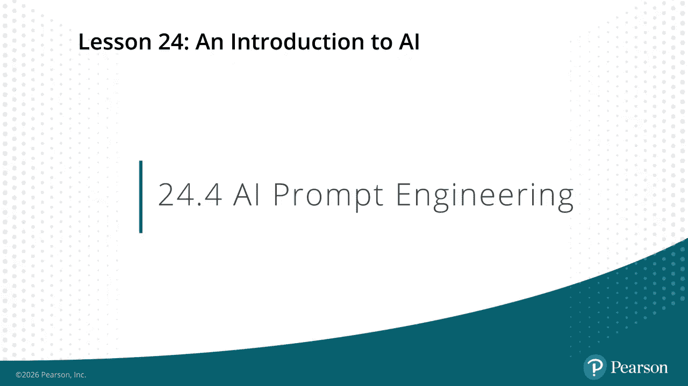
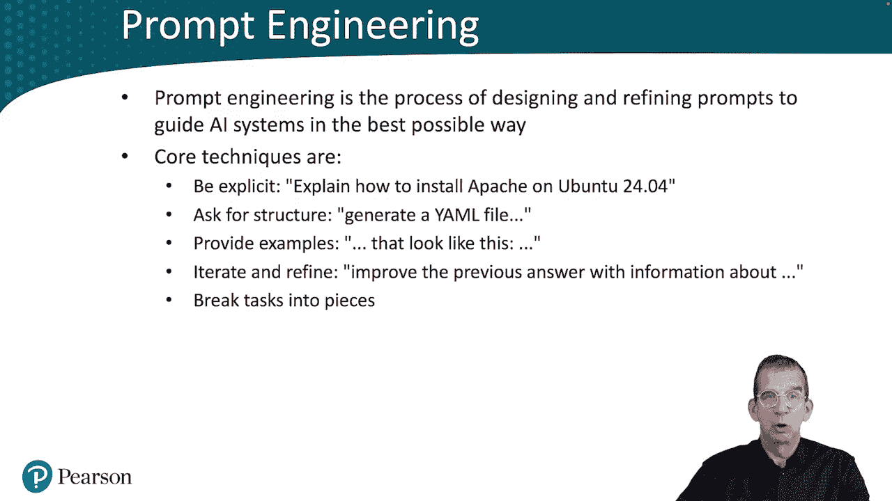

# CompTIA Linux+ V8：244：AI 提示词工程 🤖


在本节课中，我们将一起学习什么是 AI 提示词工程，以及如何通过设计和优化提示词，引导人工智能系统以最佳方式产出高效结果。提示词工程听起来可能比较高深，但实际上它就是一种跟 AI 对话时说话的技巧，掌握了这些技巧，你就能让 AI 更好地理解你的真实需求，避免它给出模糊、不准确或无法直接使用的回答。


## 一、什么是提示词工程




提示词工程的核心目标，是通过设计和优化提示词，引导 AI 系统按照你的意图给出高效输出。你可以把它理解为一种“指令编写艺术”，因为 AI 并不像人类那样能自动猜出你心里在想什么，如果你的描述不够清楚，它很容易理解偏差，甚至给出完全错误的建议。

以下是提示词工程的基本定义：

```text
提示词工程 = 设计提示词 + 优化提示词 → 引导 AI 系统 → 获得高效输出
```


## 二、核心技巧一：明确具体地表达需求


上一节我们介绍了提示词工程的基本概念，本节我们来看看第一个核心技巧，也就是在编写提示词时要尽可能明确和具体。

当你向 AI 下达指令时，描述越具体，得到的答案就越准确。不要只说“安装一个网页服务器”，而最好说“在 Vo2 2404 系统上安装 Apache”。这样 AI 就能考虑到不同操作系统之间可能存在的差异，避免因为信息不足而给出不适用的配置命令。

以下是模糊指令和具体指令的对比：

```text
模糊指令：安装一个网页服务器
具体指令：在 Vo2 2404 上安装 Apache
```


## 三、核心技巧二：指定输出结构


在介绍完如何明确具体地表达需求之后，我们继续看看第二个核心技巧，即告诉 AI 你希望它以什么样的格式来组织输出内容。

指定结构也是“具体”的一部分。比如当你要求 AI 生成 YAML 文件、生成配置文件等内容时，AI 就知道该怎么做，输出结果会更加符合预期。如果不指定结构，AI 可能会用普通文本把内容写出来，而不能直接用于实际的系统配置。

你可以这样在提示词中指定结构：

```text
生成一个 YAML 配置文件
生成一个 Apache 配置文件
```


## 四、核心技巧三：提供示例参考


刚才我们讨论了如何指定输出结构，本节接着来看第三个核心技巧，也就是给 AI 提供示例，让它按照你所在组织内部使用的标准来生成内容。

如果你希望 AI 的输出符合某些特定规范，最好的办法就是直接把一个示例发给它。你可以先展示一段符合要求的内容，然后把平时使用的 YAML 代码复制粘贴过去，让 AI 参照这个格式来生成新内容。这样可以大幅降低输出结果与实际标准不一致的概率。

以下是提供示例时的常见做法：

```text
输入：请参考以下示例格式，生成一份新的配置文件
示例：[粘贴已有的标准 YAML 代码]
```


## 五、核心技巧四：迭代与优化


在学习完如何提供示例参考之后，我们进入第四个核心技巧，即对 AI 的回答进行评估，并通过多轮对话不断改进结果。

迭代优化的意思是，你需要检查 AI 系统给出的答案，然后可以说：“请结合某某信息，改进之前的回答。” 在这样做的同时，要确保 AI 不会忘记你在上一次回答中已经提到的内容。如果你打算进行多轮迭代，AI 遗漏之前上下文是一个真实存在的风险，所以需要特别留意。

以下是迭代优化时可以使用的语句模板：

```text
改进之前的回答，补充关于 XXX 的信息
在保留之前内容的基础上，调整 YYY 部分
```


## 六、核心技巧五：将任务拆分成小块


前面我们讲了如何对 AI 的输出进行迭代优化，最后来看第五个核心技巧，也就是把大任务拆分成多个小任务来处理。

如果你尊重上面提到的所有技巧，包括明确具体、指定结构、提供示例、迭代优化，再加上把复杂任务拆成小块，你在做提示词工程时就会更高效，得到的结果也会更好。把任务拆开可以避免 AI 一次性处理过多信息而出现混乱，也让你更容易检查每一步的输出是否正确。

以下是任务拆分的建议步骤：

```text
步骤一：明确最终目标
步骤二：把任务分成几个独立的小步骤
步骤三：分别给 AI 下达每个小步骤的指令
步骤四：把各小步骤的结果组合起来
```


## 课程总结




本节课中，我们一起学习了 AI 提示词工程的基本定义，以及五个核心技巧：明确具体地表达需求、指定输出结构、提供示例参考、迭代与优化、将任务拆分成小块。掌握这些方法后，你就能编写出更高质量的提示词，让 AI 系统为你提供更准确、更实用的输出结果。


