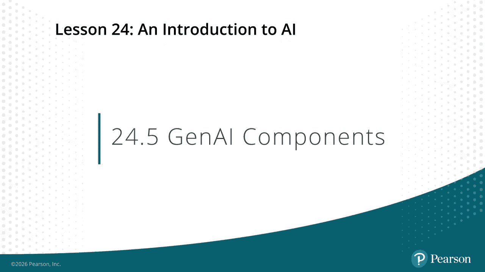
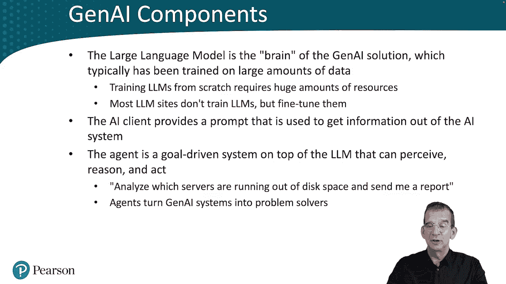

# CompTIA Linux+ V8：245：GenAI 核心组件详解 🤖

在本节课中我们将要学习生成式人工智能系统的主要组成部分。你将了解到大语言模型是如何作为系统大脑运作的，为什么大多数企业不直接从零开始训练模型，以及 AI 客户端和 AI 代理分别承担什么角色。通过这节课，你将掌握搭建和维护生成式 AI 系统所需的基础知识。


首先，我们来看看为什么了解这些组件很重要。总有一天你可能需要负责托管一套生成式人工智能系统。在实际工作中，这不仅涉及服务器资源的配置，还需要你理解模型如何运行，客户端如何连接，以及各个组件之间如何协作。掌握这些基础概念，能帮你更好地应对未来的系统维护工作。


上一节我们介绍了托管生成式 AI 系统的背景，本节中我们来看看系统的核心大脑是什么。生成式 AI 组件中，首先要介绍的是大语言模型。大语言模型被视为整个 AI 解决方案的大脑。

```text
大语言模型 (LLM)
- 训练数据：海量文本数据
- 模型体积：通常数 GB 级别
- 运行需求：大量 GPU 内存
```

它通常在海量数据上进行训练，体积往往达到好几个千兆字节。要想正常使用这个模型，需要消耗大量的 GPU 内存资源，否则模型无法加载或运行缓慢。


上一节我们介绍了大语言模型的基本特征，本节中我们来看看企业在实际部署时如何选择训练方式。从零开始训练大语言模型需要投入巨大的计算资源和人力成本。出于这个原因，绝大多数运行大语言模型的公司都不会亲自训练模型，而是选用一个标准的通用大语言模型，然后只在其基础上进行微调。这样既能节省成本，又能让模型贴合特定业务需求。

以下是常见的模型使用方式：

- 从零开始自行训练：资源消耗极高，实际中很少采用
- 使用标准模型并进行微调：企业最常见的做法，成本更可控


上一节我们介绍了模型的获取和微调方式，本节中我们来看看用户如何与 AI 系统交互。AI 客户端负责向 AI 系统提供提示词，用于从系统中获取信息。这就是用户进行操作、提出问题的地方。这个过程被称作推理。简单来说，推理就是模型根据用户输入的提示词，生成对应回答的过程。

```text
推理过程 = 输入提示词 (Prompt) → 大语言模型 → 生成回答
```


上一节我们介绍了推理过程和 AI 客户端的作用，本节中我们来看看更进一步的 AI 代理。AI 代理是构建在大语言模型之上的目标驱动系统。它不仅能回答问题，还能为你执行实际操作。AI 代理具备感知、推理和行动的能力。比如说，它可以帮你预订服务，也可以根据你的配置修改系统设置。

```text
AI 代理 = 大语言模型 + 感知能力 + 推理能力 + 行动能力
```

以下是 AI 代理可以完成的任务示例：

- 分析当前运行的服务，找出磁盘空间不足的项目，并发送报告给你
- 代表你完成预订操作
- 修改系统配置文件，或执行你配置的其他任务

有了 AI 代理，生成式 AI 系统就从简单的问答工具变成了真正能解决问题的助手。




本节课中我们一起学习了生成式人工智能系统的主要组件。我们讨论了大语言模型作为系统大脑的作用，解释了为什么大多数企业选择使用标准模型并微调而不是从零开始训练，还介绍了 AI 客户端如何通过提示词完成推理，以及 AI 代理如何通过感知、推理和行动把生成式 AI 系统变成实际的问题求解者。希望这些内容能帮助你更好地理解和托管生成式 AI 系统。

