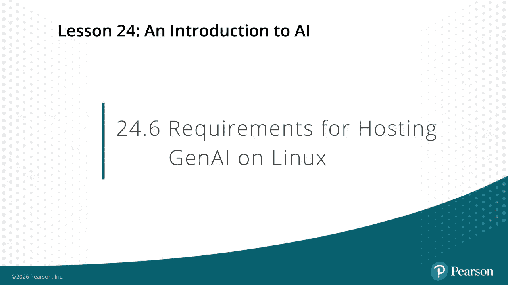

# 🤖 CompTIA Linux+ V8：第 5 章：Linux 上托管 GenAI 的要求

在本节课中，我们将一起学习在 Linux 系统上托管生成式人工智能（GenAI）需要满足的基本条件。你将了解搭建本地 AI 环境需要哪些核心组件，以及如何选择合适的大语言模型。我们还会讨论模型推理和微调这两个最常见的任务，最后重点讲解为什么 GPU 显存对运行 AI 工作负载至关重要。无论你是刚接触 Linux 的新手，还是想在自己的服务器上部署私有 AI 助手，这节课都会用最直白的语言帮你理清思路。


在开始具体配置之前，我们需要先搞清楚在 Linux 主机上运行 GenAI 最基础的架构长什么样。简单来说，你不能只安装一个模型就完事，而是需要一套完整的框架来支撑整个 AI 服务。这一套框架至少得包含两个部分，一个是用户与模型交互的客户端，另一个是负责实际计算的大语言模型本身。核心关系可以用下面这个简单公式表示：



```
AI 框架 = 客户端 + 大语言模型 (LLM)
```


以下是托管 GenAI 框架中必须包含的核心组件：

- 客户端（Client）：负责接收用户输入并把请求发送给模型，也负责把模型返回的结果展示出来。
- 大语言模型（LLM）：负责理解文本、生成回答，是整个 AI 系统的大脑。


有了框架之后，接下来要决定用哪个具体的大语言模型。关于具体选用哪个模型，其实是比较灵活的。你不需要被锁定在某个单一供应商的产品上，完全可以根据自己的需求做选择。目前比较常见的开源模型可以通过 Hugging Face 等平台获取，当然也有其他渠道可以寻找可靠的模型资源。建议你在实际部署前，花些时间检查并筛选出稳定、可信的模型文件，避免使用来源不明的权重文件。


以下是寻找和确认 LLM 时可以参考的几个方向：

- Hugging Face 平台：提供大量开源模型和社区权重文件，适合大多数自建场景。
- 其他公开模型仓库：你可以自行搜索并验证不同供应商发布的模型。
- 自行训练的模型：如果你有自己的数据和训练能力，也可以使用私有模型。


有了模型之后，接下来要考虑的是如何把自己的业务数据接入到 AI 系统中。对于大多数希望自建 AI 服务的团队来说，仅仅使用通用模型是不够的，必须能够把公司内部的文档、知识库或专有数据加入模型，这样 AI 才能回答与你业务相关的问题。这时候就用到了大语言模型微调（LLM Fine Tuning）技术，它能够让模型在原有能力基础上，学习你特定领域的内容。微调和数据集成的关系可以简化为下面这个公式：

```
定制模型 = 基础模型 + 私有数据 + 微调训练
```


以下是将数据集成到 AI 框架时通常会用到的做法：

- 使用 LLM 微调技术注入私有数据。
- 通过提示词工程或知识库检索增强模型回答。
- 在框架层面支持数据接入管道，保证数据能安全地传输到模型端。


在 AI 框架中，用户通常会执行两类典型任务，分别是推理（Inference）和微调（Fine Tuning）。理解这两个概念的区别，对你配置 Linux 主机非常有帮助。这两个任务的本质区别可以用下面这两个简单表达式说明：

```
推理：用户输入 + 已有模型 → 准确回答
微调：基础模型 + 你自己的数据 → 适配业务的模型
```


以下是两类任务的具体含义：

- 推理（Inference）：指用户与 AI 系统进行交互，向模型提问并获取准确信息的过程。这就像你跟 AI 聊天，模型根据已有知识给出回答。
- 微调（Fine Tuning）：指把你自己的数据加入模型，让模型重新学习并适应特定场景的过程。简单说，就是教会模型认识你的业务术语和工作流程。


运行 AI 模型不仅仅靠 CPU 就够了，还需要合适的硬件支持来保证性能。特别是在进行推理或微调时，对计算资源的要求非常高，如果主机缺乏必要的隔离和资源保障，任务可能跑得非常慢，甚至直接卡死。因此，在 Linux 上托管 GenAI 时，必须重视硬件层面的配置，尤其是显存支持。这里有一个关键的性能对比：

```
GPU 显存读写速度 > 普通内存读写速度
```


以下是保证 AI 任务正常运行的关键硬件要求：

- GPU 支持：必须配备图形处理器，才能以合理的速度完成推理和微调任务。
- 大容量 GPU 显存：GPU 显存（GPU RAM）的读写速度远快于普通内存，AI 模型在加载参数和进行矩阵运算时需要这种高速缓存。
- 充足的显存数量：模型参数越大，需要的显存越多，通常建议准备多块显卡以应对大规模模型。


在本节课中，我们一起学习了在 Linux 系统上托管 GenAI 的核心要求。我们介绍了包含客户端和大语言模型的基本框架，讲解了如何从 Hugging Face 等渠道选择灵活的开源模型，讨论了通过微调技术集成私有数据的方法，区分了推理与微调两类常见任务，并强调了 GPU 显存对 AI 性能的决定性作用。希望这些内容能帮你在自己的 Linux 主机上顺利搭建起生成式人工智能服务。
