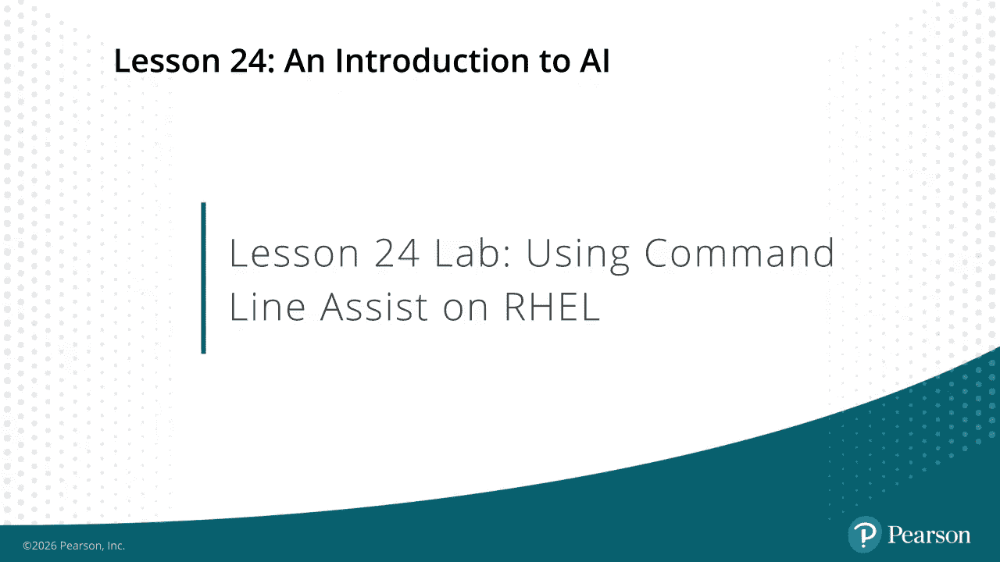
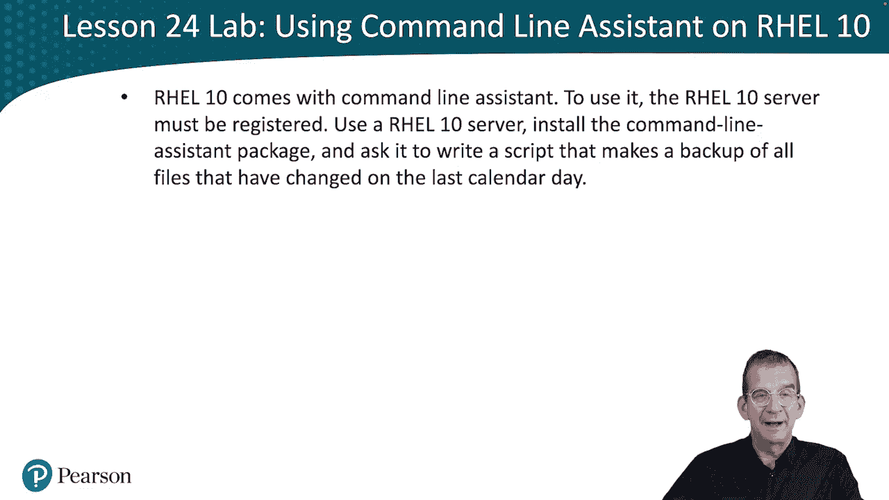

# CompTIA Linux+ V8：Lesson 24：Using Command Line Assist on RHEL 🖥️

在本节课中我们将要学习在RHEL 10服务器上使用命令行助手的方法。首先我们会解释命令行助手到底是个什么东西，接着说明在RHEL 10上启用这个功能之前，服务器必须完成注册这一步骤。随后我们会演示如何安装命令行助手的软件包，最后会请这个助手帮我们写一个脚本，用来备份上一个日历天里所有发生过变化的文件。希望大家能够跟着步骤一步步操作，把这套流程彻底搞清楚。

在开始动手之前，我们先来搞清楚命令行助手到底是干什么用的。


命令行助手是RHEL 10系统自带的一个辅助工具，它的主要作用是在你不太清楚具体命令怎么写的时候，给出建议或者直接帮你生成相关的脚本。简单来说，当你面对复杂的Linux命令感到迷茫时，这个助手就可以充当你的参谋，告诉你接下来应该输入什么。RHEL 10系统默认就集成了这个功能，所以你不需要从网上另外下载奇怪的程序，只要系统本身是正常的，这个助手就摆在那里等着你使用。

```
RHEL 10 命令行助手 = 系统自带辅助工具 + 命令建议与脚本生成
```



刚才我们了解了命令行助手的基本用途，那么在真正使用它之前，还有一个必须满足的前提条件，下面我们来看看具体是什么。

根据RHEL 10的设定，命令行助手并不是对所有设备都开放的，只有完成注册的服务器才能正常启用这个功能。也就是说，如果你拿到一台全新的RHEL 10机器，但还没有把它和Red Hat的订阅服务绑定，那么命令行助手大概率是无法使用的。注册的过程其实就是让Red Hat知道你的这台服务器是合法授权的，只有通过了这个验证，系统才会解锁相关的辅助服务。

```
使用前提 = RHEL 10 服务器 + 已完成 Red Hat 注册
```

确认服务器已经注册之后，接下来就是安装阶段了，下面我们来看看具体需要安装什么。

要在RHEL 10上使用命令行助手，你需要把相应的软件包安装到系统中。这个软件包包含了命令行助手运行所需的所有程序文件和配置项，安装完成后，系统才能识别并启动这个助手。安装过程通常通过系统的包管理器完成，只需要一条命令就能把软件包下载并配置好，之后你就可以开始使用命令行助手来辅助你的日常工作了。

以下是安装命令行助手所需的主要步骤：
- 确认系统已连接网络并可以访问软件仓库
- 使用包管理器安装命令行助手软件包
- 验证安装是否成功，确认助手命令可用

```bash
# 安装命令行助手软件包（示例命令）
sudo dnf install -y command-line-assistant
```

软件包安装好之后，最关键的部分来了，也就是如何利用命令行助手来完成实际的任务，下面我们看看具体怎么做。

现在我们要让命令行助手帮我们写一个脚本，这个脚本的作用是备份上一个日历天里所有被修改过的文件。也就是说，如果今天是5号，那么脚本会自动找到4号当天所有改动过的文件，并把它们打包备份起来。这个功能对于系统管理员来说非常实用，因为它可以帮你快速抓取最近一天的变更数据，而不需要你手动去查找每一个文件。命令行助手会根据你的描述，自动生成相应的备份脚本代码。

以下是请求命令行助手编写备份脚本时需要注意的要点：
- 明确告诉助手要备份哪些文件
- 指定时间范围为上一个日历天
- 确认生成的脚本可以正确识别已更改的文件



```bash
# 示例：请求命令行助手生成备份脚本
command-line-assistant --write-script "backup all files changed on the last calendar day"
```

本节课中我们一起学习了在RHEL 10上使用命令行助手的基本流程。我们了解了命令行助手是系统自带的辅助工具，强调了使用前必须完成服务器注册，介绍了如何安装相关的软件包，最后还演示了如何请助手编写一个备份最近更改文件的脚本。希望大家能够把这些步骤记住，并在实际操作中尝试一遍，掌握在RHEL 10上借助命令行助手简化运维工作的方法。
