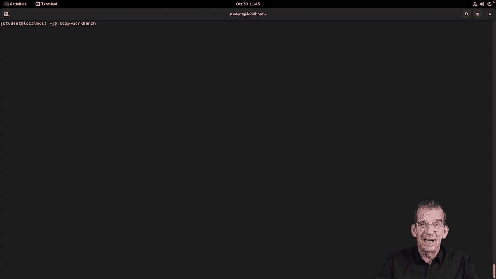

# CompTIA Linux+ V8：24：RHEL 上使用命令行助手备份最近修改的文件 🐧

## 课程概述


在本节课中，我们将学习在 Red Hat Enterprise Linux 上完成一个动手实验。老师会先用包管理命令检查系统里有没有装好需要的软件包，然后告诉你实验到底要写一个什么样的脚本，最后再演示怎么让命令行助手自动生成这段脚本。听起来步骤不多，但每一步都跟日常运维工作息息相关，建议你跟着老师的思路把每个命令都在自己机器上试一遍。

## 第一步：用 DNF 检查命令行助手是否已安装

刚才我们说到了要先确认软件包是否存在，下面我们就来看看具体怎么操作。在 Red Hat 系 Linux 中，DNF 是默认的软件包管理工具，我们可以用它列出所有名字以某个词开头的软件包，从而快速知道目标软件是不是已经装好了。

以下是老师演示使用的命令：

```bash
dnf list command*
```

这条命令里的 `dnf` 是包管理器，`list` 表示列出软件包，而 `command*` 则是一个带通配符的搜索模式。星号代表“任意字符”，所以整个表达式的意思是“列出所有名字以 command 开头的软件包”。老师之所以这么做，是因为他猜测命令行助手可能已经装在系统里了，万一没装，这个命令也能帮我们把相关软件全都列出来，不至于找不到包名。

执行之后，输出里会显示已安装的软件包列表。老师看到里面有 `command-line-assistant.noarch` 这一行，其中的 `noarch` 只是表示这个软件不依赖特定的 CPU 架构，可以在各种机器上运行。看到这个条目，就说明环境准备好了，可以放心进行下一步。

## 第二步：搞清楚实验脚本需要做什么

上一节我们介绍了怎么检查软件包是否存在，本节中我们来看看这个实验到底要求脚本完成哪些任务。老师说这个实验的解法非常简单，核心就是写一段 Bash 脚本，并且要把需求描述得非常具体，不能让脚本自己瞎猜。

以下是脚本需要完成的两件事情：

- 把上个自然日里被修改过的所有文件找出来。
- 把找到的这些文件备份起来。

这里的“上个自然日”指的是日历上的昨天，而不是“过去二十四小时”，这一点非常重要，如果理解错了，脚本筛选出来的文件范围就会不准确。另外，“备份”就是指把这些文件复制到另一个地方，以免原文件被意外改动或删除。老师特别强调，在写脚本时要明确告诉系统只要昨天的文件，不要今天的，也不要更早的。

脚本的核心逻辑可以用下面的伪代码来描述：

```
for 每个文件:
    if 文件修改日期 == 上个自然日:
        备份该文件
```

## 第三步：让命令行助手生成脚本并检查前提条件

刚才我们梳理了脚本的两个基本目标，接下来就要交给命令行助手去生成具体代码了。命令行助手不是完全离线运行的工具，它启动之后会主动连接到 Red Hat 的服务器，根据你的需求生成脚本和对应的使用说明。

以下是命令行助手正常工作必须满足的条件：

- 你的 Red Hat Enterprise Linux 系统必须已经完成注册。
- 系统必须拥有有效的 Red Hat 订阅。

如果系统没有注册，命令行助手就无法联系上 Red Hat 服务器，生成脚本这一步就没法完成。所以在动手之前，请先确认自己的订阅状态，避免遇到“无法连接服务器”这类报错。

执行完成后，你会在屏幕上看到助手生成的脚本内容，以及配套的操作说明。这些输出就是本次实验需要的最终结果，老师也说，能看到这些内容就说明任务已经完成了。

## 课程总结



本节课中我们一起学习了如何在 RHEL 上使用 DNF 检查命令行助手是否已安装，明确了需要编写一个备份上个自然日修改文件的 Bash 脚本，并了解了命令行助手生成脚本依赖于 Red Hat 系统注册这一关键前提。到此，本次实验解法的全部内容就介绍完毕了。

