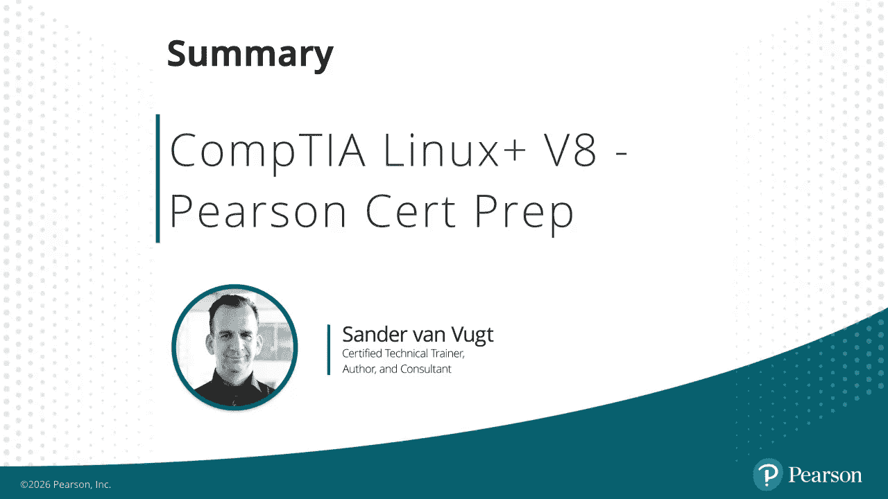

# CompTIA Linux+ V8：478：CompTIA Linux+ V8 总结 🏁

在本节课中我们将要学习本课程的结尾总结。老师会恭喜你完成学习，希望你喜欢学习这些不同的主题，并且现在觉得已经准备好参加 CompTIA Linux+ 考试了。老师还会祝你好运，并希望在其他视频课程中再见到你。

## 课程结束与恭喜 🎉



上一节我们介绍了Linux的各种知识点，本节中我们来看看课程结束时老师说了什么。以下是课程结束部分的主要内容：

- 你已经完成了整个课程，做得很好。
- 老师希望你喜欢学习这些不同的主题。
- 老师希望你现在觉得自己已经准备好参加 CompTIA Linux+ 考试了。

可以把这句话理解为一个简单的判断过程：

```text
if 课程学习完成 == 真:
    考试准备就绪 == 真
```

也就是说，只要你把这门课看完了，就可以去报考了。不需要觉得自己必须记住每一个细节，只要整体框架清楚，考试时应该能够应对。

## 祝福与再见 👋


刚才我们看完了老师对学习者的恭喜和鼓励，本节中我们来看看结尾的祝福语。以下是结尾部分的主要内容：

- 祝你考试顺利，好运相伴。
- 老师希望能在其他视频课程中很快再见到你。

这段话的意思是，学习并没有到此结束，如果你对Linux感兴趣，可以继续看老师的其他课程。考试只是一个节点，真正的掌握还需要日后的实践和积累。


## 本节小结 📚

在本节课中我们一起学习了课程的结尾部分。老师恭喜你完成了学习，希望你喜欢这些主题，并且觉得已经准备好参加 CompTIA Linux+ 考试。最后老师祝你好运，并期待在其他课程中与你再次相遇。

