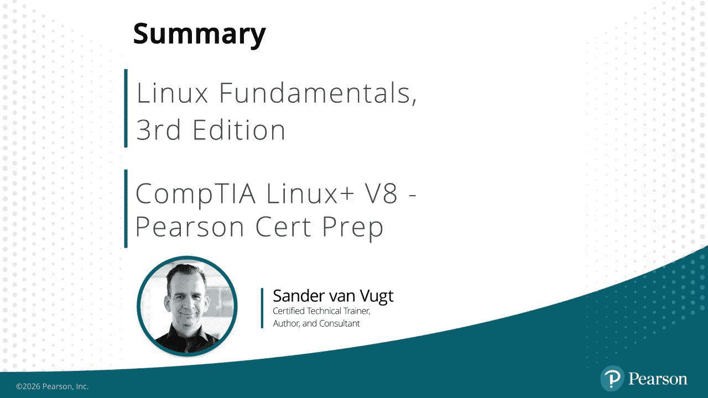

🎓 CompTIA Linux+ V8：05：课程总结与下一步建议

在本节课中，我们将一起回顾整个 CompTIA Linux+ V8 课程的学习内容，看看你已经掌握了什么，以及接下来可以如何规划自己的 Linux 职业道路。这篇教程适合刚刚完成所有视频章节的初学者，不需要任何额外的背景知识，只需要你愿意花几分钟时间梳理一下学习成果即可。



接下来我们先来看看课程完成的情况。你已经走到了这门课程的最后一章，恭喜你完成了所有的学习任务。从最初的第一节课开始，一步步跟随讲师的讲解，你现在已经积累了足够的 Linux 基础知识。在这个好用的操作系统里，你可以尝试开始自己的职业生涯，去从事系统运维、服务器管理或者相关的 IT 工作岗位。

以下是你在本课程中应该掌握的核心能力清单：

```text
Linux 职业起步 = 基础命令行操作 + 文件与权限管理 + 系统配置知识 + 实践动手经验
```

完成课程之后，我们再来谈谈学习体验与考试准备。学习了这么多不同的知识主题，你可能已经对 Linux 的各个模块有了初步的印象，希望你在学习过程中觉得有趣且有收获。如果你现在觉得自己已经准备充分，那么可以考虑报名参加 CompTIA Linux+ 认证考试，用一个证书来证明你的能力。

以下是考试准备的简单建议清单：

```text
考前准备 = 回顾笔记 + 做模拟题 + 熟悉考试形式 + 保持良好心态
```

最后，祝你在即将到来的考试中好运顺利。我也希望能在未来的某一天，见到你在我的其他视频课程中继续学习新的技术内容，我们下次再见。


本节课中，我们一起学习了课程结束后的总结回顾，确认了你已经具备的 Linux 职业起步能力，整理了核心技能与考试准备清单，并送上了考试祝福与后续学习建议。希望这篇教程能帮助你理清思路，在 Linux 的学习道路上走得更远。
