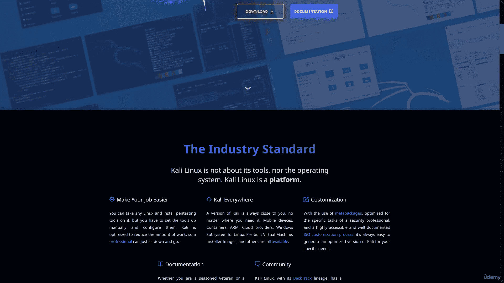
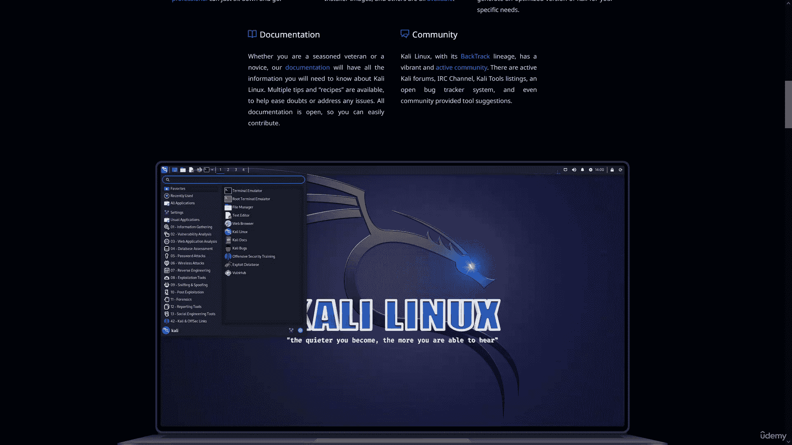
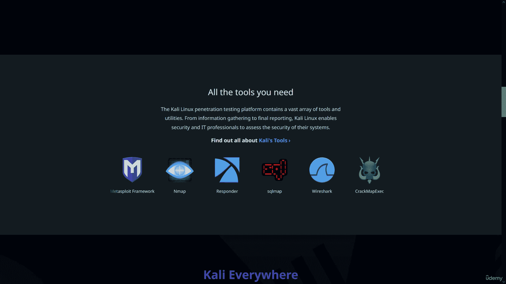

🚀 Udemy - Complete Ethical Hacking Course 2026：Go From Zero to Hero：p01 1：Introduction

在本节课中，我们将要学习道德黑客与网络安全课程的开篇介绍。这一节主要是让你对整个课程有一个初步的认识，了解你在这门课里能学到什么，以及学完之后能够做什么。内容比较基础，适合完全没有经验的初学者，所以不用担心看不懂。

接下来我们先来看看课程的基本情况，你将在这门课里接触到哪些核心内容。

你好，欢迎来到道德黑客与网络安全课程。在这门课程里，我们会从最基础的概念开始讲解，循序渐进地带你进入网络安全的世界。你将学习道德黑客和网络安全的基础知识，这些知识是你后续进行实操练习的根基，如果连基础都搞不清楚，后面的内容会变得非常困难。

你将在整个课程中获得识别和利用计算机系统和网络漏洞的实践经验，并学习如何保护它们免受网络攻击。也就是说，你不仅要知道坏人是如何攻击系统的，还要知道如何把这些攻击手段反过来用来防守，让系统变得更安全。

我们会在课程中涵盖很多不同的主题，以下是具体包括的内容：

- 网络扫描，用于发现网络中活跃的设备和开放的端口
- 漏洞评估，用于检查系统中是否存在已知的安全缺陷
- Web应用安全，用于保护网站和在线服务不被攻击
- 无线网络安全，用于保护Wi-Fi等无线网络不被未经授权的访问
- 更多其他与网络安全相关的实用技术

本课程教授的技能和技术必须合乎道德地负责任地使用，核心原则可以用简单的公式来描述：

```text
道德黑客 = 获得授权 + 合法目的 + 无害测试
```

这句话的意思是，你只有在获得目标系统所有者明确授权的情况下，并且出于改善安全的目的，才能进行渗透测试和漏洞分析。私自攻击他人系统是违法的，绝对不能这么做。

课程结束时，你将对道德黑客和网络安全的原则和实践有扎实的理解，并具备帮助组织改善其安全态势的技能。你可以把安全态势理解为一个组织抵御网络攻击的整体能力，公式可以简单表示为：



```text
安全态势 = 防御能力 ÷ 风险暴露面
```




防御能力越强，风险暴露面越小，安全态势就会越好。



感谢收听。


在本节课中，我们一起学习了道德黑客与网络安全课程的简介，包括课程的基本内容、你将掌握的实操技能、课程涵盖的主要主题，以及使用这些技能时必须遵守的道德规范。希望这节介绍能让你对接下来的学习有清晰的预期。

