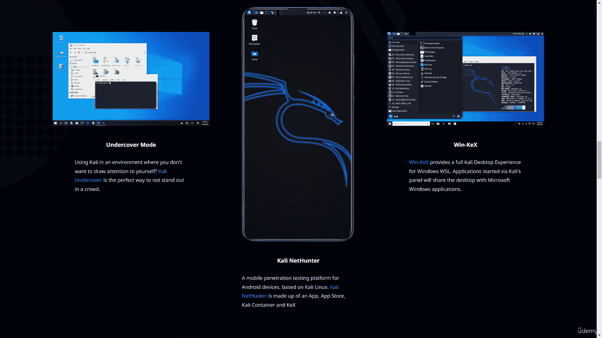

# 🔐 Udemy - Complete Ethical Hacking Course 2026：Go From Zero to Hero：02：为什么要学习道德黑客技术

在本节课中，我们将一起学习为什么学习道德黑客技术和网络安全非常重要，以及这些知识如何帮助你在网络安全领域的职业发展中走得更远。我们会用大白话把每一个概念讲清楚，让完全没有基础的初学者也能听得懂，看完后你会对这门课程有一个完整的认识，知道自己接下来要学什么，为什么要学。

学习道德黑客和网络安全，核心 idea 就是通过模拟攻击来发现系统中的弱点，然后在坏人利用这些弱点之前把它们修复掉。你可以把它理解为一种“白帽子”的安全体检，目的是让计算机系统和网络变得更安全，而不是造成破坏。在开始具体技术之前，先弄清楚为什么要学，比直接动手更重要，这样你才有明确的学习动力。

道德黑客的核心定义可以用下面这个简单的公式来表达：

道德黑客 = 获得目标组织授权 + 发现系统漏洞 + 提交修复建议

换句话说，如果你没有征得对方同意就去测试别人的系统，那这就不是道德黑客，可能是违法行为。我们在本课程中会反复强调这一点，确保每位学习者都清楚什么是合法的安全测试，什么是越界的行为，避免在学习过程中走错方向。

上一节我们简单介绍了课程的整体目标，本节中我们来看看学习道德黑客到底能给你带来什么实际好处。

以下是学习道德黑客和网络安全的主要好处：

- 你能在自己的计算机系统和网络中找出漏洞，知道黑客可能从哪里入侵。
- 你能学会如何利用这些漏洞，但仅限于授权范围内的教学演示，目的是为了更好地防御。
- 你能学会如何保护系统免受网络攻击，让自己的数字资产更安全。
- 你能掌握一项非常实用的职业技能，为在网络安全行业找工作或升职打下基础。

这些好处不仅适合完全的新手，也适合已经在网络安全领域工作了一段时间的人。无论你目前的基础如何，这门课程都会帮助你把技能提升到一个新的水平，让你在面对真实的安全挑战时更有信心。

接下来我们来看看本课程具体会讲哪些内容，这样你就知道学习路线是什么样子了。

以下是本课程将会涵盖的主要主题：

- 网络扫描：学习如何检查网络中哪些设备是开启的，哪些端口开放。
- 漏洞评估：学习如何评估系统中存在哪些安全弱点。
- Web 应用程序安全：学习如何保护网站和 Web 服务不被攻击。
- 无线网络安全：学习如何保护 Wi-Fi 等无线网络免受窃听和破解。
- 事件响应：学习当安全事故真正发生时，应该如何应对和处理。

学完这些主题之后，你会对整个网络安全的防御体系有一个比较完整的了解，而不仅仅是孤立的几个技术点，以后遇到问题也能举一反三。

在学习具体技术之前，我们必须先聊聊道德黑客的法律边界和伦理责任，这是每个学习者都必须绕不过去的一课，不能跳过。

以下是关于道德黑客与非法黑客的关键区别：

- 道德黑客只能在目标组织明确同意的前提下进行，并且必须有书面授权。
- 非法黑客没有任何授权，未经允许就进入他人系统，这属于违法行为。
- 我们会详细讨论非法黑客可能带来的法律后果和伦理问题，让你明白越界的风险有多大。

记住，拥有技术并不代表可以随意使用技术，合法合规的前提是道德黑客能够长期发展的基石，也是你作为安全人员的职业底线。

无论你是零基础的初学者，还是已经有一定经验的网络安全从业者，这门课程的设计初衷都是为了帮助你将技能提升到下一个层次。我们会从最基础的概念开始，循序渐进地深入，确保每位学习者都能跟上节奏，在学完之后具备独立进行授权安全测试的能力，不再觉得网络安全遥不可及。

感谢你花时间听完本节内容，我们下节课再见。

本节课中我们一起学习了为什么要学习道德黑客和网络安全，学习这些技能可以带来哪些职业上的好处，本课程会讲授哪些具体主题，以及道德黑客必须遵守的法律与伦理边界。希望这些内容能帮助你建立起正确的学习方向，为接下来的实战课程打下坚实基础。
