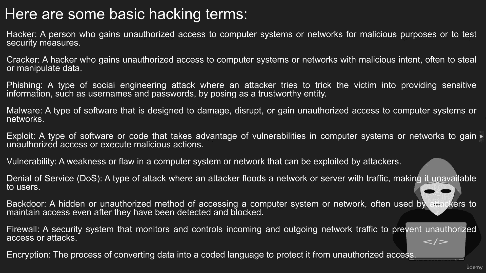

# 🛡️ Udemy - Complete Ethical Hacking Course 2026：p03：3. 基本术语，如白帽子、黑帽子和灰帽子黑客


## 本节概述


在本节课中，我们将学习网络安全和道德黑客领域中的一些基本术语。这些词汇是后续课程的基础，理解它们能帮助你更好地跟上课程进度。请跟随视频一起看完，把每个概念都弄明白，为接下来的内容打好基础。


## 什么是黑客


上一节我们简单介绍了课程背景，本节我们先来看看最基础的概念——黑客。

黑客是指未经授权进入计算机系统或网络的人，目的是出于恶意目的，或者是为了测试安全措施。在这里我们要注意一个重要的原则，现实生活中不要随意成为黑客，必须遵守政府的法律法规，未经对方允许不得控制任何系统或网络。

**公式：**
```python
Hacker = 未经授权访问计算机系统或网络的人
```

以下是黑客的关键特征：
- 未经授权访问计算机系统或网络
- 可能出于恶意目的
- 也可能出于测试安全措施的目的
- 现实操作必须遵守法律法规


## 什么是骇客


介绍完黑客之后，我们继续看一个非常相似但含义不同的词，也就是骇客。

骇客是指以恶意目的未经授权进入计算机系统或网络的黑客，通常目的是窃取或篡改该计算机或网络中的数据。这类行为明显违反法律和道德规范，属于网络攻击行为，绝对不能模仿。

**公式：**
```python
Cracker = 带有恶意意图的未经授权访问者
```

以下是骇客的主要行为：
- 未经授权进入计算机系统或网络
- 带有恶意意图
- 窃取或操纵数据
- 违反法律法规


## 什么是网络钓鱼


说完了人，我们再来看看一种常见的攻击手段，也就是网络钓鱼。

网络钓鱼是一种社交工程攻击，攻击者伪装成可信任的实体，诱骗受害者提供敏感信息，比如用户名和密码。你可能在邮箱里收到过这类钓鱼链接，点击链接后会被重定向到另一个页面，攻击者就能拿到你的登录信息，这非常危险。

**公式：**
```python
Phishing = 伪装成可信实体 + 诱骗受害者提供敏感信息
```

以下是网络钓鱼的常见表现：
- 发送伪装成可信来源的邮件或链接
- 诱导用户点击恶意链接
- 重定向到伪造的登录页面
- 窃取用户名和密码等敏感信息


## 什么是恶意软件


掌握了网络钓鱼之后，我们再来了解一下恶意软件这个概念。

恶意软件是一种专门设计用来破坏、干扰或未经授权访问计算机系统的软件。这个词比较基础，读一下定义就能理解，它涵盖了很多不同类型的有害程序，是网络安全中需要重点防范的对象。

**公式：**
```python
Malware = 用于破坏、干扰或未授权访问的软件
```

以下是恶意软件的常见目的：
- 损坏计算机系统
- 干扰正常运行
- 获得未经授权的访问权限
- 窃取或损坏数据


## 什么是漏洞利用


了解恶意软件之后，我们继续看看攻击者如何利用系统弱点，也就是漏洞利用。

漏洞利用是一种软件或代码，它利用计算机系统或网络中的漏洞来获得未经授权的访问权限，或者执行恶意操作。简单说，就是专门找系统缺陷并进行攻击的工具，攻击者非常依赖它。

**公式：**
```python
Exploit = 利用系统漏洞的软件或代码
```

以下是漏洞利用的作用：
- 利用系统或网络中的漏洞
- 获得未经授权的访问权限
- 执行恶意操作
- 作为攻击者的工具


## 什么是漏洞


既然有漏洞利用，那我们就要知道什么是漏洞本身。

漏洞是指计算机系统或网络中的弱点或缺陷，黑客可以利用这些弱点来控制系统。攻击者正是通过寻找这些漏洞，才能入侵目标系统，所以修复漏洞非常重要。

**公式：**
```python
Vulnerability = 计算机系统或网络中的弱点或缺陷
```

以下是漏洞的特点：
- 系统或网络中的弱点
- 可以被黑客利用
- 可能导致系统失去控制
- 是攻击者的入侵切入点


## 什么是拒绝服务攻击


接下来我们要看一种常见的网络攻击方式，也就是拒绝服务攻击。

拒绝服务攻击，也就是Dos攻击，是指攻击者向网络或服务器发送大量流量，导致正常用户无法使用。简单来说，就是通过流量攻击让服务“瘫痪”，让合法用户无法正常访问，这会造成严重的服务中断。

**公式：**
```python
DoS = 大量流量淹没网络或服务器，导致服务不可用
```

以下是拒绝服务攻击的特征：
- 攻击者发送大量流量
- 目标网络或服务器过载
- 合法用户无法访问服务
- 导致服务拒绝或中断


## 什么是后门


说完了拒绝服务攻击，我们再来看看攻击者如何维持对系统的控制，也就是后门。

后门是指进入计算机系统或网络的隐藏或未经授权的方法，攻击者常用它来维持访问权限，即使在被发现或被阻止之后也能再次进入系统。因此你需要保持操作系统更新到最新版本，这样所有的后门都会被修补，所有漏洞也会被修复，系统才更安全。

**公式：**
```python
Backdoor = 隐藏或未经授权的系统访问方法
```

以下是后门的常见用途：
- 攻击者维持对系统的访问权限
- 即使被发现或阻止后仍可重新进入
- 需要通过系统更新来修补
- 属于隐蔽的入侵手段


## 什么是防火墙


了解了后门这种攻击手段，我们再来看看如何防御，也就是防火墙。

防火墙是一种安全系统，用于监控和控制进出的网络流量，防止未经授权的访问或攻击。它能帮助计算机系统对抗病毒、恶意软件和攻击者使用的漏洞利用工具包，是网络防护的第一道屏障。

**公式：**
```python
Firewall = 监控和控制进出网络流量的安全系统
```

以下是防火墙的作用：
- 监控进入和退出的网络流量
- 防止未经授权的访问
- 防御攻击
- 对抗病毒、恶意软件和漏洞利用工具包


## 什么是加密


最后我们来看一种保护数据的重要技术，也就是加密。

加密是指将数据转换成编码语言的过程，以防止未经授权的访问。通过加密，即使数据被截获，没有密钥的人也无法读取其内容，从而保障信息安全。

**公式：**
```python
Encryption = 将数据转换为编码语言以防止未授权访问
```

以下是加密的作用：
- 将数据转换为编码形式
- 防止未经授权的访问
- 保护数据在传输和存储过程中的安全
- 需要密钥才能解密和读取


## 本节总结




本节课中我们一起学习了黑客、骇客、网络钓鱼、恶意软件、漏洞利用、漏洞、拒绝服务攻击、后门、防火墙和加密这些基本术语。这些概念是整个课程中会反复使用的基础知识，建议你仔细掌握。下一节我们将继续学习更多术语，到时候见。

