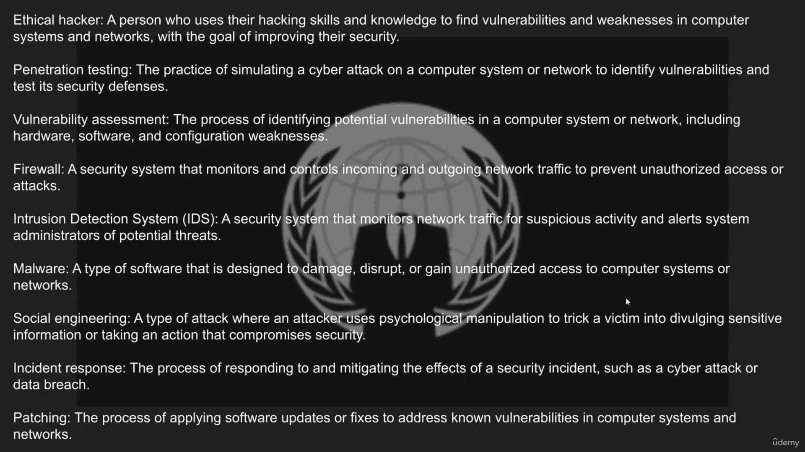

# 🛡️ Udemy - Complete Ethical Hacking Course 2026：Go From Zero to Hero：4：基础术语（包括SQL注入、VPN、恶意软件、病毒和键盘记录器）


在本节课中，我们将一起学习网络安全和道德黑客职业中常用的一些基础术语。这些词汇是后续课程的基石，只有先把它们搞清楚，你才能更好地理解接下来要讲的内容。无论你是完全没有经验的新手，还是已经入门的学习者，掌握这些概念都能让你在后面的学习过程中少走弯路，打下坚实的基础。

首先，我们来聊聊谁是道德黑客。道德黑客是指利用黑客技能和知识，去寻找计算机系统和网络中的漏洞与弱点，其目的是提升安全性，而不是去破坏别的什么。在现实生活中，我非常鼓励你成为一个道德黑客，而不是去触犯法律的黑客。

以下是道德黑客的简单逻辑描述：

```text
if 发现计算机系统或网络中的漏洞和弱点:
    目标 = 提升系统安全性
    行为 = 合法授权的测试与修复
else:
    行为 = 违法攻击（不可取）
```

上一节我们初步了解了道德黑客的身份定义，本节中我们来看看渗透测试。渗透测试本质上就是模拟一次网络攻击，针对计算机系统或网络进行测试，目的是找出漏洞，并检验安全防护措施是否有效。你可以把它理解为请专业人士假装攻击你的系统，看看它到底经不经得起考验。

以下是渗透测试的流程描述：

```text
模拟网络攻击 -> 目标系统或网络 -> 识别漏洞 -> 测试安全防护
```

在渗透测试之后，我们还需要了解漏洞评估。漏洞评估是指识别计算机系统或网络中潜在漏洞的过程，这些漏洞可能涉及硬件、软件以及系统配置等方面。简单来说，就是先找出系统里哪些地方不够安全，以便后续修复。

以下是漏洞评估的关注范围：

```text
漏洞评估范围 = {硬件, 软件, 系统配置}
```

关于防火墙，我们在之前的视频中已经介绍过，这里就不再重复讲解。防火墙主要用于控制进出网络的流量，起到拦截不当访问的作用。

接下来我们要认识入侵检测系统。入侵检测系统是一种安全系统，它会监控网络流量，寻找可疑活动，并在发现潜在威胁时提醒系统管理员。它就像一个一直在盯着网络的安保人员，一旦发现有恶意软件在系统或网络中运行，就会立即通知管理员或用户。

以下是入侵检测系统的工作逻辑：

```text
监控网络流量 -> 发现可疑活动 -> 发出警报 -> 通知系统管理员或用户
```

再来看看恶意软件。恶意软件是一类专门用来干扰、破坏系统正常运行的软件，这部分内容我们之前也提及过。它包括病毒、蠕虫、木马等多种形式，目的是损害计算机或网络。

以下是恶意软件的简单定义：

```text
恶意软件 = 旨在干扰或损坏计算机系统的软件
```

然后是社交工程。社交工程属于网络安全和道德黑客领域中的一种攻击方式，攻击者利用心理操纵手段，诱骗受害者透露敏感信息，或者采取会危及安全的行为。换句话说，黑客不是通过技术漏洞攻击，而是通过操纵人的心理来达成目的。

以下是社交工程的攻击路径：

```text
心理操纵 -> 诱骗受害者 -> 泄露敏感信息 / 采取危及安全的行为
```

接着我们要学习事件响应。事件响应是指应对并减轻安全事件影响的过程，这些安全事件可能包括网络攻击或数据泄露等情况。当出现安全问题时，需要及时响应，把损失降到最低。

以下是事件响应的常见场景：

```text
安全事件 = {网络攻击, 数据泄露} -> 响应并减轻影响
```

最后是补丁管理。补丁管理是指通过应用软件更新或修复程序，来解决计算机系统中已知的漏洞，并对漏洞进行修补。简单说，就是给系统打补丁，把已知的安全漏洞堵上。

以下是补丁管理的操作逻辑：

```text
应用软件更新或修复程序 -> 修复已知漏洞 -> 补丁管理完成
```

好了，以上就是本节课想要和你讨论的一些基础术语。我们下一节课再见。



在本节课中，我们一起学习了道德黑客、渗透测试、漏洞评估、防火墙、入侵检测系统、恶意软件、社交工程、事件响应以及补丁管理等基础术语。希望这些概念能帮你打好网络安全的基础，为后续的学习做好准备。

