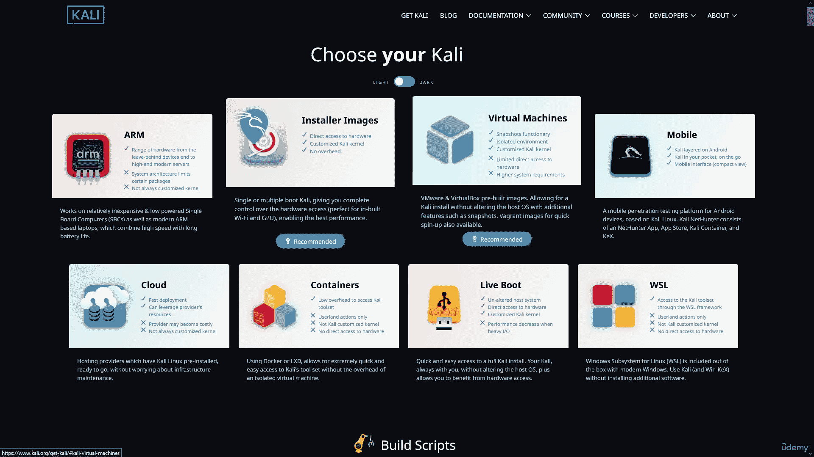
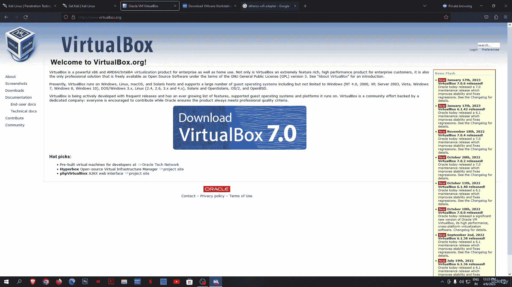
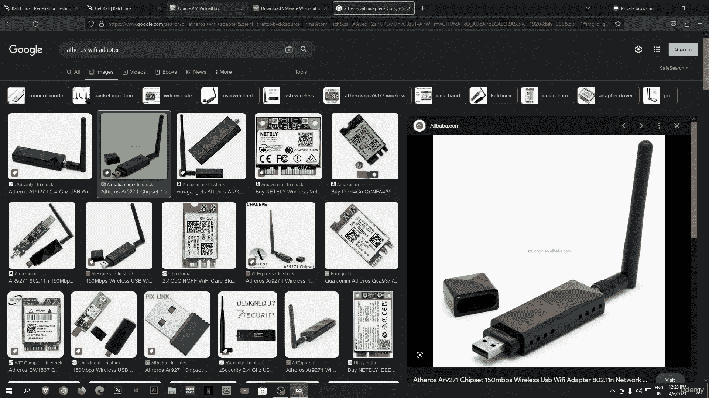
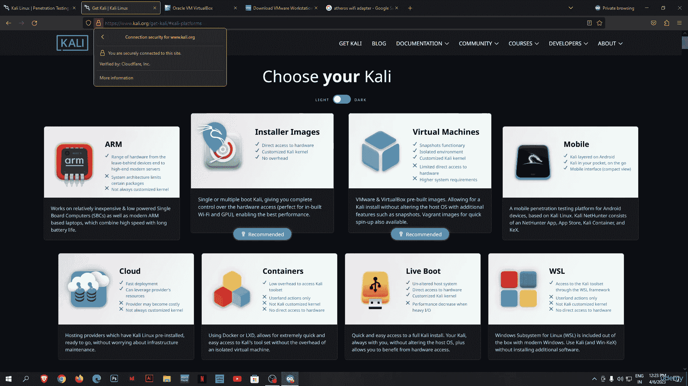
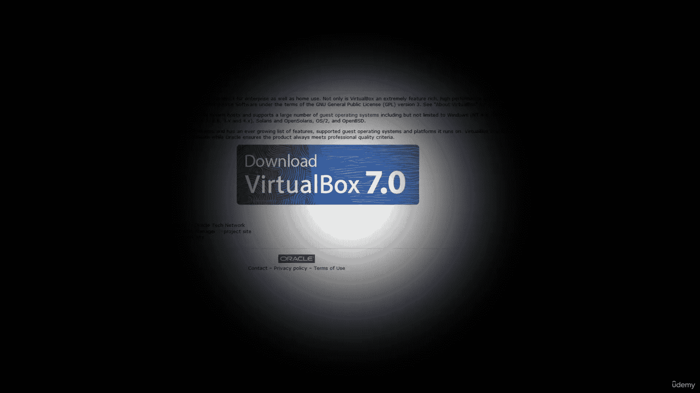

# 💻 道德黑客课程：第05节：所需软件

在本节课中我们将要学习搭建道德黑客实验室所需的基础软件工具。我们会先认识操作系统，接着了解虚拟机的概念，再看看需要什么样的无线网卡，最后整理出一份安装前的准备清单。希望这节内容能帮你把环境准备好。

## 操作系统：Kali Linux

上一节我们简单介绍了课程的整体目标，本节中我们来看看具体要用什么操作系统。在道德黑客课程中，我们要使用的操作系统是 Kali Linux。那么什么是 Kali Linux？Kali Linux 是一个功能强大且被广泛使用的操作系统，它专门为渗透测试、网络安全分析和数字取证而设计。简单来说，这就是专门用来做安全测试的系统。

它自带一整套完整的工具和实用程序，安全专业人员可以使用这些工具来发现并修复系统、网络和应用程序中的漏洞。换句话说，你不需要一个一个去装扫描工具，系统里已经帮你准备好了。讲解者会在后续视频中带你走完整个安装过程，并且会配套发布一系列关于在 Windows 操作系统上安装 Kali Linux 以及搭建道德黑客环境的教程。讲解者自己使用的是 Windows 10 专业版，所以接下来的步骤也是基于这个系统来演示的。

接下来我们要下载 Kali Linux 的 ISO 镜像文件，并将它安装在虚拟机里面。

## 虚拟机软件：VirtualBox 和 VMware

安装完操作系统之后，我们需要一个地方来运行它。接下来我们要讨论的是虚拟机软件。那么什么是虚拟机？虚拟机就是一种让你在已有的电脑里再“跑”一个完整电脑的技术，你不需要另外买一台机器，就可以在当前系统中安全地安装和使用 Kali Linux。

课程中主要提到的两个选择是 VirtualBox 和 VMware，这两个软件都可以用来创建和管理虚拟机，你可以根据自己的喜好任选其一。不过要注意的是，VMware 的免费版本功能有限，完整版本需要付费购买，而 VirtualBox 基本上是免费可用的。讲解者会在课程后面部分更详细地对比这两者的区别，所以你现在不用急着决定，先知道有这两个选择就可以了。

下面是两款软件的简单说明：

- VirtualBox：免费开源，适合初学者和个人学习使用
- VMware：功能强大，但完整版需要付费，免费版功能受限

核心概念可以这样理解：

虚拟机 = 你的电脑 + 虚拟化软件 + 客户机操作系统

这意味着你可以在 Windows 里面“套”一个 Kali Linux，两者互不干扰，实验出问题也不会影响真实系统。

## 网络适配器：无线网卡

上一节我们介绍了虚拟机软件，本节中我们来看看还需要什么硬件设备。除了软件之外，你还需要一块无线网卡，也就是 WiFi 适配器，用来进行网络扫描。任何能用于网络扫描的 WiFi 适配器都可以，讲解者使用的是带有 Atheros AR9271 芯片组的网卡，你可以参考这个型号选购。

这里有一点要特别说明：无线网卡主要用于网络扫描部分，如果你只是做一些不需要无线功能的基础操作，可能暂时用不到它，但为了能够完整地完成课程中的网络扫描实验，建议还是准备一块。

下面是准备清单：

- 操作系统镜像：Kali Linux ISO 文件
- 虚拟机软件：VirtualBox 或 VMware
- 无线网卡：支持网络扫描的 WiFi 适配器（推荐 Atheros AR9271 芯片组）

安装路径可以用公式表示：

安装环境 = 虚拟机软件 + Kali Linux ISO 文件 + 虚拟机配置

## 安装准备与总结

最后我们来汇总一下整个安装流程。我们会使用 VirtualBox 或者 VMware，并从 Kali Linux 的官方网站下载 ISO 镜像文件，然后将这个镜像安装到虚拟机里面。这样一来，你的道德黑客实验室环境就算搭建完成了。

本节课中我们一起学习了搭建道德黑客环境所需的软件与硬件准备工作，包括 Kali Linux 操作系统、VirtualBox 和 VMware 虚拟机软件，以及用于网络扫描的无线网卡。下一节课我们将进入具体的安装步骤，敬请期待。
