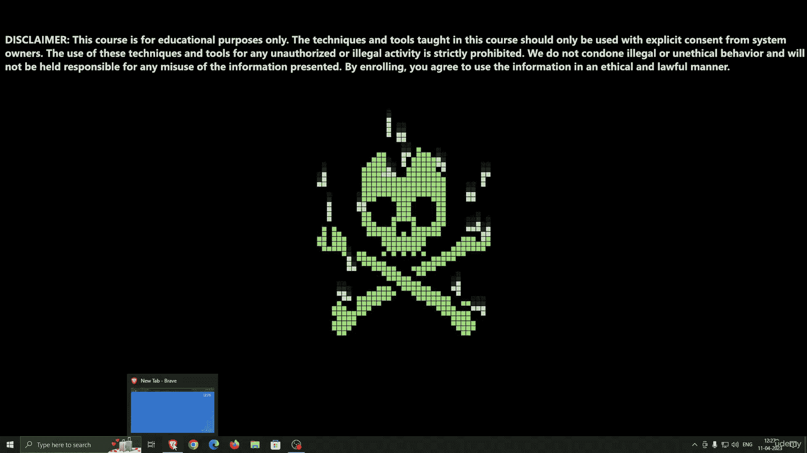
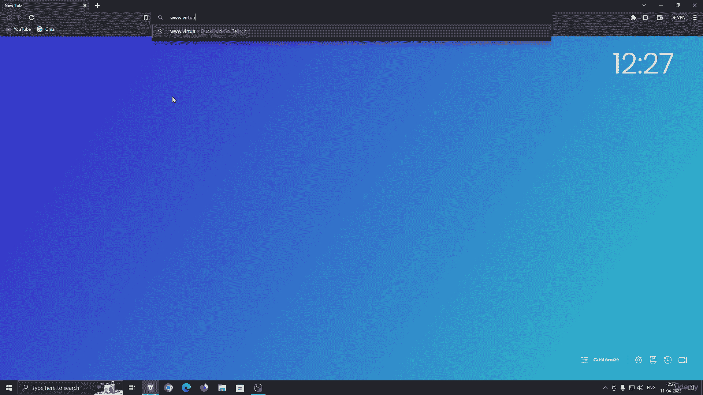
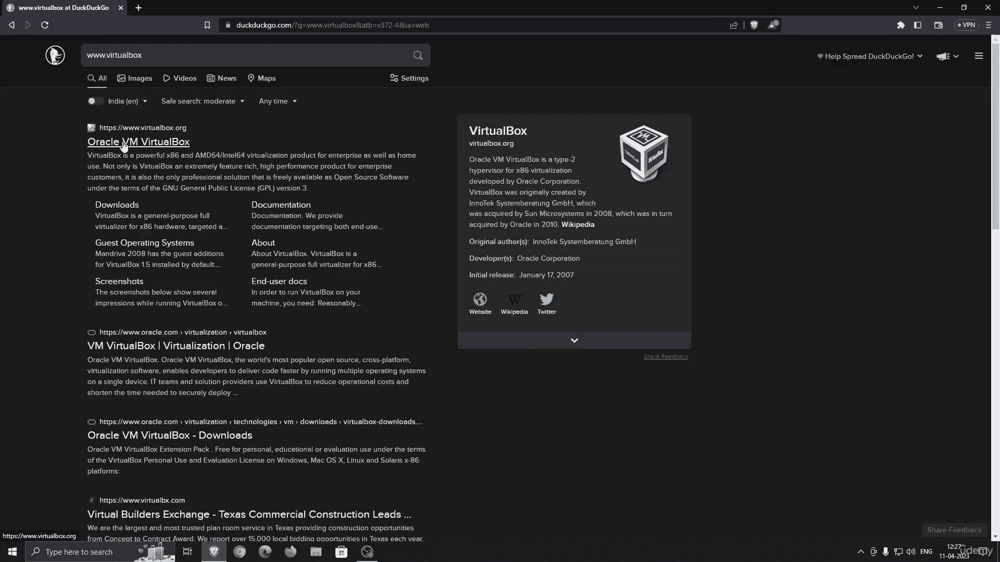
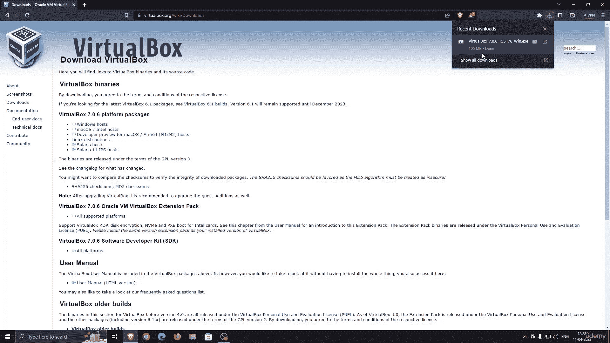
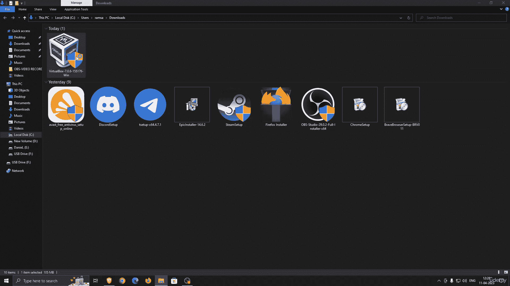
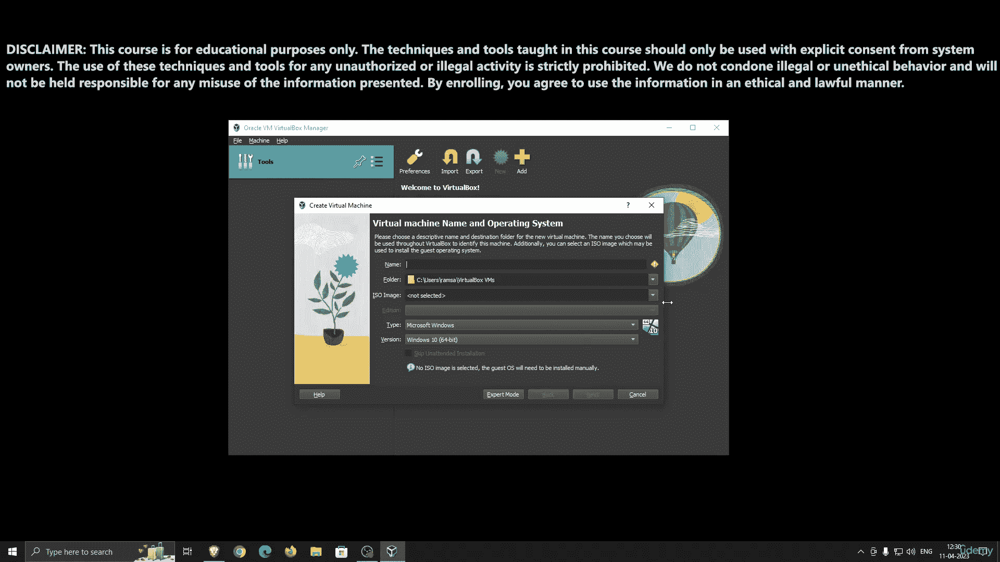

# Udemy - Complete Ethical Hacking Course 2026：Go From Zero to Hero p06：6：在 Windows 10 上安装 VirtualBox 🖥️


在本节课中我们将要学习如何在 Windows 10 操作系统上安装 VirtualBox，当然这个方法也适用于其他操作系统。VirtualBox 是我们后续进行实验的基础环境，安装完成后才能继续下一步的操作。所以请跟着步骤一步步来，不要跳过任何一个细节。


先快速看一下免责声明。本课程仅用于教育目的，课程中教授的工具和技术必须在系统所有者明确授权下使用，我不对任何软件（如 Linuxux 或其中的工具）的误用负责。请勿将此类工具用于任何非法活动，这种行为被严格禁止，请以合乎道德且合法的方式使用这些信息。




了解完免责声明后，我们接下来进入实际操作。打开你常用的浏览器，在地址栏输入 www.virtualbox.com。






VirtualBox 是一款免费开源的虚拟化软件，我们将用它来安装操作系统。被称为 Kali Linux 的操作系统。我们直接开始。点击第一个链接，确保是官方链接，以访问官方网站。网站上有一个名为“下载 VirtualBox”的按钮。确保你在官方网站上，然后点击这个按钮。网站使用 HTTPS 加密，不要从任何第三方或其他网站下载 VirtualBox，只需从官网下载，点击下载即可，非常简单。


它是一款帮助我们在单台电脑上运行多个操作系统的软件。无论你是软件开发人员、IT 专业人员，还是只想测试不同操作系统的人，VirtualBox 都是一个值得放在工具箱里的好工具。


```text
VirtualBox = 免费开源虚拟化软件
一台物理电脑 -> 同时运行多个操作系统
```


搞清楚什么是 VirtualBox 之后，我们就可以开始具体的安装过程了。






以下是安装 VirtualBox 的详细步骤。

- 点击“Windows 主机”，会弹出窗口提示你需要保存文件。
- 直接保存并下载。点击保存后，文件开始下载。
- 下载完成后，文件大约 1 到 5 MB。点击文件夹，双击这个图标。
- 图标会要求管理员权限，点击“是”。
- 是的，安装开始，点击“下一步”。我们准备安装 VirtualBox，默认安装路径是 `C:\Program Files\Oracle\VirtualBox`，如果你想更改路径可以自行修改，本教程中我就安装在这个默认路径，点击“下一步”。
- 接着会提示网络接口，点击“下一步”，然后点击“是”。
- 点击“安装”开始安装，你可以选择安装在 D、E、F 盘或任何你偏好的驱动器。安装完成后，下节课我会展示如何在 VirtualBox 中安装 Kali Linux ISO 文件，完成后点击“完成”。


虚拟化软件打开后，界面如下所示。我可能会开启深色模式。下节课我们将安装 Kali Linux ISO 文件并在 VirtualBox 中打开它。你可以点击“添加”，然后打开 ISO 文件，就这样。你可以为新操作系统命名。


我们下节课见。




本节课中我们一起学习了如何在 Windows 10 上下载并安装 VirtualBox，包括访问官网、选择正确的主机版本、运行安装程序以及完成安装后的界面确认。安装完成后，我们就准备好在下一节中导入 Kali Linux 镜像了。
